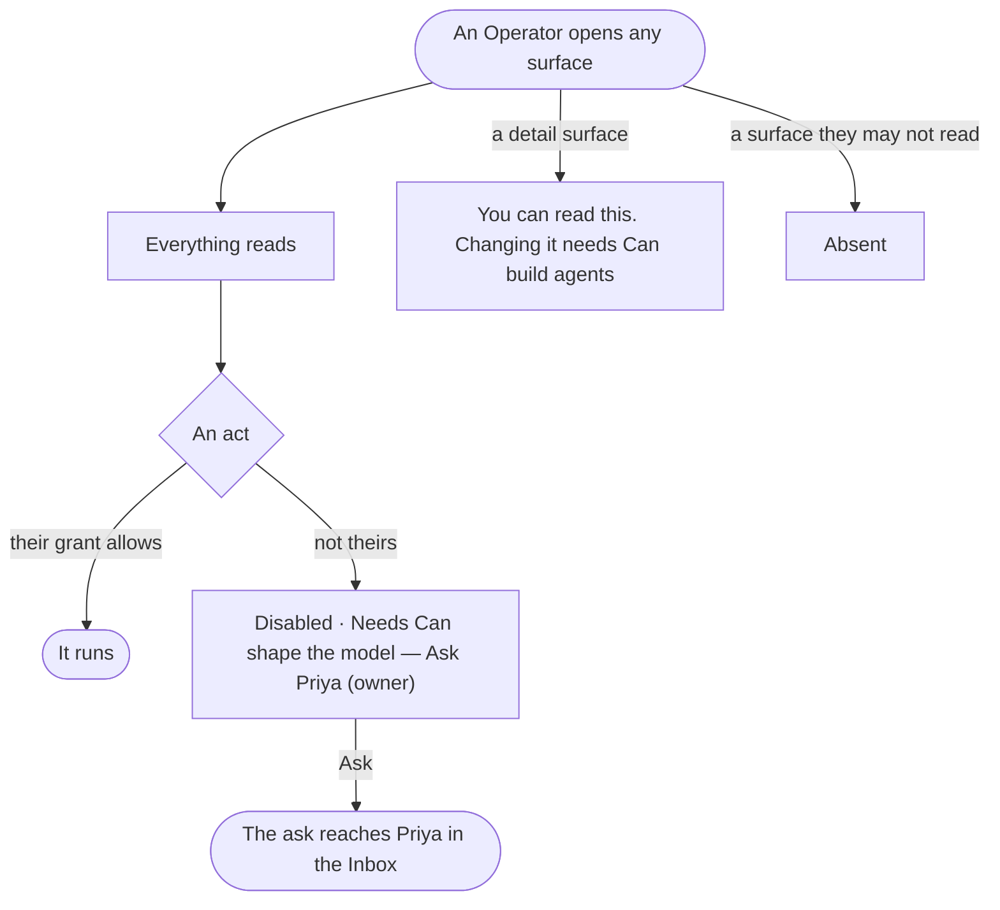

# GR-12 · Read without the grant and see who can act

**As** an analyst without a grant **I want** to read every surface and see who can act, instead of a dead end **so that** I learn what exists and whom to ask.

Tasks: [task.md](task.md) · Feature: [GR-F03](../../feature.md)

## Who can

| Lens | Can | Otherwise sees |
|---|---|---|
| Admin | Every act | — |
| Operator | Read every surface of the Graph; look, ask, open boards, re-run their own runs | Every other act disabled, *Ask Priya (owner)* — the role named and who holds it; a detail surface opens with *You can read this. Changing it needs …*. With the grant an act needs: that act as Admin |

## Flow

## Acceptance criteria

| # | Given | When | Then |
|---|---|---|---|
| GR-12.1 | An Operator on a Graph | they open any mode or overlay | it reads in full; nothing is hidden that they may read |
| GR-12.2 | An act whose grant they lack | it draws | it is disabled, its tooltip naming the role as a sentence and who holds it — *Needs Can shape the model — Ask Priya (owner)* |
| GR-12.3 | A detail sheet whose changes need a grant they lack | it opens | it says *You can read this. Changing it needs …*, naming the grant |
| GR-12.4 | A surface they may not read at all | the frame draws | it is absent, never shown empty |
| GR-12.5 | An Operator | they look, ask, open boards, or re-run their own run | it works, as for an Admin |
| GR-12.6 | An Operator given a grant | they reach an act it covers | it works, without signing in again |
| GR-12.7 | Who holds a role | the refusal draws | the holders come from the engine; a role nobody holds reads *Ask an Admin* |

## Screens

| Surface | Lens | First use | Empty after a filter | Loading | Has data | Failed | Agent working or proposing | No access |
|---|---|---|---|---|---|---|---|---|
| Access rules, read | Admin | — | — | — | — | — | — | — |
| Access rules, read | Operator | — | — | — | access.locked | — | — | access.locked |
| A mode, read only | Admin | — | — | — | model.board | — | — | — |
| A mode, read only | Operator | — | — | — | model.board · Read only | — | — | model.board · Read only |
| A sheet, read only | Admin | — | — | — | agents.agent | — | — | — |
| A sheet, read only | Operator | — | — | — | agents.agent · Read only | — | — | agents.agent · Read only |
