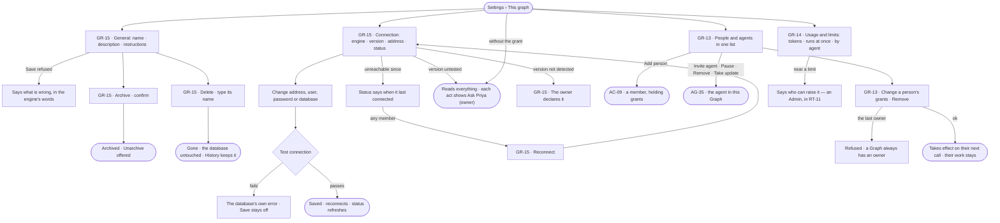

# This graph — name, connection, members, usage

> The open Graph's own settings: what it is called and what it is for, the one graph database it reads, who is on it —
> people and agents in one list — and what it spends against the limits the install set. The decision it helps make:
> *is this Graph grounded on a database that works, staffed by the right people and agents, and inside what it may
> spend?*

## User journey

Journeys this feature is a step of: [J07 · Ready an install for its Graphs](../../../../journeys/J07-ready-an-install-for-its-graphs.md)

## Stories

| ID | Story | Status |
|---|---|---|
| GR-13 | [See and change who is on this graph](stories/GR-13-see-and-change-who-is-on-this-graph/story.md) | idea |
| GR-14 | [Read what this graph spends against its limits](stories/GR-14-read-what-this-graph-spends-against-its-limits/story.md) | idea |
| GR-15 | [Name, describe and connect this graph](stories/GR-15-name-describe-and-connect-this-graph/story.md) | idea |

## Access

| Act | Role (`.claude/team/TEAM.md` §7) | Everyone else sees |
|---|---|---|
| Read General, Connection (never the password), members and usage | Operator — every member | — |
| Change name, description, instructions, the daily caps on asks for more · Archive · Unarchive · Delete | `owner` · shown as *Owner* | Fields read-only; *Save*, *Archive* and *Delete* shown as *Ask Priya (owner)* |
| Change the connection · Test connection · Read the database's types again · Declare the server version · Accept an untested version | `owner` · shown as *Owner* | Address, user, database and status read; the password field is absent; acts shown as *Ask Priya (owner)* |
| Reconnect an unreachable connection | Operator — every member | — |
| Change a person's grants · remove a person | `iam-admin` · shown as *Can manage people* | The list reads; *Edit* and *Remove* shown as *Ask Priya*, naming someone who can manage people |
| Add a person | As AC-09 | As AC-09 |
| Invite, pause, remove an agent · take an update | As AG-35 | As AG-35 |
| Raise a limit | Admin — in Settings › Invana (RT-11) | Usage reads the limit and says only an Admin raises it |

## States

| State | What the person sees |
|---|---|
| First use | General with the setup timeline leading it while required setup is unfinished; Members holds only the creator, as owner |
| Empty after a filter | Members filtered to no one: *No one matches* and *Clear filter* |
| Loading | The modal and its left nav at once; rows fill in place |
| Has data | General · Connection with its status · people and agents · usage against limits |
| Failed | A save refused with the reason; a test that failed with the database's own words; a Graph that does not exist says so |
| Agent working or proposing | — an agent never changes a Graph's settings |
| No access | Every section reads; each act is shown as *Ask Priya (owner)* or names someone who can manage people |

## Rules

| Rule | Detail |
|---|---|
| One Graph, one graph database | There is no second connection, and no Graph without one once it is made |
| A test gates every save | A connection that has not connected cannot be saved — on the first save and on every change to address, user, password, database or connector |
| The connector is fixed after the first save | Everything modelled against it would stop meaning what it means; address, user, password and database stay editable |
| The password is never read back | The user is shown; the password field is blank — *Stored encrypted. Leave blank to keep it.* A blank password saves and tests with the stored one |
| The database name is not a secret | Shown beside the address and editable; blank means the connector's default, and the read view says *connector default* |
| A read-only connection is never written to | By any path — loads, edits, agents |
| The status is honest | Connected · unreachable · degraded, with the last time it connected; rotated credentials show as unreachable, never as silence |
| The server version decides the property types | It is detected, may be declared, and the model's property types follow it |
| Membership reads, grants write | A member reads everything in the Graph; each grant lets them change one part (AC-F02) |
| An agent is a member | People and agents are one list; an agent's row opens the agent in this Graph (AG-35) |
| A Graph always has an owner | Removing or demoting the last owner is refused |
| Access is checked on every call | Removing a person or changing their grants takes effect on their next call |
| Removing never removes work | A removed person's work and authorship stay; their open tasks stay assigned and say who is gone |
| The Graph's resting screen | With no tab open, main shows the Graph itself — its name and question, its connection's state, its record counts and what was open recently; while required set-up is unfinished, set-up is its content. It is never a tab and never closes |
| Which Graph, and is it ready — nothing else | Where the Graph shows itself (the resting screen, General's head) it leaves out its `owner/slug` (the crumb reads it), the connection's address and latency (the footer and Connection show them) and counts of AI models, skills or members — each is one click away where it is managed, and a number with no row under it is trivia |
| General is one form | Name, description and instructions are one form with one *Save* — what a Graph is called, what is in it and what it is for are one answer at three lengths |
| A section is its own group | No section wraps its fields in a collapsible group: a group that is the section's only content is a title over a title, and its disclosure would hide the section's reason for being. What survives of a group header is its one-line rule, and the connection's state beside it |
| Usage reads, the install sets | A Graph reads its limits and its spend; only an Admin raises a limit, in Settings › Invana (RT-11) |
| The engine counts | Tokens and runs at once are stored per run when it settles; Usage only shows them |
| Leans on | Adding people and access rules (AC-F02) · inviting agents (AG-F02) · each Graph's limits (RT-F04) · creating a Graph and connecting at creation (GR-F02) · History (AC-F06) |

## Data touched

| Record | Read or write |
|---|---|
| The Graph — name, description, instructions, archived | Read · write |
| The Graph's connection — connector, address, database, encrypted credentials, read-only, server version, status | Read · write |
| Members — people and their grants; the Graph's agents | Read · write |
| Limits and per-run spend (RT-F04) | Read |
| History rows of every change (AC-F06) | Write |

## Engine

The low-level design: what this feature stores, serves and refuses. Conventions — naming, errors, lists, events — are
[system-design.md](../../../../system-design.md) §§ 6–8; this section only fills them in.

### Records

| Table | Columns | Notes |
|---|---|---|
| `graphs` | `slug` · `name` · `description` · `instructions` (the question every agent reads before it plans) · `setup_state` (skips only) · `status` (`active` · `archived`) · `default_agent_id?` · `ask_cap_per_holder` (20) · `ask_cap_per_graph` (200) · `created_by_id` (the owner, the address's `<user>`) · `created_at` · `updated_at` | Unique (`created_by_id`, `slug`). `setup_state` is [GR-F02](../GR-F02-create-a-graph/feature.md#engine)'s; the caps bind asks for more ([AC-F04](../../../access/features/AC-F04-what-an-agent-may-touch/feature.md#engine)) |
| `graphs_connections` | `graph_id` (unique) · `connector` (its registered name under `invana.connectors`, fixed after the first save) · `uri` · `database?` (blank is the connector's default) · `auth_encrypted` · `read_only` · `status` (`connected` · `unreachable` · `degraded`) · `last_connected_at?` · `last_health_check_at?` · `latency_ms?` · `server_version?` · `server_version_source` (`detected` · `declared`) · `compatibility_status` · `version_acknowledged` · `model_id` (the database's mirror in the model) | One per Graph, never none once the Graph is made |
| `graphs_members` | `graph_id` · `user_id` · `roles[]` (`operator` · `contributor` · `builder` · `modeller` · `owner` · `iam-admin`) · `added_by_id?` · `added_at` | People only; unique (`graph_id`, `user_id`). An agent's membership is [AG-F02](../../../../capabilities/agents/features/AG-F02-the-agents-catalogue/feature.md#engine)'s `agents_members` |

### Reads

| Record | Owner |
|---|---|
| Accounts — a member added by email or username | [AC-F01](../../../access/features/AC-F01-sign-in-account-and-sessions/feature.md#engine) |
| The built-in rules a member's roles are, and every other access rule | [AC-F02](../../../access/features/AC-F02-access-rules/feature.md#engine) |
| Groups and holdings a removed member leaves | [AC-F03](../../../access/features/AC-F03-groups-keys-and-holders/feature.md#engine) |
| Agents on the Graph — invite, pause, remove, update | [AG-F02](../../../../capabilities/agents/features/AG-F02-the-agents-catalogue/feature.md#engine) |
| The live connector pool, capabilities and server-version resolution | [RT-F05](../../../runtime/features/RT-F05-graph-database-connectors/feature.md#engine) |
| Each Graph's limits and what it spends — *Usage and limits* | [RT-F04](../../../runtime/features/RT-F04-limits/feature.md#engine) · [AC-F02 › limits](../../../access/features/AC-F02-access-rules/feature.md#routes) |
| The model's mirror of the database, read again | [SE-F01](../../../../capabilities/semantics/features/SE-F01-start-a-model/feature.md#engine) |
| History — every event this feature writes | [AC-F06](../../../access/features/AC-F06-history/feature.md#engine) |

### Routes

| Route, after `/api/v1/u/{u}/{g}` | Does | Story |
|---|---|---|
| `GET /` · `PATCH /` · `DELETE /?confirm=<name>` | The Graph with its set-up steps · change name, description, instructions, the caps on asks for more, or `status` (archive · unarchive) · delete Invana's records of it | GR-15 · GR-01 |

| Route, after `/api/v1/u/{u}/{g}/graphs` | Does | Story |
|---|---|---|
| `GET /connection` · `PATCH /connection` | The connection — `auth_username` read back, never the password · save a change that passed its test | GR-15 |
| `POST /connection/test` | Test the form's details on a transient connector: `{ok, latency_ms?, server_version?, compatibility_status?, error?}` | GR-15 |
| `POST /connection/ping` | *Reconnect* — try the saved connection again and refresh its status | GR-15 |
| `POST /connection/introspect` | *Read types again* — in the background | GR-15 |
| `POST /connection/acknowledge-version` · `PATCH /connection/version` | Accept an untested server version · declare one the connector cannot detect | GR-15 |
| `GET /members` · `POST /members` | Members by the list contract (`?q=` username or email · `?role=` a role as stored, sorted by username): `user_id` · `username` · `first_name` · `last_name` · `roles` · `added_at` · add a person `{user (email or username), roles?}` | GR-13 · AC-09 |
| `PATCH /members/{member}` · `DELETE /members/{member}` | Replace a person's roles · remove them; their work and authorship stay | GR-13 |
| `GET /members/me` | `{roles, areas: [{area, label, role, allowed, holders}]}` — `holders` the usernames that hold the role, so a refused act names who can do it | GR-12 · AC-07 |

### Events

| Event | When |
|---|---|
| `graphs.update` · `graphs.archive` · `graphs.unarchive` · `graphs.delete` | The Graph changes · is archived · restored · deleted, its name kept in `details` |
| `graphs.connection.attach` · `graphs.connection.update` | The first save · a change, which reconnects |
| `graphs.connection.test` · `graphs.connection.ping` · `graphs.connection.introspect` · `graphs.connection.introspect_complete` | Who tested it and when · a reconnect · a read of the types, started · finished |
| `graphs.connection.health_check` · `graphs.connection.reconnect` | The engine's own check · its own reconnect — actor `system` |
| `graphs.connection.version_detected` · `graphs.connection.version_acknowledge` · `graphs.connection.version_declare` · `graphs.connection.compatibility_downgrade` | A version found · accepted · declared · a version that turned untested |
| `graphs.members.add` · `graphs.members.roles` · `graphs.members.remove` | A person added · their roles changed · removed — `{username, roles}` in `details` |

### Refusals

| Status | When | Sentence | Criterion |
|---|---|---|---|
| 404 | Any Graph-scoped call by someone not a member of the Graph — absent, not forbidden | *Not found.* | GR-01.9 · AC-02.17 · AC-10.8 · GR-13.6 · AC-07.9 |
| 403 | A write whose area needs a role the caller does not hold — `role_required`, with the area, the role and who holds it | *This needs {role sentence} — ask {holders}.* | GR-12.2 · AC-07.5 · GR-15.15 · GR-15.23 · GR-13.9 |
| 409 | Removing the last owner, or taking Owner from them | *A graph always has an owner.* | GR-13.4 |
| 404 | Adding a person no account has | *No account has {value} — there is no invitation.* | AC-09.4 |
| 422 | A Graph save with an empty name, or a field past its length | *{field}: {why}.* | GR-15.1 |
| 422 | Deleting with a `confirm` that is not the Graph's name | *Type {name} to delete it.* | GR-15.17 |
| 409 | Saving a connection whose details have not passed a test | *Test the connection to save it.* | GR-15.6 |
| 422 | Changing the connector after the first save | *The connector is fixed once saved.* | GR-15.10 |
| 409 | A write to a read-only connection, or one on an untested server version, by any path | *{graph}'s database is read-only — {why}.* | GR-15.12 · GR-15.21 |
| 503 | *Read types again* when the connector is not connected | *The database is not connected — reconnect first.* | GR-15.24 |

### CLI

| Command | Does |
|---|---|
| `invana members list · add · roles · remove --graph <user>/<slug>` | The members routes, as the person signed in with a key |

### Mechanisms

| Mechanism | How |
|---|---|
| The membership gate | Every Graph-scoped route reads membership now; a non-member is answered as if the Graph did not exist |
| The area of a write | One table maps route prefixes (after `/api/v1/u/{u}/{g}`) to an area, first match wins; a read (`GET` · `HEAD` · `OPTIONS`) has none, a write the table does not name needs `owner` |
| `ask` — `operator` | `agents/runs` (answer · cancel · rerun · resume) · `explore/sessions` · `explore/<reads>` · `explore/boards` · `graphs/connection/ping` · `graphs/notifications/read` · `access/approvals` · `access/ledger` · `access/tokens` (one's own) · `access/test` · `model/requests` · `runtime/mcp` |
| `work` — `contributor` | `projects` · `projects/tasks` · `explore/edits` · `explore/annotations` · `agents/schedules` |
| `build` — `builder` | `agents` · `agents/skills` · `agents/evals` · `agents/plans` · `agents/functions` · `explore/projection-templates` · `runtime/mcp-server` |
| `model` — `modeller` | `model` and every tail under it · `projects/{key}/rules` · `records` writes |
| `settings` — `owner` | The Graph itself (`PATCH` · `DELETE`) · `graphs/connection` (its introspect included) · `graphs/setup` · `agents/default` · `graphs/notifications` (rules and channels) · `graphs/alert-rules` |
| `iam` — `iam-admin` | `graphs/members` · `access` and every tail under it but those under `ask` |
| A narrower prefix wins | It sits above the broader one it carves out of: `projects/{key}/rules` is model, not work · `model/requests/{id}/resolve` model, `model/requests` ask · `agents/runs/{id}/emissions/{id}/template` build, `agents/runs` ask · `agents/schedules` work, `agents` build · `explore/projection-templates` build, `explore` ask · the four `access/…` tails ask, `access` iam · `graphs/connection/ping` ask, `graphs/connection` settings |
| Every route has an area | `area_for(method, path)` and `holds(roles, role)` are pure — no database, no request; a test walks every Graph-scoped route and fails on one without the membership gate or a write the table does not name |
| Roles imply | `owner` implies `contributor`, `builder` and `modeller`; `iam-admin` is implied by nothing; `operator` is the floor every member holds, stored alone or not at all. A Graph's creator holds `owner` and `iam-admin` |
| Asking is an Operator's act | What asking spends is bounded by the agent's limits and the Graph's, not by a role |
| A connection is tested before it is saved | A test builds a transient connector, connects within 10 seconds and discards it; `error` is the connector's own words, or *Connect timed out after 10s.* A save needs a passing test of the same details |
| The password is write-only | Encrypted under `INVANA_ENCRYPTION_KEY`; a blank password tests and saves with the stored one. The user name is decrypted for the form as `auth_username`; the password never is |
| A save reconnects | A first save registers the connector with the pool; a change reconnects it |
| Reading types again | Fire-and-forget in its own session; `graphs.connection.introspect_complete` when it lands |
| The server version | Detected on connect, or declared; a version Invana has not tested makes the connection read-only until an owner accepts it |
| The status is honest | The engine's health check sets `status` and `last_connected_at`; rotated credentials read `unreachable`, never silence |
| Members | Adding with no roles makes an `operator`; a `PATCH` replaces the set, and an empty list leaves `operator`. Giving or taking Owner or *Can manage people*, and widening one's own roles, go through [AC-F02 › A change that waits for an Owner](../../../access/features/AC-F02-access-rules/feature.md#mechanisms). Removing a person removes their groups and holdings here ([AC-F03](../../../access/features/AC-F03-groups-keys-and-holders/feature.md#mechanisms)) and leaves their work |
| Deleting a Graph | Removes Invana's records of it — connection, members, settings — and never touches the graph database's data; its History rows stay, `graph_id` emptied, its name kept |
| Usage reads | *Usage and limits* reads the runtime's figures and each access rule's limits; this feature serves no route of its own for it |

## System impact

| HLD section | Change | NFRs |
|---|---|---|
| § 6 Data and storage | Three tables in Invana's own store; credentials encrypted at rest under `INVANA_ENCRYPTION_KEY` | — |
| § 8 APIs and events | The Graph's own routes, its connection and members, and `graphs.*` events | — |
| § 11 Failure modes | An unreachable database reads `unreachable` with the last time it connected; any member reconnects | — |
| § 12 Qualities | Security: membership checked on every call, a non-member answered `404`, every write mapped to an area by one pure table | — |

## Decisions

| Decision | Detail |
|---|---|
| This graph is a part of Settings | *Settings › This graph* — General · Connection · People and access · Usage and limits · Notifications; a modal, never a page in main |
| AI models and runs at once are the install's | Neither is a section of This graph; they are *Settings › Invana* (RT-F01 · RT-F04) |
| An agent is a member, with no Graph role | People and agents are one Members list and an agent is invited like a person (AG-35). Its membership is its own record, `agents_members` — never a `graphs_members` row, which holds people only (`apps/graphs/models.py` `GraphMember.user_id` references `users`) — and it holds no Graph role: what it may do is its access rules (AC-F04) |
| Members keep the engine's grants | The six grants are listed; *Can manage people* holds what changes members |
| Testing a connection is recorded | Who proved it worked, and when, is in History; a test before a Graph exists records nothing |
| The database may move | Changing it re-tests, like changing the address; pointing a Graph at a restored copy is a move people make |
| There is no Info panel | The setup timeline leads General while setup is unfinished |
| Deleting a Graph is the Owner's, and asks for its name | It removes Invana's records of the Graph — its connection, members and settings — and never touches the graph database's data; archiving is the undoable way to put a Graph away |
| Reconnecting is every member's | It changes nothing the Graph holds; it only tries the saved connection again |
| An untested server version reads, never writes | Until an owner accepts it; who accepted it is in History |

## Open questions

| Question | Who answers |
|---|---|
| Does the install Admin reach a Graph they are not a member of? [Access › Being Admin opens no Graph](../../../access/product.md#decisions) and AC-07.9 say no; GR-F01's Access and GR-01.5 say an Admin sees every Graph. The membership gate answers a non-member `404`, Admin included, until this is settled. Recommend: no — the Admin runs the install, never a Graph's contents | Ravi |
| General and Connection have no board yet; the spec names them as states of `settings.people` (the Settings modal). Recommend: the designer draws them as their own boards, `settings.general` and `settings.connection`, and the spec renames the cells | Ravi |

## Not building

| Item | Why not |
|---|---|
| A second connection per Graph | The Graph is the reasoning boundary |
| Changing the connector after the first save | Everything modelled against it would stop meaning what it means |
| Connection pooling settings in Studio | Tuning belongs to configuration |
| Credential vault integrations | Encryption at rest is enough for now |
| Raising a limit from the Graph | The install controls cost and capacity (RT-F04) |
| Invitations to people without accounts | An invitation flow is a product of its own |
| Per-canvas access | The Graph is the boundary |
| Transferring ownership | A second owner is a grant, not a transfer; the address is the creator's username |
