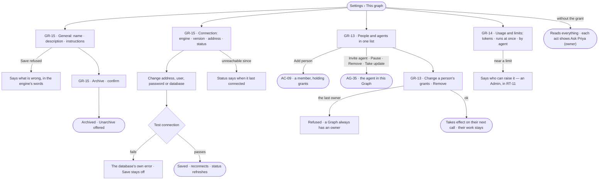

# This graph — name, connection, members, usage

> The open Graph's own settings: what it is called and what it is for, the one graph database it reads, who is on it —
> people and agents in one list — and what it spends against the limits the install set. The decision it helps make:
> *is this Graph grounded on a database that works, staffed by the right people and agents, and inside what it may
> spend?*

## User journey

## Stories

| ID | Story | Status |
|---|---|---|
| GR-13 | [See and change who is on this graph](stories/GR-13-see-and-change-who-is-on-this-graph/story.md) | idea |
| GR-14 | [Read what this graph spends against its limits](stories/GR-14-read-what-this-graph-spends-against-its-limits/story.md) | idea |
| GR-15 | [Name, describe and connect this graph](stories/GR-15-name-describe-and-connect-this-graph/story.md) | idea |

## Access

| Act | Role (`.claude/team/TEAM.md` §7) | Everyone else sees |
|---|---|---|
| Read General, Connection (never the password), members and usage | Operator — every member | — |
| Change name, description, instructions, the daily caps on asks for more · Archive · Unarchive | `owner` · shown as *Owner* | Fields read-only; *Save* and *Archive* shown as *Ask Priya (owner)* |
| Change the connection · Test connection · Read the database's types again | `owner` · shown as *Owner* | Address, user, database and status read; the password field is absent; acts shown as *Ask Priya (owner)* |
| Change a person's grants · remove a person | `iam-admin` · shown as *Can manage people* | The list reads; *Edit* and *Remove* shown as *Ask Priya*, naming someone who can manage people |
| Add a person | As AC-09 | As AC-09 |
| Invite, pause, remove an agent · take an update | As AG-35 | As AG-35 |
| Raise a limit | Admin — in Settings › Invana (RT-11) | Usage reads the limit and says only an Admin raises it |

## States

| State | What the person sees |
|---|---|
| First use | General with the setup timeline leading it while required setup is unfinished; Members holds only the creator, as owner |
| Empty after a filter | Members filtered to no one: *No one matches* and *Clear filter* |
| Loading | The modal and its left nav at once; rows fill in place |
| Has data | General · Connection with its status · people and agents · usage against limits |
| Failed | A save refused with the reason; a test that failed with the database's own words; a Graph that does not exist says so |
| Agent working or proposing | — an agent never changes a Graph's settings |
| No access | Every section reads; each act is shown as *Ask Priya (owner)* or names someone who can manage people |

## Rules

| Rule | Detail |
|---|---|
| One Graph, one graph database | There is no second connection |
| A test gates every save | A connection that has not connected cannot be saved — on the first save and on every change to address, user, password, database or connector |
| The connector is fixed after the first save | Everything modelled against it would stop meaning what it means; address, user, password and database stay editable |
| The password is never read back | The user is shown; the password field is blank — *Stored encrypted. Leave blank to keep it.* A blank password saves and tests with the stored one |
| The database name is not a secret | Shown beside the address and editable; blank means the connector's default, and the read view says *connector default* |
| A read-only connection is never written to | By any path — loads, edits, agents |
| The status is honest | Connected · unreachable · degraded, with the last time it connected; rotated credentials show as unreachable, never as silence |
| The server version decides the property types | It is detected, may be declared, and the model's property types follow it |
| Membership reads, grants write | A member reads everything in the Graph; each grant lets them change one part (AC-F02) |
| An agent is a member | People and agents are one list; an agent's row opens the agent in this Graph (AG-35) |
| A Graph always has an owner | Removing or demoting the last owner is refused |
| Access is checked on every call | Removing a person or changing their grants takes effect on their next call |
| Removing never removes work | A removed person's work and authorship stay; their open tasks stay assigned and say who is gone |
| Usage reads, the install sets | A Graph reads its limits and its spend; only an Admin raises a limit, in Settings › Invana (RT-11) |
| The engine counts | Tokens and runs at once are stored per run when it settles; Usage only shows them |
| Leans on | Adding people and access rules (AC-F02) · inviting agents (AG-F02) · each Graph's limits (RT-F04) · creating a Graph and connecting at creation (GR-F02) · History (AC-F06) |

## Data touched

| Record | Read or write |
|---|---|
| The Graph — name, description, instructions, archived | Read · write |
| The Graph's connection — connector, address, database, encrypted credentials, read-only, server version, status | Read · write |
| Members — people and their grants; the Graph's agents | Read · write |
| Limits and per-run spend (RT-F04) | Read |
| History rows of every change (AC-F06) | Write |

## Decisions

| Decision | Detail |
|---|---|
| This graph is a part of Settings | *Settings › This graph* — General · Connection · People and access · Usage and limits · Notifications; a modal, never a page in main |
| AI models and runs at once are the install's | Neither is a section of This graph; they are *Settings › Invana* (RT-F01 · RT-F04) |
| Members keep the engine's grants | The six grants are listed; *Can manage people* holds what changes members |
| Testing a connection is recorded | Who proved it worked, and when, is in History; a test before a Graph exists records nothing |
| The database may move | Changing it re-tests, like changing the address; pointing a Graph at a restored copy is a move people make |
| There is no Info panel | The setup timeline leads General while setup is unfinished |

## Open questions

| Question | Who answers |
|---|---|
| General and Connection have no board yet; the spec names them as states of `settings.people` (the Settings modal). Recommend: the designer draws them as their own boards, `settings.general` and `settings.connection`, and the spec renames the cells | Ravi |

## Not building

| Item | Why not |
|---|---|
| A second connection per Graph | The Graph is the reasoning boundary |
| Changing the connector after the first save | Everything modelled against it would stop meaning what it means |
| Connection pooling settings in Studio | Tuning belongs to configuration |
| Credential vault integrations | Encryption at rest is enough for now |
| Raising a limit from the Graph | The install controls cost and capacity (RT-F04) |
| Invitations to people without accounts | An invitation flow is a product of its own |
| Per-canvas access | The Graph is the boundary |
| Transferring ownership | A second owner is a grant, not a transfer; the address is the creator's username |
