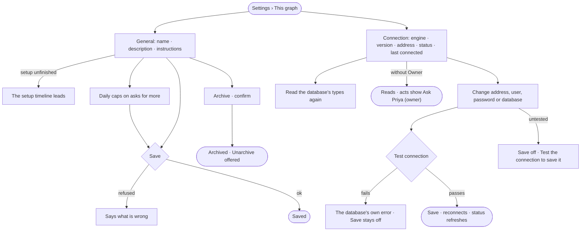

# GR-15 · Name, describe and connect this graph

**As** a Graph owner **I want** the Graph's name, instructions and the one database it reads in one place, proven to
work before anything depends on it **so that** the Graph is grounded and reachable, and nothing is built on a
connection that was never proven.

Tasks: [task.md](task.md) · Feature: [GR-F04](../../feature.md)

## Who can

| Lens | Can | Otherwise sees |
|---|---|---|
| Admin | Change name, description and instructions; the daily caps on asks for more; archive and unarchive; change the connection after a passing test; read the database's types again | — |
| Operator | Read the Graph's name, description, instructions and its connection — engine, version, address, user, database, status | Fields read-only; the password field is absent; *Save*, *Archive*, *Test connection* shown as *Ask Priya (owner)* |

## Flow

## Acceptance criteria

| # | Given | When | Then |
|---|---|---|---|
| GR-15.1 | An owner | they change name, description or instructions and save | it saves; a refused save says what is wrong, in the engine's words |
| GR-15.2 | Required setup unfinished | General opens | the setup timeline leads it |
| GR-15.3 | An owner | they archive the Graph, confirming | it is archived and *Unarchive* is offered |
| GR-15.4 | A Graph with a connection | Connection opens | a summary reads — engine and server version, connector and address, status and the last time it connected — then address, user, password, database, server version and read-only |
| GR-15.5 | A saved connection | Connection opens | the user reads back; the password field is blank, saying it is stored encrypted and blank keeps it |
| GR-15.6 | A change to address, user, password, database or connector | it has not passed *Test connection* | *Save* is off, saying *Test the connection to save it* |
| GR-15.7 | A test that fails | it returns | the database's own error shows under the fields and *Save* stays off |
| GR-15.8 | A test that passes | the owner saves | the Graph reconnects; the status reads connector, server version, type count and read-write, in that order |
| GR-15.9 | A blank password | the owner tests or saves | the stored password is used |
| GR-15.10 | A saved connection | the owner looks for the connector | it is fixed; only address, user, password and database change |
| GR-15.11 | A blank database | the connection reads | it says *connector default*, never an invented name |
| GR-15.12 | A connection marked read-only | anything would write to it | nothing writes to it, by any path |
| GR-15.13 | Credentials rotated outside Invana | the status is read | it reads unreachable, with the last time it connected |
| GR-15.14 | A test | it runs | History records who tested it and when (AC-F06) |
| GR-15.15 | An Operator | they open General or Connection | everything reads but the password; *Save*, *Archive* and *Test connection* are shown as *Ask Priya (owner)* |
| GR-15.16 | An owner | they change the daily caps on asks for more — per holder and for the Graph (AC-F04) — in General and save | the new caps bind from the next ask; *Usage and limits* reads them (GR-14); History records who changed them (AC-F06) |

## Screens

| Surface | Lens | First use | Empty after a filter | Loading | Has data | Failed | Agent working or proposing | No access |
|---|---|---|---|---|---|---|---|---|
| General | Admin | settings.people · General · Setup unfinished | — | settings.people · Loading | settings.people · General | settings.people · General · Could not save | — | — |
| General | Operator | settings.people · General · Setup unfinished | — | settings.people · Loading | settings.people · General · Read only | settings.people · Could not load | — | settings.people · General · Read only |
| Connection | Admin | — | — | settings.people · Loading | settings.people · Connection | settings.people · Connection · Test failed | — | — |
| Connection | Operator | — | — | settings.people · Loading | settings.people · Connection · Read only | settings.people · Connection · Unreachable | — | settings.people · Connection · Read only |
