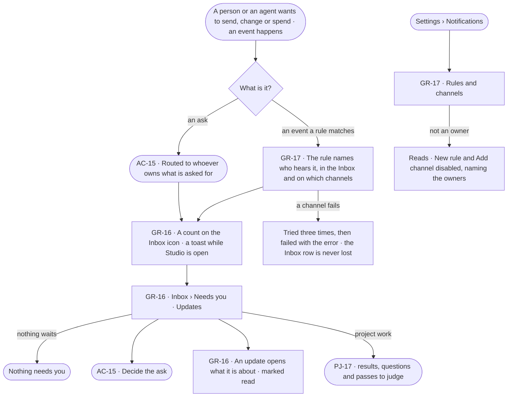

# The Inbox — what needs me, and notifications

> Every ask that waits on a person (AC-F05) and everything else that should reach them arrives in one Inbox, by rules
> an owner writes. The decision it helps make: *what needs me first?*

## User journey

Journeys this feature is a step of: [J03 · Give an agent work and decide on the result](../../../../journeys/J03-give-an-agent-work-and-decide-on-the-result.md) · [J04 · Build an agent and improve it from what runs teach](../../../../journeys/J04-build-an-agent-and-improve-it-from-what-runs-teach.md) · [J06 · Set what an agent may touch](../../../../journeys/J06-set-what-an-agent-may-touch.md)

## Stories

| ID | Story | Status |
|---|---|---|
| GR-16 | [See what needs me in one inbox](stories/GR-16-see-what-needs-me-in-one-inbox/story.md) | idea |
| GR-17 | [Say which events reach whom, and where](stories/GR-17-say-which-events-reach-whom-and-where/story.md) | idea |

## Access

| Act | Role (`.claude/team/TEAM.md` §7) | Everyone else sees |
|---|---|---|
| Read one's own Inbox — Needs you and Updates | Operator — every member | — |
| Decide an ask | As AC-F05 | As AC-F05 |
| Read rules and channels | Operator — every member | — |
| Write a rule — notification or History alert — or a channel | `owner` · shown as *Owner* · Admin | Read only; *New rule*, *Add channel* and each switch disabled, naming the owners |
| Project work in Needs you | PJ-F02 — *Can work on projects* | As PJ-F02 says |

## States

| State | What the person sees |
|---|---|
| First use | Needs you: *Nothing needs you*, as good news. Updates with no rule written: *Nothing needs you*, with *New rule* — failures reach a person only through a rule. Rules: *No rules yet*, with *New rule* |
| Empty after a filter | Needs you or Updates filtered by product, kind or *Unread* with no match: *Nothing matches*, with *Clear filters* |
| Loading | The Inbox opens at once with rows loading in place; its count is the last one read |
| Has data | Needs you — asks first, nearest deadline first (AC-F05); Updates newest first, unread marked. Rules one row each; channels with their masked target and *ready* |
| Failed | The list could not load, saying why, with *Try again*. A channel that failed a send names the error on its delivery |
| Agent working or proposing | An agent's ask in Needs you, as AC-F05 shows it |
| No access | An ask routed to someone else reads, as AC-F05 says. Rules and channels read; every write disabled, naming the owners |

## Rules

| Rule | Detail |
|---|---|
| One list of what waits | Needs you holds every ask a person, an agent or a run makes of a person — access · budget · delegation · send · question · more than a line allows (AC-14) · a person's act set to Ask — a held delivery of a finished run, a breaking model publish, and project work (PJ-F02). The Inbox icon and the header carry one count: unread updates + asks waiting on the reader + runs waiting on the reader's answer |
| Questions lead Needs you | A question asked back of the person sits first: it holds a run until it is answered. Then every other ask, oldest first |
| Only asks toast | A new ask or question for the reader shows a toast with *Review*; updates never toast |
| Rules read what happened | A rule matches events after they are written, never slowing or failing a write. A rule never matches its own notifications, deliveries or reminders, so it cannot feed itself |
| In the Inbox, and out | *In app* is not a channel: every rule and schedule may write to the Inbox. Channels — email · Slack · webhook — are what leaves Invana |
| Channel secrets are write-only | Stored encrypted, never read back; the read shows a masked target |
| A failed send retries | Three tries, then *failed* with the error; the Inbox row is written first and never depends on a channel |
| Recipients resolve when a rule matches | Named members still on the Graph, holders of named Graph roles, and *whoever the run was for*. An event on a private project reaches only its people |
| Alerts over History | A History alert matches acts — what was done, what it touched, allowed or refused and why, optionally a count in a window — and tells named members in the Inbox only. It sees only what happens after it exists |
| Leans on | Agents and their runs (AG-F03) · project work in Needs you (PJ-F02) · suggested changes (EX-F07) · schedules and their deliveries (AG-F07) · asks and approvals (AC-F05) · History (AC-F06) · access rules (AC-F02) |

## Data touched

| Record | Read or write |
|---|---|
| Notifications — one Inbox row per person, read or not, its target | Write · read |
| Deliveries — one send to one channel, exactly what was sent, status, tries, the error | Write · read |
| Notification rules · History alerts · channels | Write · read |
| Runs waiting on the reader's answer (AG-F03) | Read |
| History rows of every decision and every rule change (AC-F06) | Write |

## Engine

The low-level design: what this feature stores, serves and refuses. Conventions — naming, errors, lists, events — are
[system-design.md](../../../../system-design.md) §§ 6–8; this section only fills them in.

### Records

| Table | Columns | Notes |
|---|---|---|
| `graphs_notifications` | `graph_id` · `user_id` · `kind` (`event` · `approval` · `reminder` · `expired` · `delivery`) · `title` · `body` · `event_id?` · `rule_id?` · `approval_id?` · `run_id?` · `target_kind?` · `target_id?` · `read_at?` · `created_at` | One Inbox row. Unique (`user_id`, `event_id`, `rule_id`) |
| `graphs_notification_rules` | `graph_id` · `name` · `events[]` · `match{}` (an optional finished run's status) · `member_ids[]` · `roles[]` · `requester` · `in_app` · `channel_ids[]` · `enabled` · `created_by_id` | Unique (`graph_id`, `name`) |
| `graphs_notification_channels` | `graph_id` · `name` · `kind` (`email` · `slack` · `webhook`) · `target` (masked when read) · `secret_encrypted?` · `created_by_id` | Unique (`graph_id`, `name`). Created and removed, never updated |
| `graphs_notification_deliveries` | `graph_id` · `channel_id` · `rule_id?` · `event_id?` · `firing_id?` · `approval_id?` · `status` (`pending` · `held` · `sent` · `failed`) · `payload` (exactly what is sent) · `attempts` · `error?` · `sent_at?` | One send to one channel |
| `graphs_notification_cursors` | `name` · `event_id` · `created_at` | How far the clock has matched the event store |
| `graphs_alert_rules` | `graph_id` · `name` · `enabled` · `match{}` (act pattern · touched pattern · verdicts · refusal reasons · optional `count` in `window_s`) · `notify_user_ids[]` · `last_seq` · `last_fired_at?` · `created_by_id` | A History alert |

### Reads

| Record | Owner |
|---|---|
| The event store a rule matches, and History rows an alert matches | [AC-F06](../../../access/features/AC-F06-history/feature.md#engine) |
| Asks waiting on the reader, and the ask a held delivery waits for | [AC-F05](../../../access/features/AC-F05-asks-and-approvals/feature.md#engine) |
| Runs waiting on the reader's answer, and a run's requester | [AG-F03](../../../../capabilities/agents/features/AG-F03-runs-and-how-the-agents-are-doing/feature.md#engine) |
| Schedules, their firings, the deliveries they make, and the shared clock | [AG-F07](../../../../capabilities/agents/features/AG-F07-schedules/feature.md#engine) |
| Project work in Needs you | [PJ-F02](../../../../capabilities/projects/features/PJ-F02-objectives-and-review/feature.md#engine) |
| Private projects a recipient is not on | [PJ-F01](../../../../capabilities/projects/features/PJ-F01-projects-and-tasks/feature.md#engine) |
| Members and their roles — who a rule's recipients are | [GR-F04](../GR-F04-this-graph/feature.md#engine) |

### Routes

| Route, after `/api/v1/u/{u}/{g}/graphs` | Does | Story |
|---|---|---|
| `GET /notifications` | The reader's Inbox on this Graph — `?view=needs_you · updates` · `?product=` · `?kind=` · `?unread=true` — with `count` (unread updates + asks waiting on the reader + runs waiting on their answer) | GR-16 |
| `POST /notifications/read` | Mark rows read — `{ids[]}` or `{all: true}` | GR-16 |
| `GET /notifications/rules` · `POST /notifications/rules` | Notification rules · write one | GR-17 |
| `GET /notifications/rules/{id}` · `PATCH /notifications/rules/{id}` · `DELETE /notifications/rules/{id}` | Read · change, switch on or off · remove one | GR-17 |
| `GET /notifications/channels` · `POST /notifications/channels` · `DELETE /notifications/channels/{id}` | Channels with `ready` or why not · add one; the secret is never read back · remove one | GR-17 |
| `GET /alert-rules` · `POST /alert-rules` · `PATCH /alert-rules/{id}` · `DELETE /alert-rules/{id}` | History alerts — `?q=` the name · `?enabled=`, sorted by name; each read adds `match_line` and `notify_line` | GR-17 |

### Events

| Event | When |
|---|---|
| `graphs.notification_rules.create` · `graphs.notification_rules.update` · `graphs.notification_rules.delete` | A rule is written · changed · removed |
| `graphs.notification_channels.create` · `graphs.notification_channels.delete` | A channel is added · removed |
| `graphs.notification_deliveries.fail` | A delivery fails for good — `{channel_id, attempts, error}` |
| `graphs.alert_rules.create` · `graphs.alert_rules.update` · `graphs.alert_rules.delete` | A History alert is written · changed · removed |

### Refusals

| Status | When | Sentence | Criterion |
|---|---|---|---|
| 422 | A rule or alert with no recipient, naming a channel that does not exist, or matching an event a rule may not match | *{field}: {why}.* | GR-17.5 · GR-17.6 |
| 409 | Removing a channel a rule or a schedule names | *{rules and schedules} use this channel.* | GR-17.13 · AG-42.17 |
| 422 | A rules file with a refused rule — nothing in it applied | *{rule} · {field}: {why}.* | GR-17.17 |

### CLI

| Command | Does |
|---|---|
| `invana notifications rules apply --file <yaml>` | Creates each rule, or replaces the one of its name, with the checks of *New rule*; all or nothing |

### Mechanisms

| Mechanism | How |
|---|---|
| Rules read the record | On the shared clock tick ([AG-F07](../../../../capabilities/agents/features/AG-F07-schedules/feature.md#mechanisms)) the matcher reads the event store after its cursor, taken `FOR UPDATE SKIP LOCKED`, after commit — a write is never slowed or failed by a rule |
| No rule feeds itself | Notification, delivery and reminder events and rule and channel changes are never matched |
| Recipients resolve at match | Named members still on the Graph · holders of named roles · *whoever the run was for* — the run's requester; an event on a private project reaches only its people |
| The Inbox row first | Each recipient's row is written before any delivery, and never depends on a channel |
| Deliveries | Each pending delivery is tried once a tick; the third failure leaves it `failed` with the error and writes `graphs.notification_deliveries.fail`. A `held` delivery waits for its ask. A deleted channel fails its delivery at once. There is no backoff and no auto-disable — the owner fixes or removes the channel |
| Channel bodies | Webhook: the payload as JSON, signed `X-Invana-Signature: sha256=<hmac>` when it has a secret · Slack: `{"text": …}` to the incoming webhook · email through the install's SMTP (`INVANA_SMTP_HOST` · `PORT` · `USERNAME` · `PASSWORD` · `FROM` · `STARTTLS`); without it an email channel reads not ready |
| History alerts | Each tick reads each enabled alert's Graph after its `last_seq`; a match writes an Inbox row to each of `notify_user_ids`, sets `last_fired_at` and advances `last_seq`. A new alert starts at the Graph's head |
| The count | Unread notifications + asks waiting on the reader + runs waiting on their answer; a run held on an ask counts once, as the ask |
| Read state | Per row, `read_at` |

## System impact

| HLD section | Change | NFRs |
|---|---|---|
| § 6 Data and storage | Six tables in Invana's own store; channel secrets encrypted at rest | — |
| § 7 Components | The notification matcher and the delivery sender run on the shared clock | — |
| § 8 APIs and events | The Inbox, rules, channels and alerts routes and `graphs.notification_*` · `graphs.alert_rules.*` events | — |
| § 9 Distributed execution | The cursor taken `FOR UPDATE SKIP LOCKED` and unique Inbox rows keep two engine processes from matching an event twice | — |
| § 12 Qualities | Security: webhook bodies signed, channel secrets write-only; Privacy: a private project's events reach only its people | — |

## Decisions

| Decision | Detail |
|---|---|
| Needs you is the one queue | Every ask, every held send and project work wait in one list; there is no queue per product |
| Rules live in Settings › Notifications | Notification rules, History alerts and channels sit in one place, *What reaches whom* over *Where it can go* |
| Rules and channels are the owner's | A channel holds a credential and a rule decides who is told; reading them is every member's |
| Updates are notifications | The Inbox's Updates are the reader's notifications; Needs you never holds an update |

## Open questions

| Question | Who answers |
|---|---|
| Does the Inbox read across every Graph the person is on? The board reads *airways and your other graphs*; asks and notifications are per Graph today. Recommend: yes, grouped by Graph, the open Graph first | Ravi |

## Not building

| Item | Why not |
|---|---|
| A History alert sent to a channel | An alert reaches people in the Inbox; channels are a notification rule's |
| Microsoft Teams | Listed *not connected*; no work planned |
| An inbox per product | One Inbox, filtered by product |
| Digests and quiet hours | A schedule is how routine reading recurs |
| Rules on an answer's value | That is a monitoring product |
| Escalation chains and on-call rotations | A rule names its people; paging policy is another product's job |
| Per-person channel preferences | A rule owns its channels; a person reads the Inbox |
