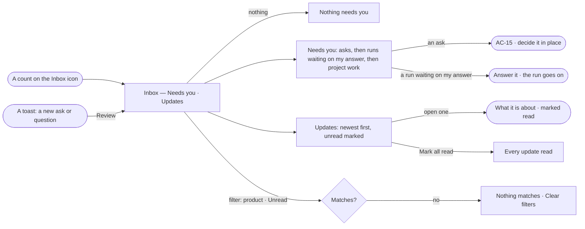

# GR-16 · See what needs me in one inbox

**As** anyone on a Graph **I want** one Inbox of what needs me and what happened that I should know, across every
product **so that** I act on what matters first and nothing waits unseen.

Tasks: [task.md](task.md) · Feature: [GR-F05](../../feature.md)

## Who can

| Lens | Can | Otherwise sees |
|---|---|---|
| Admin | Read their own Needs you and Updates; mark updates read; open what each is about | — |
| Operator | Read their own Needs you and Updates; mark updates read; open what each is about | An item they cannot act on reads, its act disabled with its reason |

## Flow

## Acceptance criteria

| # | Given | When | Then |
|---|---|---|---|
| GR-16.1 | Asks, runs waiting on the reader's answer and unread updates | any screen in the Graph is open | the Inbox icon carries one count: unread updates + asks waiting on the reader + runs waiting on their answer |
| GR-16.2 | Nothing waits and nothing is unread | the reader opens the Inbox | Needs you reads *Nothing needs you*, as good news |
| GR-16.3 | No rule has been written | the reader opens Updates | it reads *Nothing needs you*, with *New rule* — failures reach a person only through a rule |
| GR-16.4 | Items waiting | Needs you opens | asks are listed first, nearest deadline first, then runs waiting on the reader's answer, then project work (PJ-17) |
| GR-16.5 | A run held on an ask | Needs you is read | it is listed once, as the ask, never also as a run waiting on an answer |
| GR-16.6 | A run waiting on the reader's answer | they answer it | it leaves Needs you and the run goes on where it stopped |
| GR-16.7 | Updates | they are read | newest first, each with its product, its age and a dot while unread |
| GR-16.8 | An update | the reader opens it | it goes to what it is about — a run, a schedule, a change — and is marked read; one with nothing to open is marked read in place |
| GR-16.9 | Unread updates | the reader presses *Mark all read* | every update is read and the count drops by them |
| GR-16.10 | A filter by product or *Unread* | nothing matches | it reads *Nothing matches*, with *Clear filters* |
| GR-16.11 | Studio open on any screen | a new ask or question for the reader arrives | a toast names it with *Review*, which opens it in the Inbox; an update never toasts |
| GR-16.12 | The Inbox opening | its lists are still loading | it opens at once, rows loading in place, the count the last one read |
| GR-16.13 | The engine cannot read the Inbox | it opens | it says what it could not read, with *Try again* |
| GR-16.14 | A row | its product is shown | it is where the thing lives — an import Data's, a task's run Projects', a link between models Model's, a typed query Explore's, any other agent run Agents' |
| GR-16.15 | An event on a private project | a rule matches it | only that project's people are told |
| GR-16.16 | An Operator | they open the Inbox | they read their own items; acts they may not take are disabled with their reason |

## Screens

| Surface | Lens | First use | Empty after a filter | Loading | Has data | Failed | Agent working or proposing | No access |
|---|---|---|---|---|---|---|---|---|
| The Inbox icon and its count | Admin | inbox · Nothing needs you | — | inbox · Loading | inbox | — | — | — |
| The Inbox icon and its count | Operator | inbox · Nothing needs you | — | inbox · Loading | inbox | — | — | inbox |
| Inbox › Needs you | Admin | inbox · Nothing needs you | inbox · Nothing matches | inbox · Loading | inbox | inbox · Could not load | inbox · A question from an agent | — |
| Inbox › Needs you | Operator | inbox · Nothing needs you | inbox · Nothing matches | inbox · Loading | inbox | inbox · Could not load | inbox · A question from an agent | inbox · Not yours to answer |
| Inbox › Updates | Admin | inbox · Updates · No rules yet | inbox · Updates · Nothing matches | inbox · Loading | inbox · Updates | inbox · Could not load | — | — |
| Inbox › Updates | Operator | inbox · Updates · No rules yet | inbox · Updates · Nothing matches | inbox · Loading | inbox · Updates | inbox · Could not load | — | inbox · Updates |
| A toast | Admin | — | — | — | inbox · Toast | — | inbox · Toast | — |
| A toast | Operator | — | — | — | inbox · Toast | — | inbox · Toast | inbox · Toast |
