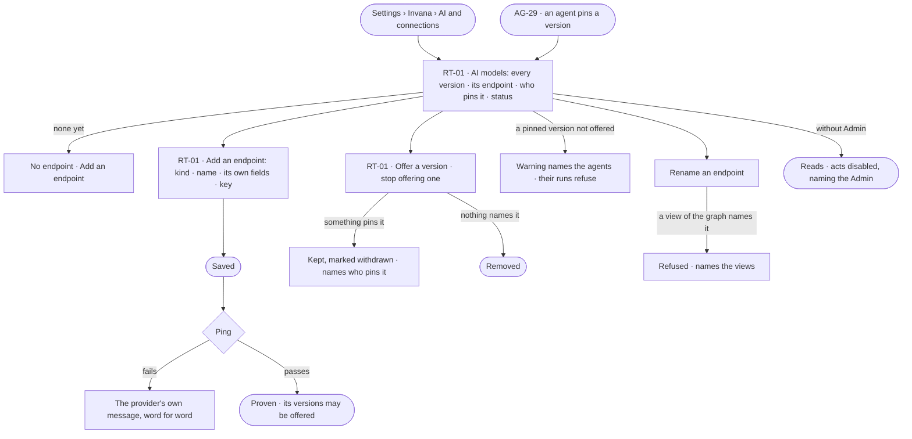

# AI models

> The model endpoints the install pays for and every model version they offer, each by its exact name, with who pins
> it. The decision it helps make: *which model versions do we offer, and can we stop offering one without breaking an
> agent?*

## User journey

Journeys this feature is a step of: [J01 · From an empty install to a first answer](../../../../journeys/J01-from-an-empty-install-to-a-first-answer.md) · [J07 · Ready an install for its Graphs](../../../../journeys/J07-ready-an-install-for-its-graphs.md)

## Stories

| ID | Story | Status |
|---|---|---|
| RT-01 | [Offer the model versions agents may pin](stories/RT-01-offer-the-model-versions-agents-may-pin/story.md) | idea |

## Access

| Act | Role (`.claude/team/TEAM.md` §7) | Everyone else sees |
|---|---|---|
| Read every endpoint, model version, status and who pins it | Operator — every member | — |
| Add, edit, rename or remove an endpoint · ping it · offer or stop offering a version | Admin | *Add a model* and each act disabled, naming the Admin; the key is never shown |
| Pin a version on an agent | As AG-29 | As AG-29 |

## States

| State | What the person sees |
|---|---|
| First use | No endpoint: *Add an endpoint*, and why a question cannot be answered without one |
| Empty after a filter | — no filter on this list |
| Loading | The section opens at once; rows fill in place |
| Has data | Every model version by its exact name — endpoint, pinned by, status — and each endpoint's last ping |
| Failed | A ping that failed, with the provider's own words; a removal or rename refused, naming who still names it |
| Agent working or proposing | — no agent changes the install's models |
| No access | Every row reads, never a key; each act is disabled, naming the Admin |

## Rules

| Rule | Detail |
|---|---|
| The install's, not a Graph's | An endpoint is set up once for the install by an Admin; every Graph resolves through it |
| An endpoint holds many versions | One endpoint is one address and one credential; its model versions are rows under it, each by the provider's exact name |
| Its name is an address | `llm/<endpoint>/<version>` is what an access rule, a view of the graph and History all carry; a person picks the name; lowercase letters, digits, hyphens and underscores |
| The form follows the provider | Anthropic · OpenAI · Google · Azure · Ollama · a local model · the Claude Agent SDK (which may use a local sign-in rather than a key) — only the fields that provider needs |
| Save, then ping | An endpoint is stored first and proven by a ping; the provider's own message is shown word for word, never reworded |
| Keys are encrypted and never read back | A blank key on edit keeps the stored one |
| There is no default model | A view of the graph decides which model answers; with none, the install's shipped choice answers |
| A version nothing names can go | Removing a version or renaming an endpoint that a view of the graph names is refused, naming the views |
| A pinned version stays listed | A version that something pins and is not offered reads *withdrawn*, naming who pins it; those agents' runs refuse rather than fall back |
| No release feed | Invana never says a newer version exists; an Admin offers the version they want |
| An endpoint has a clearance | The highest sensitivity it may receive. A new local or self-hosted endpoint starts at *personal*, an outside provider at *internal*; an Admin changes it, told how much unlabelled data it can reach; an endpoint counts as local only when the engine resolves it to loopback or a private network at each call, rebinding checked (RT-01); raising it writes a History row and alerts the Owners of each Graph that uses the endpoint (RT-01); a call carrying data above it is a send ([Which act a call is](../../../access/product.md#decisions)) |
| Each model version shows its mode | Every model version reads its mode for this Graph — Allow · Ask · Deny ([the three modes](../../../access/product.md#decisions)) — and who set it |
| Failures name the provider | A rate limit, a stopped local model or a rotated key fails naming the endpoint — never as *cannot answer* |
| Leans on | Agents pinning a version (AG-F01 · AG-29) · views of the graph (SE-F09) · access rules on AI models (AC-F02) · History (AC-F06) |

## Data touched

| Record | Read or write |
|---|---|
| Endpoints — name, kind, address, encrypted credential, clearance, last ping | Read · write |
| Model versions — exact name, what it can do, its rate, status | Read · write |
| Pins — agents, skill versions, eval judges (AG-F01 · AG-F04) | Read |
| A ping's run (AG-F03) and History rows (AC-F06) | Write |

## Engine

The low-level design: what this feature stores, serves and refuses. Conventions — naming, errors, lists, events — are
[system-design.md](../../../../system-design.md) §§ 6–8; this section only fills them in.

### Records

| Table | Columns | Notes |
|---|---|---|
| `runtime_llm_providers` | `name` (`^[a-z0-9][a-z0-9_-]*$`) · `provider` (`anthropic` · `openai` · `google` · `azure` · `ollama` · `local` · `claude_agent_sdk`) · `credential_kind` (`api_key` · `local_sign_in` · `none`) · `api_key_encrypted?` · `base_url?` · `clearance` · `last_ping_at?` · `last_ping_ok?` · `last_ping_error?` · `updated_by_id` · `updated_at` | An endpoint, install-wide; `name` unique. The key is Fernet-encrypted and never serialised |
| `runtime_llms` | `provider_id` · `model_id` (the provider's exact name) · `display_name?` · `capabilities` (`context_window` · `supports_tools` · `embedding` · `cost_rank` · `power_rank` · `local`) · `pricing` · `status` (`offered` · `withdrawn`) | A model version under an endpoint; unique (`provider_id`, `model_id`). Its address is `llm/<endpoint>/<model_id>` |

### Reads

| Record | Owner |
|---|---|
| Pins — an agent's model version, a skill version's, an eval judge's | [AG-F01](../../../../capabilities/agents/features/AG-F01-build-an-agent/feature.md#engine) · [AG-F04](../../../../capabilities/agents/features/AG-F04-skills/feature.md#engine) |
| The AI model client every run calls, and a run's resolved model | [AG-F01](../../../../capabilities/agents/features/AG-F01-build-an-agent/feature.md#engine) |
| Views of the graph that name a model version — the cast | [SE-F09](../../../../capabilities/semantics/features/SE-F09-views-of-the-graph/feature.md#engine) |
| A model version's mode for this Graph, and sends above clearance | [AC-F02](../../../access/features/AC-F02-access-rules/feature.md#engine) |
| A ping's run | [AG-F03](../../../../capabilities/agents/features/AG-F03-runs-and-how-the-agents-are-doing/feature.md#engine) |
| History rows and the Owners' alert on a raised clearance | [AC-F06](../../../access/features/AC-F06-history/feature.md#engine) |

### Routes

| Route, install-wide, after `/api/v1/runtime/llms` | Does | Story |
|---|---|---|
| `GET /` | Every endpoint, by the list contract — search `name`, filter `kind`, sort `created_at` · `name` · `-updated_at`; never a key | RT-01 |
| `POST /` | Add an endpoint `{name, provider, credential, base_url?, clearance}` | RT-01 |
| `GET /{name}` · `PATCH /{name}` · `DELETE /{name}` | Read · edit (a blank key keeps the stored one; a new `name` renames) · remove an endpoint | RT-01 |
| `POST /{name}/ping` | Ping it: opens a run, stores `last_ping_*` | RT-01 |
| `GET /{name}/models` | Its model versions — search `model_id`, filter `status` | RT-01 |
| `POST /{name}/models` · `PATCH /{name}/models/{model_id}` · `DELETE /{name}/models/{model_id}` | Offer a version · edit its ranks, pricing or status · remove it | RT-01 |
| `GET /pins` | Each address with who pins it — agents, skill versions, judges — and the views that name it | RT-01 |

### Events

| Event | When |
|---|---|
| `runtime.llm_providers.create` · `.update` · `.delete` · `.ping` | An endpoint is added, edited (a clearance change carries old and new), removed or pinged |
| `runtime.llms.add` · `.update` · `.remove` | A model version is offered, edited or withdrawn, or removed |

### Refusals

| Status | When | Sentence | Criterion |
|---|---|---|---|
| 403 | Any write by anyone but an install Admin | *Only an Admin can change AI models — {admins}.* | RT-01.12 |
| 422 | An endpoint name outside `^[a-z0-9][a-z0-9_-]*$` | *Use lowercase letters, digits, hyphens and underscores.* | RT-01.9 |
| 409 | An endpoint name already taken | *{name} is taken.* | API only — the form checks it as it is typed |
| 409 | Removing a version, or renaming or removing an endpoint, that a view of the graph names | *{address} is named by {views}.* | RT-01.6 · RT-01.20 |
| 409 | Removing an endpoint or a version something pins | *{address} is pinned by {pins}.* | RT-01.20 |
| 409 | A run whose pinned version is withdrawn or not offered | *{address} is not offered — {agent} pins it.* | RT-01.7 |
| 422 | A run with no model to answer | *No AI model answers in this graph — ask {admins}.* | RT-01.22 |

### CLI

| Command | Does |
|---|---|
| `invana llms list` | Every endpoint, its kind, clearance and last ping — never a key |
| `invana llms models <endpoint>` | Its model versions by address — what `agents pin --model` takes |

### Mechanisms

| Mechanism | How |
|---|---|
| A call's unit | `LLMEndpoint` — the endpoint, the model version and its credential, resolved once when a run opens from its view's cast; a run with none is refused before it starts |
| A ping | A run of kind `system` that calls the endpoint once; the provider's message is stored in `last_ping_error` word for word |
| Ranks | `cost_rank` · `power_rank` are seeded from the published rate when a version is offered; no published rate, or a subscription endpoint, ranks in the middle; an Admin may edit both, and nothing derives over an edit. They order *cheapest that can read* and *most capable* in the shipped cast, and nothing else |
| Local is resolved per call | `capabilities.local` holds only when the engine resolves the address to loopback or a private network at that call, rebinding checked; otherwise the call is held to an outside provider's clearance |
| Clearance at add | `personal` for a local or self-hosted endpoint, `internal` for an outside provider |
| Withdrawn | Stopping an offered version that something pins sets `status: withdrawn`; one nothing names is deleted |
| One cache | Only the model call is cached: keyed by a hash of endpoint, model version, prompt and parameters, scoped to the Graph, with a configured time to live; the step records `cached` so a cached run is never read as a cheap one. Query results are never cached |
| A rate limit is backpressure | A 429 is `transient`, retried with backoff and jitter; the per-model wait is [RT-F04](../RT-F04-limits/feature.md#engine) |

## System impact

| HLD section | Change | NFRs |
|---|---|---|
| § 6 Data and storage | Two install-wide tables; a key encrypted at rest | — |
| § 8 APIs and events | Install-wide `/api/v1/runtime/llms` routes and `runtime.llm*` events | — |
| § 10 AI and agents | One model per call; no failover; one cache on the model call | — |
| § 11 Failure modes and the outside boundary | A provider's failure is named with the endpoint and its own words; Invana inherits the provider's availability | — |
| § 12 Qualities | Security: keys never read back; clearance on every endpoint, local resolved per call | — |

## Decisions

| Decision | Detail |
|---|---|
| AI models are Settings › Invana | *AI and connections* lists AI models beside MCP servers and outside agents; an endpoint's detail and adding one are modals |
| A ping is a run | Who proved an endpoint worked, when, and what it said, is a run like any other |
| A model is ranked when offered | Cost and capability ranks come from the published rate; an install on a negotiated rate sets its own; a subscription endpoint ranks in the middle |
| One model per call | No automatic failover — a silent switch changes what produced an answer |

## Open questions

| Question | Who answers |
|---|---|
| `.claude/team/TEAM.md` §7 gives *AI providers* to a Graph's Owner; the docs make AI models the install Admin's. Recommend: Admin only — the spec follows that, and TEAM.md §7 is corrected (recommendation raised) | Ravi |

## Not building

| Item | Why not |
|---|---|
| A model picker when asking | A view of the graph decides the model; two places to choose is one too many |
| Automatic failover between endpoints | A silent switch changes what produced an answer |
| Quotas per endpoint | Spend is set per Graph (RT-F03) |
| A default model | The view of the graph answers *which model*; a second way would disagree |
| Fetching a provider's catalogue | A typed exact name is enough and does not move when a catalogue does |
