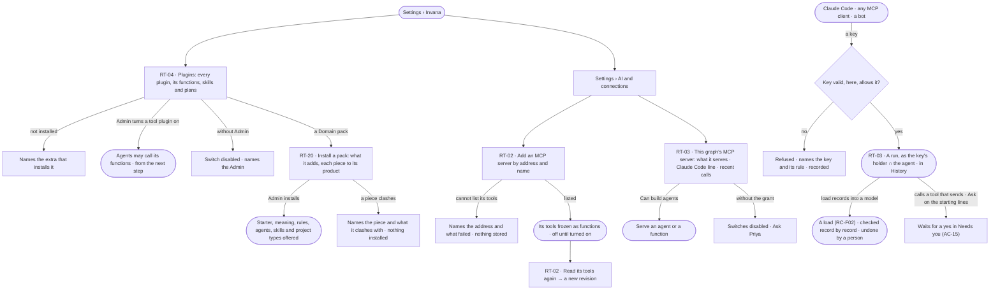
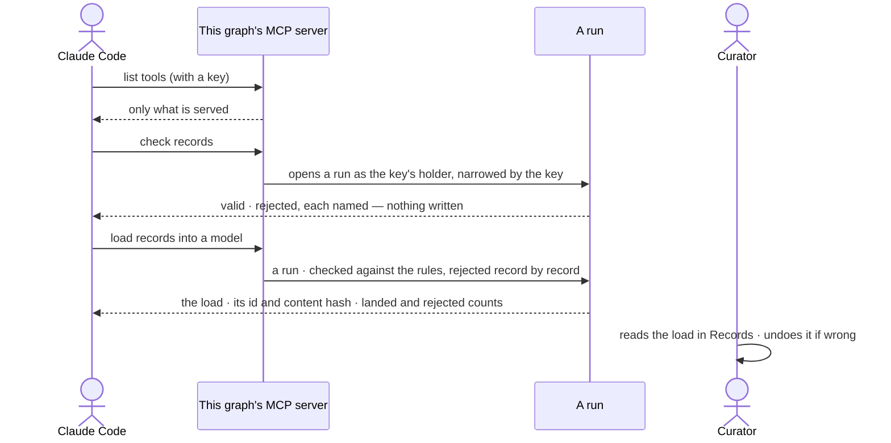

# Plugins and outside tools

> Where the install meets the outside, in both directions: tool plugins — every one an MCP server, the web, mail and
> science tools Invana ships and the outside servers an Admin adds — whose tools agents may call, and this Graph's own
> MCP server that Claude Code and other callers use — and Domain packs, which bring a domain in whole. The decision it helps make: *what may agents reach outside Invana, and what may the outside reach in here?*

## User journey

Journeys this feature is a step of: [J07 · Ready an install for its Graphs](../../../../journeys/J07-ready-an-install-for-its-graphs.md)

## Stories

| ID | Story | Status |
|---|---|---|
| RT-02 | [Add an outside tool server and let agents call its tools](stories/RT-02-add-an-outside-tool-server-and-let-agents-call-its-tools/story.md) | idea |
| RT-03 | [Let Claude Code and other callers use this graph](stories/RT-03-let-claude-code-and-other-callers-use-this-graph/story.md) | idea |
| RT-04 | [See every plugin and turn a tool plugin on](stories/RT-04-see-every-plugin-and-turn-a-tool-plugin-on/story.md) | idea |
| RT-20 | [Install a Domain pack](stories/RT-20-install-a-domain-pack/story.md) | idea |

## Access

| Act | Role (`.claude/team/TEAM.md` §7) | Everyone else sees |
|---|---|---|
| Read every plugin, its functions, skills, plans and versions | Operator — every member | — |
| Turn a tool plugin on or off | Admin | The switch is disabled, naming the Admin |
| Add an MCP server · read its tools again | Admin | *Add a server* is disabled, naming the Admin |
| Read this graph's MCP server — address, what it serves, the Claude Code line, recent calls | Operator — every member | — |
| Serve an agent or a function over this graph's MCP server | `builder` · shown as *Can build agents* | The switches are disabled — *Ask Priya*, naming someone who can build agents |
| Call this graph from outside | Whoever holds a key minted in this Graph (AC-10), as that holder, narrowed by the key | Refused, naming the key and its rule |
| Load records from outside | As RC-F02 — the key's holder must be allowed to load into that model | Refused, naming the model and who may load |
| Install or remove a Domain pack | Admin | *Install* is disabled, naming the Admin |
| Say yes to a tool that sends | As AC-F05 | As AC-F05 |

## States

| State | What the person sees |
|---|---|
| First use | Plugins: core plugins on, tool plugins off · MCP servers: none, *Add a server* · this graph's server: nothing served, *No calls yet* with the line to connect |
| Empty after a filter | Plugins filtered to none: *No plugin matches* |
| Loading | The section opens at once; rows fill in place |
| Has data | Plugins with their switches · MCP servers with their tools and revision · what this graph serves and its recent calls |
| Failed | A server that cannot be reached, named with what failed; a plugin not installed, naming its extra; a call refused, naming the key and its rule |
| Agent working or proposing | A run reaching a tool that sends waits for a yes in Needs you (AC-15) |
| No access | Every list reads; switches and *Add a server* are disabled, naming who can |

## Rules

| Rule | Detail |
|---|---|
| A plugin is a package | A versioned package of functions, skills and plans, of four kinds: core and simulator plugins, Invana's own; tool plugins; and `pack` plugins — Domain packs |
| A Domain pack brings a domain whole | A `pack` bundles a model starter, meaning, taxonomies, standards, rules, agents and skills, and project types with their report templates. Each piece stays owned by its product — Semantics, Agents, Projects — and installs as that product's own record; the pack only names what came together |
| First packs | Research · Fraud · General |
| A tool plugin is an MCP server | Every tool plugin speaks MCP: the web, mail and science tools Invana ships are MCP servers it runs on its workers, and an outside server an Admin adds is one more. Both are listed, frozen, versioned and switched the same way |
| Core and simulators stay Invana's own | Core and simulator plugins are Python in the engine, not MCP servers; their functions keep the same contracts |
| Every function's contract is JSON Schema | Its inputs and outputs are a JSON Schema — a tool's input and output schema as its MCP server lists it, or the schema an Invana function declares; a plan is checked against them when it is drawn |
| Graph connectors are not plugins | A connector package registers itself through a Python entry point ([RT-F05](../RT-F05-graph-database-connectors/feature.md#engine)); it reaches the graph database, not the outside |
| Core is always on | Core plugins and simulators are the product and never switch; tool plugins are off until an Admin turns them on |
| Turning on is a gate, not an install | It takes effect from the next step dispatched — no restart. What a process can run is fixed when it starts |
| Installed is the engine's word | A tool plugin whose extra is not installed is listed as not installed, naming the extra; its functions cannot be planned |
| A function keeps its version | Each function versions on its own; a run records the version it ran; after a breaking version the previous one serves re-runs for a while |
| Plans come two ways | *Generated* from a skill's instructions, or *packaged* in a plugin; a person never writes a plan in Studio |
| A tool that sends starts at Ask | A function that sends — mail, any call carrying Graph data out of the install, any MCP tool whose read-only hint no Admin confirmed for its revision — is a send, at Ask on every starting line but the Owner's ([Which act a call is](../../../access/product.md#decisions)); asking, it waits for a yes in Needs you, and a no fails it as *not sent* |
| Each tool shows its mode | Every function reads its mode for this Graph — Allow · Ask · Deny — and who set it |
| Outside work runs on workers | Tool and MCP steps run on workers, never in the engine serving Studio; with no worker free they wait, then fail saying no worker took them |
| Secrets stay on the workers | A function reads only the secrets its plugin declares, from the worker's environment; nothing rides a run |
| The web tools cite and respect robots.txt | Every row a web or science tool returns carries its address; a page robots.txt disallows is not read |
| An MCP server's tools are frozen | The list an Admin saw when adding it; a later change on the server reaches no plan until an Admin reads its tools again |
| One server, one plugin | Its tools are functions `mcp.<server>.<tool>`; reading them again is a new revision, and only a changed tool's version moves |
| This graph's server serves what a builder chose | Everything starts not served; an agent is served as *ask* it, a function by its tool name |
| Only a key connects | A caller connects with a key minted in this Graph; a sign-in session is refused |
| Every call is a run | As the key's holder, narrowed by the key's own rule, in Runs and History; a refusal before a run is recorded, not run |
| Outside callers read, with sources | Every answer carries where its records came from; anything out of a key's reach is refused, never silently filtered |
| The only write is a load | *Load records* is a load (RC-F02): into one model, checked against its rules, rejected record by record, a run with a stable id and content hash; a person undoes it in Records |
| An outside caller reads what it started | Every call is a run with an id; a caller polls that run — a check, a load — for its status and result, so an orchestrator knows when a load is done |
| Versions | The MCP and JSON Schema versions Invana speaks are pinned in [Engine › Mechanisms](#mechanisms) › *Standards* |
| Leans on | Keys (AC-10) · plans and functions (AG-F06) · asks in Needs you (AC-F05) · loads (RC-F02) · Domain pack pieces — Semantics (SE-F01 · SE-F03 · SE-F04 · SE-F05 · SE-F07), Agents (AG-F02), project types (PJ-F03) · workers (RT-F03) · History (AC-F06) |

## Data touched

| Record | Read or write |
|---|---|
| Plugins and whether each is on | Read · write |
| MCP servers — address, revision, frozen tools | Read · write |
| What this graph serves | Read · write |
| Runs triggered over MCP, with the tool, key and client | Write · read |
| Loads (RC-F02) | Write |
| Domain packs and what each installed | Read · write |
| History rows of every switch, add, refusal and call (AC-F06) | Write |

## Engine

The low-level design: what this feature stores, serves and refuses. Conventions — naming, errors, lists, events — are
[system-design.md](../../../../system-design.md) §§ 6–8; this section only fills them in.

### Records

| Table | Columns | Notes |
|---|---|---|
| `runtime_plugin_states` | `name` (the key) · `enabled` · `changed_by_id?` · `changed_at` | A tool plugin's switch, or a pack's installed state; no row is off. Core and simulator plugins have none |
| `runtime_mcp_servers` | `name` (`^[a-z][a-z0-9_]{0,31}$`, the key) · `url` · `revision` (from 1) · `tools` (the frozen list, each `key` · `version` · `side_effect` · `read_only_hint` · `read_only_confirmed_by_id?` · input and output schema) · `skipped` (each tool left out, with why) · `server` (`name` · `version` · `protocol` from its `initialize`) · `frozen_at` · `added_by_id` | One outside MCP server, one plugin `invana.mcp.<name>`, version `<revision>.0.0`. Previous revisions' tools stay readable for re-runs |
| `runtime_mcp_served` | `graph_id` · `kind` (`agent` · `function`) · `ref` · `served` · `changed_by_id` · `changed_at` | Unique (`graph_id`, `kind`, `ref`); what this Graph's MCP server lists |

### Reads

| Record | Owner |
|---|---|
| A function's manifest, the catalogue and a step's `key@version` | [AG-F06](../../../../capabilities/agents/features/AG-F06-plans-and-functions/feature.md#engine) |
| Keys minted in a Graph and their own rule | [AC-F02](../../../access/features/AC-F02-access-rules/feature.md#engine) |
| A function's or tool's mode for this Graph — Allow · Ask · Deny — and the read-only confirmation's effect on it | [AC-F02](../../../access/features/AC-F02-access-rules/feature.md#engine) |
| Asks for a send and their answers | [AC-F05](../../../access/features/AC-F05-asks-and-approvals/feature.md#engine) |
| Runs opened over MCP — `triggered_by = mcp`, `params.mcp` | [AG-F03](../../../../capabilities/agents/features/AG-F03-runs-and-how-the-agents-are-doing/feature.md#engine) |
| Agents that may be served, and their status | [AG-F01](../../../../capabilities/agents/features/AG-F01-build-an-agent/feature.md#engine) |
| Loads — *Load records* and the check *Check records* runs | [RC-F02](../../../../capabilities/records/features/RC-F02-bring-records-in/feature.md#engine) |
| A pack's pieces as each product reads them — starter (SE-F01), meaning (SE-F03), taxonomies (SE-F04), standards (SE-F05), rules (SE-F07), agents and skills (AG-F02), project types and report templates (PJ-F01) | Each product's `## Engine` |
| Workers that run tool and MCP steps, and their secrets | [RT-F03](../RT-F03-workers-and-the-queue/feature.md#engine) |
| History rows of every switch, add, refresh, install and refusal | [AC-F06](../../../access/features/AC-F06-history/feature.md#engine) |

### Routes

| Route, install-wide, after `/api/v1/runtime/plugins` | Does | Story |
|---|---|---|
| `GET /` | Every plugin as `PluginSummary` — `name` · `kind` · `version` · `title` · `extra` · `installed` · `enabled` · `switchable` · `restart_required` · counts of functions, skills and plans; filters `kind` · `enabled`, search `name` · `title` | RT-04 · RT-20 |
| `GET /{name}` | `PluginDetail` — the summary with `secrets` (names), each function's manifest, each plan (`key` · `version` · `kind` · `description`), each skill (`slug` · `name` · `version` · `when_to_use` · `description`), and for a pack each piece with the product that offers it; empty lists when not installed | RT-04 · RT-20 |
| `POST /{name}/enable` · `POST /{name}/disable` | Turn a tool plugin on or off | RT-04 |
| `POST /{name}/install` · `POST /{name}/remove` | Install or remove a Domain pack | RT-20 |
| `POST /mcp` | Add an MCP server `{name, url}` → `201` `McpServerRead` | RT-02 |
| `POST /mcp/{name}/refresh` | Read its tools again — a new revision | RT-02 |
| `POST /mcp/{name}/tools/{tool}/confirm-read-only` | Confirm the server's read-only hint for this revision | RT-02 |

| Route, after `/api/v1/u/{u}/{g}/runtime` | Does | Story |
|---|---|---|
| `POST /mcp` | This Graph's MCP server — JSON-RPC, stateless, JSON responses: `initialize` · `notifications/initialized` (`202`) · `ping` · `tools/list` · `tools/call` | RT-03 |
| `GET /mcp` · `DELETE /mcp` | `405` — no stream | RT-03 |
| `GET /mcp-server` | `McpServerInfo` — `url` · `transport` · `protocol_version` · `connect_command` · `agents_served` · `functions_served` · `calls_today` | RT-03 |
| `GET /mcp-server/served` · `PUT /mcp-server/served/{kind}/{ref}` | `ServedRead` — `kind` · `ref` · `name` · `tool` · `does` · `served` · `status` · `changed_at` · serve or stop serving one `{served}` | RT-03 |
| `GET /mcp-server/calls` | `McpCallRead` — `run_id` · `number` · `at` · `caller` · `client` · `token` · `tool` · `status` · `result`, newest first | RT-03 |

### Events

| Event | When |
|---|---|
| `runtime.plugins.enable` · `.disable` | A tool plugin is switched |
| `runtime.plugins.install` · `.remove` | A Domain pack is installed or removed, with its pieces |
| `runtime.mcp_servers.add` · `.refresh` · `.confirm_read_only` | A server is added, read again, or a tool's read-only hint confirmed |
| `runtime.mcp_served.update` | An agent or function is served or stops being served |
| `runtime.mcp.refused` | A call to this Graph's server refused before a run — the key, its rule and the act |

### Refusals

| Status | When | Sentence | Criterion |
|---|---|---|---|
| 403 | A switch, add, refresh, confirm, install or remove by anyone but an install Admin | *Only an Admin can do this — {admins}.* | RT-02.12 · RT-04.13 · RT-04.18 · RT-20.6 |
| 409 | Switching a core or simulator plugin | *{name} is part of Invana and is always on.* | RT-04.3 |
| 409 | Enabling a tool plugin whose extra is not installed | *{name} is not installed — install `invana[{extra}]`.* | RT-04.5 |
| 409 | An MCP server name already taken, or the `mcp` extra missing | *{name} is taken.* · *MCP needs `invana[mcp]`.* | RT-02.2 · RT-04.5 |
| 422 | A bad server name or a URL that is not http(s) | *{field}: {why}.* | RT-02.2 |
| 422 | A server that cannot be reached, refuses the token or is not an MCP server | *{url}: {what failed}.* | RT-02.3 |
| 404 | Refreshing an unknown server, or switching an unknown plugin | *Not found.* | API only — Studio lists only what exists |
| 409 | A pack piece whose name is taken in its product | *{piece} clashes with {existing} in {product}.* | RT-20.4 |
| step refused | A step calling a function of a plugin that is off | *{plugin} is off — {admins} can turn it on.* | RT-02.9 · RT-04.7 |
| step refused | A function needing a secret the workers do not hold | *Set {INVANA_SECRET_NAME} on the workers.* | RT-02.11 · RT-04.10 |
| step failed | An MCP server down at call time | *{url} did not answer.* | RT-02.10 |
| 401 | A call to this Graph's server with no key, a sign-in session, a revoked key or another Graph's key | *A key minted in this graph is needed.* | RT-03.5 |
| 403 | A call the key's own rule does not allow | *{key}'s rule {rule} does not allow {act}.* | RT-03.6 |
| 409 | A call to a served agent that is paused, retired or a draft | *{agent} is {status}.* | RT-03.4 |
| 404 | Serving an agent or function that may not be served | *Not found.* | RT-03.4 |
| 403 | Serving without *Can build agents* | *This needs Can build agents.* | RT-03.13 |
| run failed | *Load records* by a holder not allowed to load into that model | *{holder} may not load into {model} — ask {who}.* | RT-03.10 |

### CLI

| Command | Does |
|---|---|
| `invana plugins list` · `show <name>` | Every plugin with its version, installed and enabled, and its functions · one as JSON |
| `invana plugins enable · disable <name> --user` | Switch a tool plugin, as an install Admin |
| `invana plugins install · remove <pack> --user` | Install or remove a Domain pack, as an install Admin |
| `invana plugins mcp add <url> --name <name>` · `mcp refresh <name>` | Add an MCP server · read its tools again, as an install Admin |

### Mechanisms

| Mechanism | How |
|---|---|
| A plugin's folder | `plugin.toml`; `tasks/<folder>/manifest.toml` and `run.py` per function; `flows/<key>.toml` per packaged plan; `skills/<slug>/` (`skill.toml` · `instructions.md`) per skill. A pack adds `starter/` · `meaning/` · `taxonomies/` · `standards/` · `rules/` · `agents/` (agent files) · `project_types/<key>/` (`type.toml` and its report template) |
| `plugin.toml` | `name` · `kind` (`core` · `simulator` · `tool` · `mcp` · `pack`) · `title` · `engine` (the engine range, `*` for any) · `extra` · `secrets` · the ordered `tasks`, `flows` and `skills`; a pack lists its pieces by folder. A tool, simulator or pack declares its own `version`; a core plugin's is the engine's. Read with `tomllib` |
| A function's folder | The key's last dotted segment; a segment that is a Python keyword or would collide keeps its namespace (`science_uniprot_get/`). The namespace is not the plugin: `invana.core.graph_read` holds `graph.read.*` |
| Loaded once, frozen | Plugins load once per process into a frozen registry. The process stops, naming the file, when a manifest does not validate, a key's last segment is not its folder, `run.py` has no `async def run(ctx, v)`, a key repeats, `plugin.toml` lists other tasks, flows or skills than its folders hold, or a configured plugin is missing. A switch is read at dispatch |
| Installed | Read from the engine's own package metadata — `invana[tools-web]` · `invana[tools-mail]` · `invana[tools-science]` · `invana[mcp]`; an extra with no third-party requirement is always installed. Not installed: listed from its manifest, naming the extra |
| Secrets | Named in `plugin.toml`; read on the worker from `INVANA_SECRET_<NAME>`; `ctx.secret(name)` refuses a name the plugin did not declare. Nothing is stored or carried on a run |
| A plugin's skills | `skill.toml` (`name` · `when_to_use` · `description` · `version`) and `instructions.md`, seeded into every Graph by name as `origin = builtin`, a published version whose plan is generated |
| The simulator contract | `kind = "simulator"`, its own `version`, exactly one function and one packaged `simulate` plan whose single step runs it. The function: `bound = "none"` · `side_effect = "read"` · args `spec: obj` · `inputs: list` · `seed: int` · outputs `ranked: list` · `summary: obj`. It reads only through `read_inputs(ctx)` — the pinned loads, content hash checked, an undone load refused — and never queries the Graph. Checked at load |
| Tool plugins Invana ships | `web` — `web.search` (`query`, `limit` 10 → `results` (title · url · snippet) · `searched_at`; secret `web_search`, a SearXNG address) · `web.read_url` (`url` → `url` · `title` · `text` · `links` · `fetched_at`) · `web.download_file` (`url`, `max_mb` 50 → `url` · `files` · `rows` · `fetched_at`). `mail` — `mail.read` (`folder`, `limit`, `unseen_only` → `messages`; secret `imap`) · `mail.send` (`to`, `subject`, `body` → `message_id` · `sent_at`; secret `smtp`, a send). `science` — `science.pubmed.search` · `science.uniprot.get` · `science.pubchem.get`, each row with its `url`. Each runs as an MCP server on the workers |
| A redelivered send is one send | `mail.send` derives its Message-ID from the step's idempotency key |
| Adding an MCP server | Streamable HTTP at the pinned MCP version; `tools/list` once; each tool whose name keys and whose schemas are valid JSON Schema is frozen at `1.0.0`; the rest go to `skipped`, named. The bearer token `INVANA_SECRET_MCP_<NAME>` is read where the call is made — the API process for add and refresh, the worker for a step |
| Reading again | A new `revision`: a new tool starts at `1.0.0`; a tool whose input schema, description or annotations changed moves a major and returns to Ask until confirmed; an unchanged one keeps its version; a dropped one leaves the registry. A re-run on a previous version resolves it from the stored revision |
| An MCP tool as a function | `mcp.<server>.<tool>` · `bound network` · `timeout_s` 60 · `retries` 0 · `resources cpu`; outputs `text` · `content` · `structured`; one step is one `tools/call` |
| Read or send | A tool is a send unless the server marks it read-only and an Admin confirmed that for this revision; a call carrying Graph data out, or whose address or arguments the AI model produced, is a send whatever the hint |
| Loaded at start | A process loads the revisions stored when it starts: a server added or read again reads `restart_required` (`loaded_revision != revision`) until the process restarts; a worker on another revision fails the step `defect · unknown_task_type` |
| Installing a pack | Checks every piece against the names its product already offers; any clash refuses the install and changes nothing. Installed, each product offers its pieces from the frozen registry as its own kind — the starter in *New model*, project types in `GET /api/v1/projects/types`, agents and skills in the catalogue, rules and standards to apply. A product record is made only when a person applies or uses a piece |
| Removing a pack | Its pieces stop being offered; every record a person made from one stays |
| This Graph's server — the client | `initialize` answers an `Mcp-Session-Id` of `<random>.<base64url of clientInfo.name>`; each later call reads the name back as the run's `client`, else *MCP client* |
| This Graph's server — a call | Checked against the key on every call and again as a layer of the run it opens; an allowed call is a run as the key's holder, narrowed by the key, run inline in the request and admitted like any run (RT-F04). The run: `triggered_by = mcp` · `ask_kind` `mcp` (a function) or `nl` (an agent) · `author_id` and `on_behalf_of_user_id` the key's holder · `params.mcp` `{tool, token_id, token, client, result}` |
| Served tools | `check_records` (*Check records*) — `model`, `records` → `valid` · `rejected[{record, key, reason}]` · `warnings[]`, writing nothing (`data.records.validate`) · `load_records` (*Load records*) — `model`, `records`, `source?` → the load's `load_id` · `content_hash` · `landed` · `rejected` (RC-F02) · `ask_<agent>` — `question` → the answer's text, `run`, `outcome`, `summary`; the name is `ask_` and the agent's snake-case name, at most 64 characters, two of one name told apart by the id's first six characters |
| A caller polls its run | Every call returns its run id; the caller reads it with the same key at `GET /api/v1/u/{u}/{g}/agents/runs/{id}` ([AG-F03](../../../../capabilities/agents/features/AG-F03-runs-and-how-the-agents-are-doing/feature.md#routes)) |
| Recent calls and calls today | Read from the runs the server opened: each carries the one-line `result` stored when it settled; *calls today* counts the Graph's `triggered_by = mcp` runs since 00:00 UTC |
| The connect line | Built from `INVANA_ENGINE_BASE_URL` (default `http://localhost:8200`): `claude mcp add --transport http invana-<graph> <url> --header "Authorization: Bearer $INVANA_TOKEN"` |
| Standards | Model Context Protocol `2026-07-28`, client and server, Streamable HTTP · JSON Schema Draft 2020-12 for every function's inputs and outputs. One pin each: another version is refused, naming both; moving a pin is a spec change |

## System impact

| HLD section | Change | NFRs |
|---|---|---|
| § 6 Data and storage | Three install- and Graph-wide tables; the plugin registry is files, frozen per process | — |
| § 7 Architecture and components | The plugin registry; every tool plugin an MCP server on the workers; this Graph's MCP server in the engine | — |
| § 8 APIs and events | `/api/v1/runtime/plugins` and this Graph's `/runtime/mcp` routes; `runtime.plugins.*` · `runtime.mcp*` events | — |
| § 11 Failure modes and the outside boundary | An outside MCP server down fails its step, never retried; Invana inherits the server's availability and its tool definitions | — |
| § 12 Qualities | Security: a key on every outside call; a send asks; secrets only on workers; outside answers carry sources | — |

## Decisions

| Decision | Detail |
|---|---|
| Plugins and connections are Settings › Invana | Plugins, MCP servers, this graph's server and outside agents are administered in Settings, not in Agents; Agents lists the functions they add |
| MCP carries tools, outside agents carry tasks | Outside agents are AG-F05; this feature is tools and callers |
| Streamable HTTP only | An MCP server is reached by address; Invana starts no third-party process on its own machine. The tool plugins it ships run on its workers and are reached the same way |
| One bearer token per outside server | Set on the workers, never stored in Invana |
| No retries for an outside tool | A blind retry of a send is a second send |
| Served functions | *Check records* and *Load records*; served agents answer one question each |
| A pack's pieces are offered, not copied | Installed, a pack's pieces are read from the plugin registry by the product that owns each; a record is written only when a person applies or uses one, so removing a pack orphans nothing |
| Outside callers poll the run | Every served call returns its run; a caller reads it with the same key on the runs route — no tool of its own |
| A pack installs pieces, never a product | Installing a pack offers its starter, project types, agents and skills in their own products; removing it removes nothing a person already used |
| No domain in core | Nothing in the platform is domain-specific; a domain arrives as a pack |
| The engine writes the result line | Each call's one-line outcome is stored when its run settles; Recent calls only shows it |
| Every tool plugin is an MCP server | One way out for every tool: the `web`, `mail` and `science` plugins Invana ships stay, each as an MCP server on the workers, beside the servers an Admin adds |
| A changed MCP tool keeps its previous version for re-runs | An MCP tool is a function like any other: after a breaking version the previous one serves re-runs for a while; reading a server's tools again never makes a re-run on the previous version unknown |

## Open questions

| Question | Who answers |
|---|---|
| Plugins has no board (the Settings modal's *Invana › Plugins* entry draws none). Recommend: the designer draws `settings.plugins`; RT-04's cells name it once drawn | Ravi |
| May an Admin remove an MCP server? Recommend: no — turning it off stops every call, and removing would orphan the versions old runs recorded | Ravi |

## Not building

| Item | Why not |
|---|---|
| Starting outside servers on Invana's machine (stdio) | No third-party processes beside the engine |
| OAuth for outside servers or callers | A bearer token or a key covers it now |
| MCP resources, prompts, sampling, elicitation | Plans call tools; the rest has no place in a plan |
| Following a server's changed tool list | The list is frozen until an Admin reads it again |
| An Admin marking a tool read-only | An Admin only confirms the server's own hint, per revision; a tool the server does not mark stays a send |
| Hot-loading a new or refreshed server | *Turning on is a gate, not an install* ([Rules](#rules)) |
| A raw graph query as a served tool | Served agents answer with records cited |
| A general write path from outside | Writes have contracts; only a load writes, checked record by record |
| Authoring a Domain pack in Studio | A pack is a package built and versioned outside Invana |
| Webhooks | Polling with sources is simpler to reason about and to audit |
| Third-party plugin packages outside the engine | A third party's tools arrive as an MCP server an Admin adds (RT-02); core and simulator plugins stay in the engine |
| A tool interface of Invana's own | One interface — MCP — for every tool, shipped or added |
| A secrets store in Invana | The worker's environment is enough for now |
| Genebank tools | No single genebank API to wrap yet; PubMed, UniProt and PubChem are the science tools |
| Resuming a run whose ask expired | The run stays waiting; cancelling it is a person's act |
