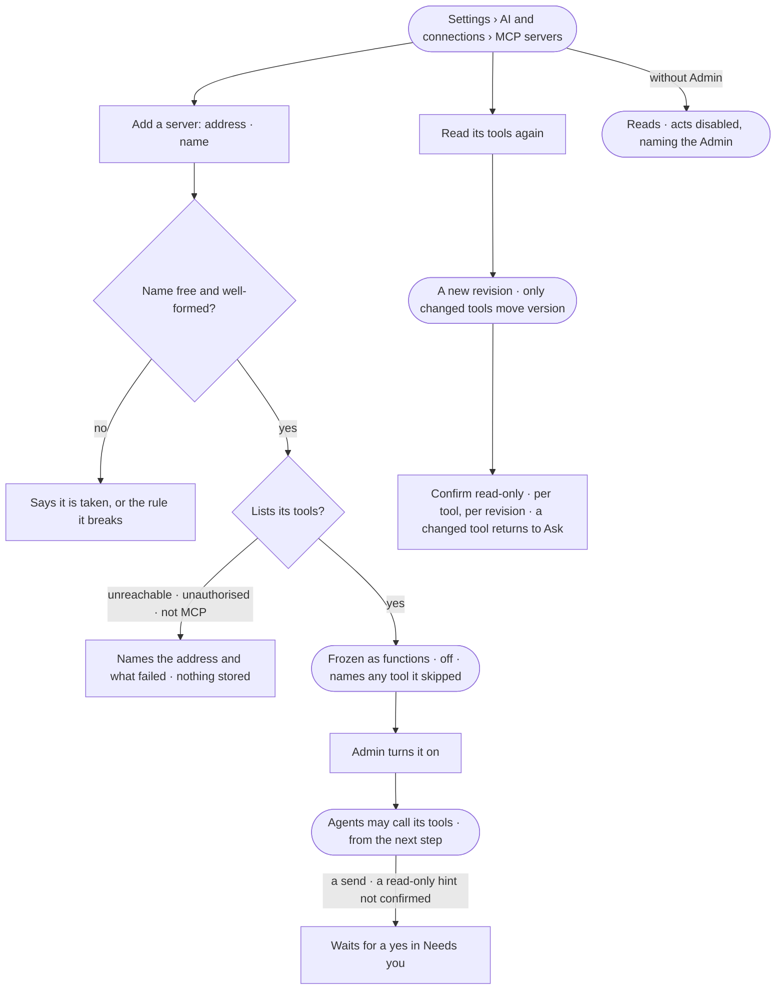

# RT-02 · Add an outside tool server and let agents call its tools

**As** an install admin **I want** to add a third party's MCP server — Figma, say — and see its tools as functions,
frozen as I saw them **so that** agents use outside tools governed like any other function, and a server cannot widen
what agents run by changing its list.

Tasks: [task.md](task.md) · Feature: [RT-F02](../../feature.md)

## Who can

| Lens | Can | Otherwise sees |
|---|---|---|
| Admin | Add a server by address and name; read its tools again; confirm a tool's read-only hint for its revision; turn it on or off | — |
| Operator | Read every server, its tools, each one's mode and which skills use them | *Add a server*, *Read its tools again*, *Confirm read-only* and the switch disabled, naming the Admin |

## Flow

## Acceptance criteria

| # | Given | When | Then |
|---|---|---|---|
| RT-02.1 | An Admin | they add a server with an address and a name | its tools are listed and frozen as functions `mcp.<name>.<tool>`, and the server is off |
| RT-02.2 | A name already taken, or not lowercase letters, digits and underscores | the server is added | it is refused, saying which |
| RT-02.3 | A server that cannot be reached, refuses the token, or is not an MCP server | it is added | it is refused, naming the address and what failed; nothing is stored |
| RT-02.4 | A tool whose name Invana cannot key | the server is added | the rest are added and the skipped tool is named |
| RT-02.5 | A server that changed its tools | nothing is done | nothing changes; agents call only the tools frozen when it was added |
| RT-02.6 | An Admin | they read its tools again | a new revision is frozen; a new tool starts at its first version, a changed tool's version moves, an unchanged one keeps it, a dropped one leaves |
| RT-02.7 | A server turned on | a plan calls a tool the server marks read-only, confirmed by an Admin for this revision, and the call only fetches, with no address or argument the AI model produced | it runs as a read |
| RT-02.8 | A server turned on, the tool reached only by a starting line other than the Owner's | a plan calls any other tool | it is a send, at Ask: the run waits for a yes in Needs you (AC-15); a no fails the step as *not sent* |
| RT-02.9 | A server turned off | a plan calls its tool | the step is refused, saying the plugin is off and who can turn it on |
| RT-02.10 | The server is down at call time | a step calls it | the step fails, naming the address; it is not retried |
| RT-02.11 | A server that wants a token the workers do not hold | a step calls it | the step is refused, naming the setting the workers need |
| RT-02.12 | An Operator | they open MCP servers | every server and its tools read; *Add a server*, *Read its tools again* and the switch are disabled, naming the Admin |
| RT-02.13 | An add, a refresh or a switch | it is done | History records who did it and when (AC-F06) |
| RT-02.14 | A server's tools | they are read | each tool shows its mode for this Graph — Allow · Ask · Deny — and who set it |
| RT-02.15 | A call that carries Graph data out of the install, or an outside call whose address or arguments the AI model produced | a step makes it | it is a send, whatever the tool's read-only hint says, held to that tool's own line on sends — which someone who can manage people may set to Allow on purpose, such as *web search · send*; a call that only fetches, from an address and arguments the model did not produce, is a read; the hint counts only once an Admin confirms it for that tool's revision, and History records who confirmed it |
| RT-02.16 | A tool whose definition changed | its tools are read again | it returns to Ask until an Admin confirms it again, and the Admins are told in the Inbox |
| RT-02.17 | A tool whose input or output schema is not valid JSON Schema | the server is added or its tools read again | the rest are added and the tool is skipped, naming the tool and what is wrong with its schema |

## Screens

| Surface | Lens | First use | Empty after a filter | Loading | Has data | Failed | Agent working or proposing | No access |
|---|---|---|---|---|---|---|---|---|
| MCP servers | Admin | settings.ai · No MCP servers | — | settings.ai · Loading | settings.ai | settings.ai · Could not load | — | — |
| MCP servers | Operator | settings.ai · No MCP servers | — | settings.ai · Loading | settings.ai · Read only | settings.ai · Could not load | — | settings.ai · Read only |
| Add a server | Admin | settings.ai · Add a server | — | settings.ai · Listing its tools | settings.ai · Tools listed | settings.ai · Server unreachable | — | — |
| Add a server | Operator | — | — | — | — | — | — | settings.ai · Read only |
| Confirm read-only | Admin | — | — | — | settings.ai · Confirm read-only | settings.ai · Could not load | — | — |
| Confirm read-only | Operator | — | — | — | settings.ai · Read only | — | — | settings.ai · Read only |
