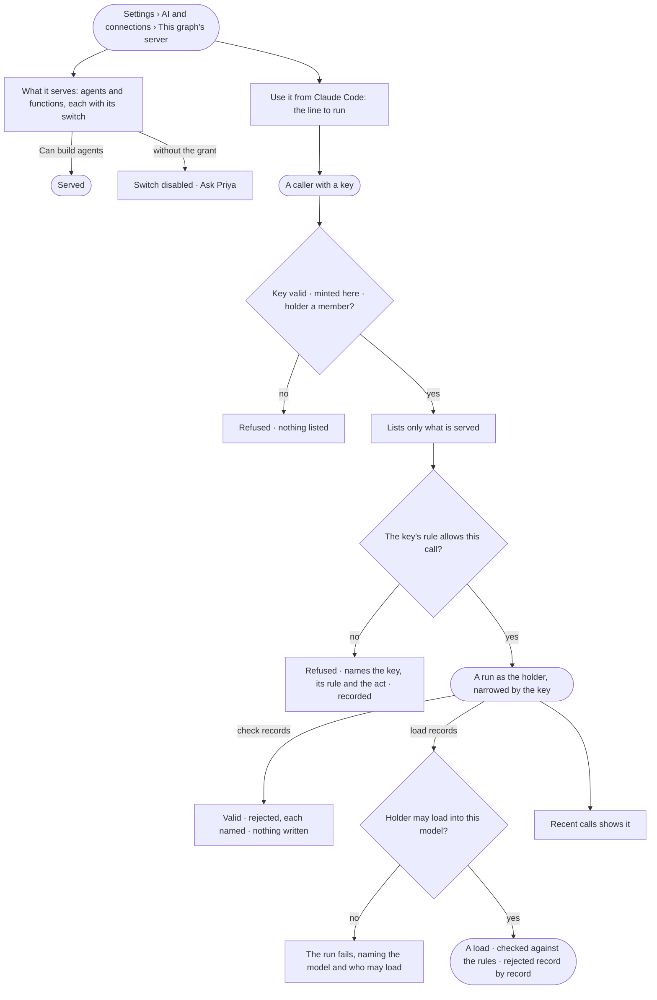

# RT-03 · Let Claude Code and other callers use this graph

**As** an agent builder or data curator **I want** Claude Code, any MCP client or a bot to use this Graph — check
records, load records into a model, ask an agent — with a key that reaches only what I said **so that** data arrives
without Invana pulling it, integrating never means handing over the keys, and every load is checked and can be undone.

Tasks: [task.md](task.md) · Feature: [RT-F02](../../feature.md)

## Who can

| Lens | Can | Otherwise sees |
|---|---|---|
| Admin | Serve or stop serving an agent or a function; read the address, the Claude Code line and recent calls | — |
| Operator | Read the address, what is served, the Claude Code line and recent calls; call the server with their own key (AC-10) | The served switches are disabled — *Ask Priya*, naming someone who can build agents. With *Can build agents*: serve and stop serving |

## Flow

## Acceptance criteria

| # | Given | When | Then |
|---|---|---|---|
| RT-03.1 | A member | they open *This graph's server* | its address, how to connect, what it serves with a switch each, the Claude Code line, and recent calls read |
| RT-03.2 | Nothing served yet | the page opens | every agent and function that may be served lists with its switch off, and recent calls says *No calls yet* with the line to connect |
| RT-03.3 | Someone who can build agents | they serve an agent or a function | a caller lists it from their next call — an agent as *ask* it, *Check records* and *Load records* by their tool names |
| RT-03.4 | An agent that is paused, retired or a draft | the served list is read | it cannot be served; a call to it is refused, naming its status |
| RT-03.5 | No key, a sign-in session, a revoked key, or a key minted in another Graph | a caller connects | it is refused, and nothing is listed |
| RT-03.6 | A key narrowed by its own rule | it calls a tool the rule does not allow | the call is refused, naming the key, its rule and the act; History records the refusal; no run opens |
| RT-03.7 | An allowed call | it is made | it is a run as the key's holder, narrowed by the key, recorded with the tool, the key and the client; an agent never does more than the key allows |
| RT-03.8 | *Check records* | it runs | it returns which records are valid and which are rejected, each with its reason, and writes nothing |
| RT-03.9 | *Load records* into one model by a holder allowed to load into it | it runs | it is a load (RC-F02): records that hold land, records that break a rule are rejected each with its reason, and the caller gets the load's id, content hash and counts |
| RT-03.10 | *Load records* by a holder not allowed to load into that model | it runs | the run fails, naming the model and who may load; nothing is written |
| RT-03.11 | An answer to an outside caller | it returns | every record carries where it came from; anything out of the key's reach is refused, never silently left out |
| RT-03.12 | A call | its run settles | recent calls shows when, caller and client, key, tool, its one-line result as the engine stored it, and the run |
| RT-03.13 | An Operator without *Can build agents* | they open the page | everything reads; the served switches are disabled — *Ask Priya*, naming someone who can build agents |

## Screens

| Surface | Lens | First use | Empty after a filter | Loading | Has data | Failed | Agent working or proposing | No access |
|---|---|---|---|---|---|---|---|---|
| This graph's server | Admin | settings.ai · Nothing served | — | settings.ai · Loading | settings.ai · This graph's server | settings.ai · Could not load | — | — |
| This graph's server | Operator | settings.ai · Nothing served | — | settings.ai · Loading | settings.ai · Read only | settings.ai · Could not load | — | settings.ai · Read only |
| Recent calls | Admin | settings.ai · No calls yet | — | settings.ai · Loading | settings.ai · Recent calls | settings.ai · Call refused | — | — |
| Recent calls | Operator | settings.ai · No calls yet | — | settings.ai · Loading | settings.ai · Recent calls | settings.ai · Call refused | — | settings.ai · Read only |
