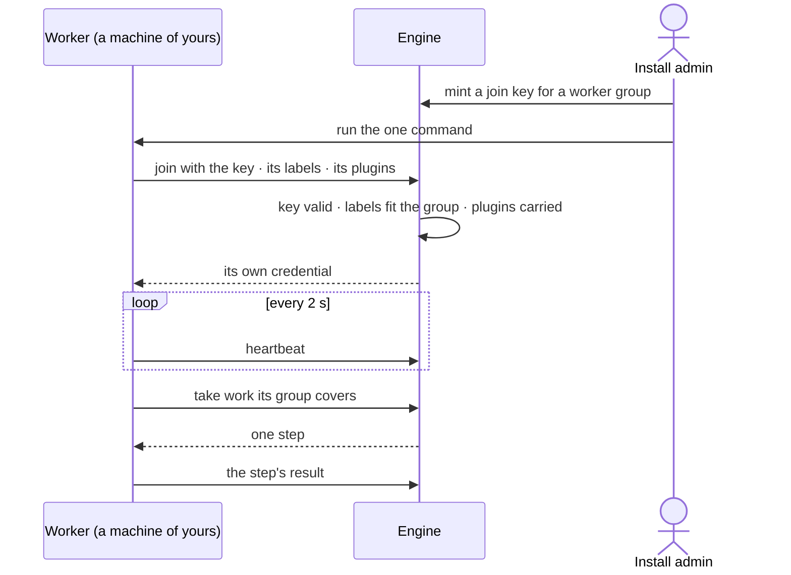

# Workers and the queue

> The machines that run agents' work and the order work is taken in — added and scaled by an install admin, read
> everywhere. The decision it helps make: *where is work waiting, and do we add workers or let it queue?*

## User journey

Journeys this feature is a step of: [J07 · Ready an install for its Graphs](../../../../journeys/J07-ready-an-install-for-its-graphs.md)

## Stories

| ID | Story | Status |
|---|---|---|
| RT-05 | [See where work is and why it waits](stories/RT-05-see-where-work-is-and-why-it-waits/story.md) | idea |
| RT-06 | [Questions go before batch work](stories/RT-06-questions-go-before-batch-work/story.md) | idea |
| RT-07 | [A lost coordinator costs seconds, not runs](stories/RT-07-a-lost-coordinator-costs-seconds-not-runs/story.md) | idea |
| RT-08 | [See how many workers each group needs](stories/RT-08-see-how-many-workers-each-group-needs/story.md) | idea |
| RT-09 | [See every worker and what it is running](stories/RT-09-see-every-worker-and-what-it-is-running/story.md) | idea |
| RT-10 | [Add workers on my own machines with one command](stories/RT-10-add-workers-on-my-own-machines-with-one-command/story.md) | idea |

## Access

| Act | Role (`.claude/team/TEAM.md` §7) | Everyone else sees |
|---|---|---|
| Read Workers — groups, workers, where work waits, coordinators, rate limits | Operator — every member | — |
| Add workers · make or change a worker group · mint and revoke join keys · drain a worker or a group | Admin | Each act disabled — *Install admins add and scale workers* |

## States

| State | What the person sees |
|---|---|
| First use | No workers: *Steps run inside the engine on this install. Add workers to run tool steps on other machines.* and *Add workers* |
| Empty after a filter | Workers filtered to a state none has: *No worker matches* |
| Loading | The section opens at once; rows fill in place |
| Has data | Each worker group with its workers, what each runs, where steps wait and how many workers would clear it |
| Failed | A join that failed, naming the check; a lost worker, with how many steps were handed on; a step no group covers, naming the missing label |
| Agent working or proposing | A run waiting names its position and what it waits behind |
| No access | Everything reads; every act is disabled — *Install admins add and scale workers* |

## Rules

| Rule | Detail |
|---|---|
| A run waiting is not a run running | It holds no slot, uses no worker and costs nothing |
| Questions go first | Work is taken in this order: a question someone waits on · a project task picked up · batch (schedules, sweeps, runs past twenty agents). Busy Graphs share the install equally; an idle Graph's share is lent |
| Waiting always says why | A waiting run names its position and what it waits behind — *a person is waiting* · *helper — counts as a run* · *schedule* — or the limit, the AI model's rate limit or the worker group |
| Agents never start machines | Workers are added and scaled by a person; Invana says where steps wait and how many workers would clear them |
| Work goes by labels | A step goes to a worker group whose labels cover what its function needs; a step no live group covers waits, naming the missing label, then fails |
| A worker dials out | Over HTTPS with its own credential; no inbound port, no database credential; it runs steps under the agent's access, never its own |
| A lost worker loses no work | No heartbeat for 30 s is lost; its steps go to another worker and run once |
| Join keys are shown once | Scoped to one worker group, with an expiry and a cap on how many may join; revoking stops new joins; draining stops a worker after what it holds |
| A library runs where it is installed | A library added in Agents (AG-F08) must be installed on the workers of the groups that run its functions; Workers shows which groups carry it |
| The engine counts | Every number on Workers and Usage — busy, waiting, oldest, suggested — is stored by the engine; Studio only shows it |
| Leans on | Limits (RT-F04) · runs (AG-F03) · plugins and outside tools (RT-F02) |

## Data touched

| Record | Read or write |
|---|---|
| Worker groups — name, runs on, labels, slots a worker, plugins, secret names, outbound domains | Read · write |
| Workers — state, what each runs, heartbeat | Read · write (drain) |
| Join keys | Write · read |
| Stored counts every 30 s — workers, busy, waiting, oldest, suggested | Read |
| Waiting and refused runs with their reasons (AG-F03) | Read |
| History rows of every limit, join, drain and revoke (AC-F06) | Write |

## Engine

The low-level design: what this feature stores, serves and refuses — the runtime that walks every run's plan and the
workers that run its steps. Conventions — naming, errors, lists, events — are
[system-design.md](../../../../system-design.md) §§ 6–8; this section only fills them in.

### Records

| Table | Columns | Notes |
|---|---|---|
| `runtime_worker_pools` | `name` · `runs_on` (`docker` · `python` · `kubernetes`) · `labels` (`cpu` · `llm` · `egress` · `gpu` · `code`) · `slots_per_worker` (4) · `plugins` · `secrets` (names only) · `egress` (outbound domains) · `min_workers` · `max_workers` · `set_by` (`hand` · `replicas`) · `replicas?` | A worker group; `name` unique on the install. `replicas` is what a person declared for a Kubernetes group — Invana never starts them |
| `runtime_workers` | `pool_id` · `name` · `node` · `version` · `labels` · `plugins` · `slots` · `slots_busy` · `cpu?` · `state` (`starting` · `busy` · `idle` · `draining` · `lost` · `stopped`) · `credential_hash` · `previous_credential_hash` · `credential_rotated_at` · `queue_worker_id` · `joined_via` · `joined_at` · `last_heartbeat_at` · `from_ip` · `redelivered` | One joined worker; `queue_worker_id` is the queue's own id for it |
| `runtime_worker_events` | `pool_id` · `worker_id?` · `change` (`joined` · `lost` · `drained` · `stopped` · `replicas` · `changed` · `revoked`) · `detail` · `why` · `actor_id?` · `at` | A group's changes, newest first; append-only |
| `runtime_worker_stats` | `pool_id` · `at` · `workers` · `starting` · `lost` · `slots` · `slots_busy` · `ready` · `oldest_s` · `envelopes` · `suggested` | Written every 30 s per group; every number Workers shows |
| `runtime_worker_logs` | `worker_id` · `at` · `level` · `line` | A worker's recent log, kept beyond its process; trimmed to the newest 1,000 lines a worker |
| `runtime_envelope_outcomes` | `idempotency_key` (`run_id:node_id:attempt`, the key) · `run_id` · `outcome` (`out` · `failure` · `needs_input` · `cannot_answer` · `converse`, with `_worker` — id · group · duration — and `_artifacts`) · `created_at` | A step's outcome as a worker posted it; the first one stands |
| `runtime_coordinators` | `id` · `host` · `pid` · `started_at` · `renewed_at` · `state` (`holding` · `standby` · `lost`) · `runs_held` | One row per engine process; the one `holding` hands out steps |

### Reads

| Record | Owner |
|---|---|
| Runs and their step rows — `cursor`, `lane` · `iteration` · `attempt`, `triggered_by`, `idem_key`, the stream a run writes | [AG-F03](../../../../capabilities/agents/features/AG-F03-runs-and-how-the-agents-are-doing/feature.md#engine) |
| The plan and its grammar, the check, the catalogue and a function's `resources` · `timeout_s` | [AG-F06](../../../../capabilities/agents/features/AG-F06-plans-and-functions/feature.md#engine) |
| What an agent may do — the envelope, its bounds and `requires_approval` | [AG-F01](../../../../capabilities/agents/features/AG-F01-build-an-agent/feature.md#engine) |
| Helper depth and chain depth | [AG-F05](../../../../capabilities/agents/features/AG-F05-delegation-and-outside-agents/feature.md#engine) |
| Admission, runs at once, capacity pools, rate-limit waits | [RT-F04](../RT-F04-limits/feature.md#engine) |
| Plugins a worker carries, their secrets | [RT-F02](../RT-F02-plugins-and-outside-tools/feature.md#engine) |
| Join keys — a service account's keys scoped to one group | [AC-F03](../../../access/features/AC-F03-groups-keys-and-holders/feature.md#engine) |
| Libraries a group must carry | [AG-F08](../../../../capabilities/agents/features/AG-F08-portable-agents-and-skills/feature.md#engine) |
| Pauses — approvals, clarifications, verdicts — and who answers | [AC-F05](../../../access/features/AC-F05-asks-and-approvals/feature.md#engine) |
| History rows of every join, mint, drain, revoke and group change | [AC-F06](../../../access/features/AC-F06-history/feature.md#engine) |

### Routes

| Route, install-wide, after `/api/v1/runtime/workers` | Does | Story |
|---|---|---|
| `GET /` | Each group: runs on, labels, workers, busy and total, steps waiting, the oldest and its state — keeping up · short · no workers | RT-09 |
| `POST /pools` · `PATCH /pools/{name}` | Make or change a worker group | RT-10 |
| `GET /pools/{name}/workers` | Its workers, filter `state` | RT-09 |
| `GET /pools/{name}/events` | Its changes, newest first | RT-09 |
| `POST /pools/{name}/drain` · `POST /{id}/drain` | Drain a group · a worker | RT-09 |
| `GET /{id}` | One worker — what it runs now, steps this hour, failures, recent log | RT-09 |
| `GET /capacity` | Per group: steps waiting, the oldest, workers, suggested, as last stored | RT-08 |
| `GET /work` | Runs by stage — started · admitted · running · waiting — each count as stored, each waiting run with its reason and how long; the order work is taken in and each Graph's share | RT-05 · RT-06 |
| `GET /coordinators` | Each coordinator, its state, the runs it holds, when it last renewed | RT-07 |
| `GET /join-keys` · `POST /pools/{name}/join-keys` · `POST /join-keys/{id}/revoke` | List keys (prefix, expiry, joined of cap, revoked) · mint one `{expires_at, cap}` → its secret once and the commands · revoke | RT-10 |
| `POST /join` · `POST /heartbeat` · `POST /lease` · `POST /outcome` | The worker's own: join with a key, labels and plugins → its credential · heartbeat · long-poll for one step (20 s) · post a step's outcome | RT-10 |

### Events

| Event | When |
|---|---|
| `runtime.worker_pools.create` · `.update` · `.drain` | A group is made, changed or drained |
| `runtime.workers.join` · `.lost` · `.drain` · `.stop` | A worker joins, goes silent, is drained, stops |
| `runtime.join_keys.mint` · `.revoke` | A join key is minted or revoked |
| `runtime.coordinators.takeover` | A coordinator's lease lapses and another takes its runs |

### Refusals

| Status | When | Sentence | Criterion |
|---|---|---|---|
| 403 | A group change, mint, revoke or drain by anyone but an install Admin | *Install admins add and scale workers.* | RT-08.7 · RT-09.10 · RT-10.10 |
| 409 | A group name already taken | *{name} is taken.* | RT-10.3 |
| 422 | Labels outside `cpu` · `llm` · `egress` · `gpu` · `code` | *{label} is not a worker label.* | RT-10.3 |
| 401 | A join with an expired, revoked or used-up key | *This join key {why}.* | RT-10.8 |
| 422 | A join whose labels the group does not allow, or missing the group's plugins | *{labels or plugins} do not fit {group}.* | RT-10.8 |
| 401 | A drained or stopped worker's credential | *This worker has stopped — join again.* | API only — the worker process reads it and exits |
| step failed | No live group carries a step's labels past its allowance — `transient · worker_unavailable` | *No worker took this — no group carries {label}. Add workers: {command}.* | RT-04.9 · RT-08.5 · RT-16.8 |
| step failed | A function `key@version` the process has not loaded — `defect · unknown_task_type` | *{key@version} is not loaded on {worker} — restart the workers with the engine.* | API only — an install fault named on the step |

### CLI

| Command | Does |
|---|---|
| `invana worker --engine --token --pool [--labels] [--slots] [--name]` | Join and run steps from the group's queues; env `INVANA_ENGINE_URL` · `INVANA_JOIN_TOKEN` · `INVANA_POOL` · `INVANA_LABELS` · `INVANA_SLOTS`; the image `invana/worker:<engine version>` runs the same |
| `invana worker install-service` | Prints a systemd or launchd unit for the same command |

### Mechanisms

| Mechanism | How |
|---|---|
| The runtime is a plan interpreter | It walks a checked plan, holds a frontier and honours the signals steps return; every kind of run — ask, import, bulk, stitch, model, canvas, data edit, enrich — runs here, and nothing downstream branches on kind. Nothing executes outside it |
| The frontier | A run's `cursor` — `done` · `running` · `settled` (step → outcome) · `lanes` (step → done · failed · total). A step is ready when every reachable predecessor has settled, at least one edge is satisfied (`success` · `failure` · `any_outcome`) and its `when` holds; every ready step dispatches, up to the lowest ceiling (RT-F04). The run ends when nothing is ready or running — a required step failed is `failed`, else `answered` or `cannot_answer` |
| Skip | A false `when` settles the step `skipped`, recording the predicate; downstream `success` edges are unsatisfied, `any_outcome` edges satisfied |
| Fan-out | One lane, one row; lanes retry independently. The step settles when every lane has: `fail` — any lane failing fails it · `fail_fast` — the first failure cancels the rest · `continue` — it succeeds and the failures are reported by lane, grouped by reason. Emissions merge in lane order. A declared `int` or `float` output sums over succeeded lanes, a `list` concatenates; `.lanes` · `.succeeded` · `.failed` · `.failed_lanes` bind on every fanned-out step |
| Loops | A `loop` node stays `running` while it iterates; each pass is an `iteration` row; `${self.previous}` · `${self.feedback}` · `${self.verdict}` bind inside it; downstream reads the last pass, or every pass under `accumulate`. A verdict loop pauses after each pass, once whatever its lanes |
| Signals | A step returns one of `next` · `repeat` (bounded by `retry.max_attempts`) · `back(id)` (the repair budget) · `replan` (the run's replan count) · `ask` · `approve` (before dispatch) · `judge` (after the pass) · `skip` · `stop(outcome)`. A signal past its bound becomes `stop(failed)`, naming the bound; exceptions are for faults |
| Pauses hold nothing | A run waiting on an answer, an approval or a verdict releases its slot and holds no worker; the deadline that ends a pause is `stop(failed)`, naming who was asked — never an auto-approval. A pause is an `agents_run_prompts` row (AG-F03) |
| Streamed signals | Each signal writes a frame — `step.retrying` · `step.skipped` · `plan.revised` · `run.awaiting_input` · `run.awaiting_approval` · `run.awaiting_verdict` — to the run's stream (AG-F03) |
| Cancellation | Cooperative: every step gets a cancel token and honours it at its await points; one that ignores it is cancelled at its `timeout_s`. Nothing new dispatches once a run is cancelling; cancelling cancels every descendant, each recorded; a cancelled child settles `cancelled` and its parent applies its edge rule |
| Resume | On restart or a coordinator takeover, a `running` step closes `interrupted` and re-dispatches as a new attempt if its retry allows, else fails the run with a diagnosis; the frontier resumes from the database |
| Opening a run | `triggered_by` `user` · `task` · `schedule` · `automation` (the automation and its event recorded) · `delegation` · `canvas` · `mcp` · `system`. The same call for every opener; the same `idem_key` twice in a Graph returns the existing run |
| Interactive runs | `run_inline` runs a committed run inside the caller's request — same plan, view, stream and trace, admission still applied; under contention a `canvas` run waits with a `user` run's precedence and a `system` run with a schedule's. Their cost is measured — runs a minute a person, rows and bytes a run, latency added, the window anyone reads — and turned down in order: coarser steps · shorter retention · prune steps and stream, keep the row · reference the plan and view, not copy them |
| A step travels as an envelope | `TaskEnvelope` — `run_id` · `node_id` · `attempt` · `plugin` (`name@version`) · `task` (`key@version`) · `args` (resolved, JSON only) · `graph_id?` · `lens_id?` · `actor_id?`. No session, connection or secret rides it; the worker rebuilds the step's context from ids with the same `run_vars` the interpreter uses |
| `run_envelope()` is the one call | In-process and on every worker; it applies `timeout_s` (`transient · task_timeout`); a `key@version` not loaded is `defect · unknown_task_type` before any context opens |
| Idempotency | The key is `run_id:node_id:attempt`; redelivery keeps it, a retry the coordinator decides changes it; a key already in `runtime_envelope_outcomes` returns that outcome and runs nothing |
| Wire forms | A worker's outcome crosses as tagged JSON: `out` (every output field) · `failure` (`cls` · `cause` · `message` · `short` · `evidence` · `raw`) · `needs_input` (`question` · `options` · `descriptions`) · `cannot_answer` (`reason` · `exchange`) · `converse` (`reply` · `options` · `exchange`). Anything else, or an exception the worker cannot name, is `defect · worker_error` |
| Outcomes come back through a row | The queue keeps no result: the engine writes what a worker posts; the waiting process polls it (250 ms, backing off to 1 s) and raises the failure or signal as in-process |
| The worker owns its transaction | It commits when the function returns, rolls back when it raises; it settles the step's row through the engine |
| In-process by default | `INVANA_EXECUTOR` — `procrastinate` (default with PostgreSQL) sends steps to the queue · `inline` calls `run_envelope` in the API process. procrastinate is the `workers` extra, on the app's PostgreSQL, its tables applied by `invana migrate`; with any other database the engine refuses to start, naming `INVANA_EXECUTOR=inline` |
| What stays in-process | A step that hands over through run vars rather than declared outputs — the import stages, the question-answering chain — runs in the engine until that state is an output |
| Join | Checked in order — key, group, labels, plugins — and refused, making no worker, with the reason. A joined worker gets `invana_wkr_…`, stored as sha256, rotated hourly; the previous one stays valid until the next heartbeat |
| Heartbeat and loss | Every 2 s. A sweep every 5 s marks a worker silent 30 s `lost` and requeues its steps under the same idempotency key; a lost worker that heartbeats again is revived under a new `queue_worker_id` and runs none of them |
| Drain | A draining worker takes no new step; when it reports no busy slot it is `stopped` and its credential refused |
| Queues | A step's queue is `tools.<labels>` — its function's `resources`, sorted and joined by `+` (`tools.cpu`, `tools.cpu+gpu`) — one per label set and step class; a worker leases from every queue its labels cover. The step's frames land in the run's stream by run id |
| The order work is taken | A question someone waits on · a project task picked up · batch (schedules, sweeps, runs past twenty agents); within a class first in, first served; a delegated child takes its parent's class. Busy Graphs share the install equally; an idle Graph's share is lent. Position is stored and readable |
| Suggested | Steps ready ÷ steps a worker took over the last ten minutes, written to `runtime_worker_stats` every 30 s; clamped to the group's `min_workers` · `max_workers` and to each Graph's worker-seconds. A step waiting on an AI model's rate limit is not counted |
| Idle drain | A worker idle 5 minutes in a group above its `min_workers` is drained, then stopped; a person starts every machine |
| No group carries the label | Past the step's limit plus the queue-wait allowance, the step fails `transient · worker_unavailable`, naming the label and the command that adds a worker; the envelope stays queued |
| A worker dials out | It long-polls `POST /lease` over HTTPS with its own credential: no inbound port, no database credential. It resolves only the secrets its step's function declares |
| One coordinator | The engine process whose `runtime_coordinators` row is `holding` hands out steps, renewing every 5 s; a lease unrenewed for 15 s lapses, another process takes it, woken by `LISTEN/NOTIFY`, and the lost one's runs resume from their last settled step |
| Artifacts stay at home | A remote worker keeps artifacts in its own network; the engine holds each one's digest (AG-F03) |

## System impact

| HLD section | Change | NFRs |
|---|---|---|
| § 6 Data and storage | Seven runtime tables; procrastinate's queue tables on the app's PostgreSQL | — |
| § 7 Architecture and components | The runtime (planner, interpreter, executor) in the engine; workers as optional processes that dial out | — |
| § 8 APIs and events | `/api/v1/runtime/workers` routes, the worker's own four, and `runtime.workers.*` events | — |
| § 9 Distributed execution | Steps as envelopes over a procrastinate queue; one coordinator by lease; outcomes through a row; redelivery under one idempotency key; workers by label | — |
| § 11 Failure modes and the outside boundary | A lost worker requeues its steps; a lost coordinator's runs move on; no worker for a label fails, never hangs | — |
| § 12 Qualities | Security: workers hold no database credential and no inbound port; secrets never ride an envelope | — |

## Decisions

| Decision | Detail |
|---|---|
| Workers is Settings › Invana | One section with Workers · Where work waits · Join keys; a worker group or a worker opens in place, with a breadcrumb; Add workers is a modal |
| Worker groups are the install's | An Admin assigns each Graph the groups it may use; a heavy Graph gets its own, others share |
| Suggested is the engine's | Steps ready ÷ steps a worker took over the last ten minutes, every 30 s |
| Every group is scaled by hand | Docker, Python or Kubernetes; Invana never starts a machine and holds no cloud keys |
| Scale-out keeps its pools, not an autoscaler | Pools carry the labels `cpu` · `llm` · `egress` · `gpu` · `code`, with one queue per label and step class (a question · a project task · batch). The engine's desired-workers figure — steps ready ÷ steps a worker runs at once — is clamped to the pool's min and max and to the Graph's worker-second quota; a worker idle 5 minutes is drained, then stopped. A person adds every machine; the engine shape is [Engine](#engine) |

## Open questions

| Question | Who answers |
|---|---|
| RT-05 · RT-06 · RT-07 · RT-12 · RT-13 come from a scale-out proposal still under review (durable runs, coordinators, admission, the AI-model rate limiter). Recommend: keep them at `idea` until Ravi accepts the proposal; the rest of the feature stands without them | Ravi |
| Where does *Where work is* (RT-05) draw — a tab of Workers, or each run in Inbox › Running? Recommend: a tab of Workers for the install; a run's own wait on its run | Ravi |

## Not building

| Item | Why not |
|---|---|
| Autoscaling, cloud APIs, a Helm chart | A person adds workers; Invana says how many |
| KEDA or EC2 Auto Scaling applying the desired-workers figure | Every group is scaled by hand; Invana holds no cloud credentials |
| Coordinator replicas — `invana start --role orchestrator` | One coordinator holds the lease (RT-07); a second role is a second thing to run and watch |
| A deployment shape per mode — laptop, compose, Kubernetes with Jobs | One image and one command run every shape; workers are added the same way everywhere (RT-10) |
| Agents asking for workers or starting machines | A person adds and scales workers |
| Pinning an agent or a run to a worker | Work goes per step, by labels |
| Priority weights per agent · stopping a running run to make room | A weight nobody can explain makes an order nobody can predict; a half-run agent leaves work nobody can account for |
| One-shot containers, a Claude Code runtime | Claude Code reaches a Graph over its MCP server (RT-03) |
| Access rules on workers | Workers run any agent's steps; access belongs to the agent |
| Keeping workers near a cache | An optimisation for later |
