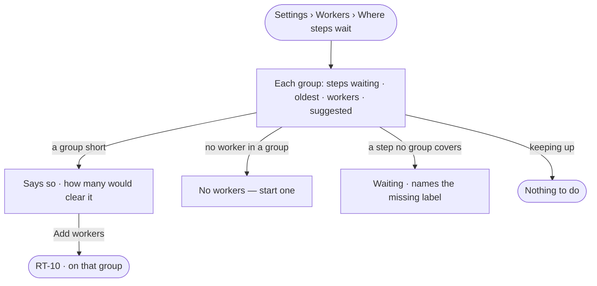

# RT-08 · See how many workers each group needs

**As** an install admin **I want** each worker group's steps waiting, the oldest, and how many workers would clear
them **so that** I add workers where they are short, without Invana holding cloud keys.

Tasks: [task.md](task.md) · Feature: [RT-F03](../../feature.md)

## Who can

| Lens | Can | Otherwise sees |
|---|---|---|
| Admin | Read where steps wait; *Add workers* on a short group | — |
| Operator | Read where steps wait and how many workers would clear them | *Add workers* disabled — *Install admins add and scale workers* |

## Flow

## Acceptance criteria

| # | Given | When | Then |
|---|---|---|---|
| RT-08.1 | A member | they open *Where steps wait* | each worker group reads steps waiting, the oldest, its workers and how many are suggested, as the engine stored them every 30 s |
| RT-08.2 | A group with more steps waiting than its workers take | it is read | it says it is short and how many workers would clear it — steps waiting ÷ steps a worker took over the last ten minutes |
| RT-08.3 | A short group | the Admin presses *Add workers* | Add workers opens on that group (RT-10) |
| RT-08.4 | A group with no worker | it is read | it says *no workers — start one*, and a run waiting on it names the group |
| RT-08.5 | A step whose labels no live group covers | it waits | it is named, with the missing label, and fails when its wait runs out |
| RT-08.6 | Any group | Invana suggests workers | nothing starts a machine; a person adds them |
| RT-08.7 | An Operator | they open Where steps wait | everything reads; *Add workers* is disabled — *Install admins add and scale workers* |

## Screens

| Surface | Lens | First use | Empty after a filter | Loading | Has data | Failed | Agent working or proposing | No access |
|---|---|---|---|---|---|---|---|---|
| Where steps wait | Admin | settings.workers · No workers | — | settings.workers · Loading | settings.workers · Where steps wait | settings.workers · Short of workers | — | — |
| Where steps wait | Operator | settings.workers · No workers | — | settings.workers · Loading | settings.workers · Where steps wait | settings.workers · Short of workers | — | settings.workers · Read only |
