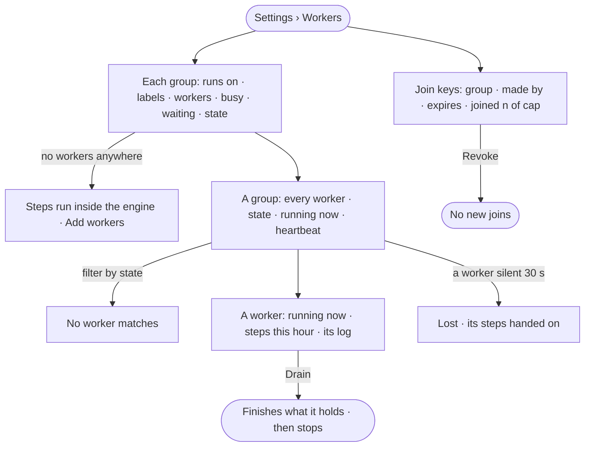

# RT-09 · See every worker and what it is running

**As** an install admin **I want** every worker in every group, what each is running, and where steps wait for want of
workers **so that** I add workers where they are short and drain the ones I am retiring.

Tasks: [task.md](task.md) · Feature: [RT-F03](../../feature.md)

## Who can

| Lens | Can | Otherwise sees |
|---|---|---|
| Admin | Read every group and worker; drain a worker; revoke a join key | — |
| Operator | Read every group and worker and what each runs | *Drain* and *Revoke* disabled — *Install admins add and scale workers* |

## Flow

## Acceptance criteria

| # | Given | When | Then |
|---|---|---|---|
| RT-09.1 | A member | they open *Workers* | each group reads what it runs on, its labels, workers, busy and total, steps waiting, the oldest and its state — keeping up · short · no workers |
| RT-09.2 | An install with no workers | Workers opens | it says steps run inside the engine on this install and offers *Add workers* |
| RT-09.3 | A group | it opens | each worker reads its state — busy · idle · starting · lost · draining — what it is running now (function · run · agent), its heartbeat's age and how long it has been up |
| RT-09.4 | A filter by state that matches none | it is applied | *No worker matches* shows with *Clear filter* |
| RT-09.5 | A worker | it opens | what it runs now, its steps this hour and failures, and its recent log read |
| RT-09.6 | A worker silent for 30 s | it is read | it reads lost, with how many steps were handed to another worker; each runs once |
| RT-09.7 | An Admin | they drain a worker | it takes no new work, finishes what it holds, then stops |
| RT-09.8 | An Admin | they revoke a join key | no new worker joins with it; joined workers keep running |
| RT-09.9 | Every number on Workers | it is read | it is the engine's, stored every 30 s; a change against last week reads `—` when nothing was measured |
| RT-09.10 | An Operator | they open Workers | everything reads; *Drain* and *Revoke* are disabled — *Install admins add and scale workers* |

## Screens

| Surface | Lens | First use | Empty after a filter | Loading | Has data | Failed | Agent working or proposing | No access |
|---|---|---|---|---|---|---|---|---|
| Workers | Admin | settings.workers · No workers | — | settings.workers · Loading | settings.workers | settings.workers · Could not load | — | — |
| Workers | Operator | settings.workers · No workers | — | settings.workers · Loading | settings.workers · Read only | settings.workers · Could not load | — | settings.workers · Read only |
| A group | Admin | — | settings.workers · No worker matches | settings.workers · Loading | settings.workers · Group | settings.workers · Worker lost | — | — |
| A group | Operator | — | settings.workers · No worker matches | settings.workers · Loading | settings.workers · Group · Read only | settings.workers · Worker lost | — | settings.workers · Read only |
| A worker | Admin | — | — | settings.workers · Loading | settings.workers · Worker | settings.workers · Worker lost | — | — |
| A worker | Operator | — | — | settings.workers · Loading | settings.workers · Worker · Read only | settings.workers · Worker lost | — | settings.workers · Read only |
