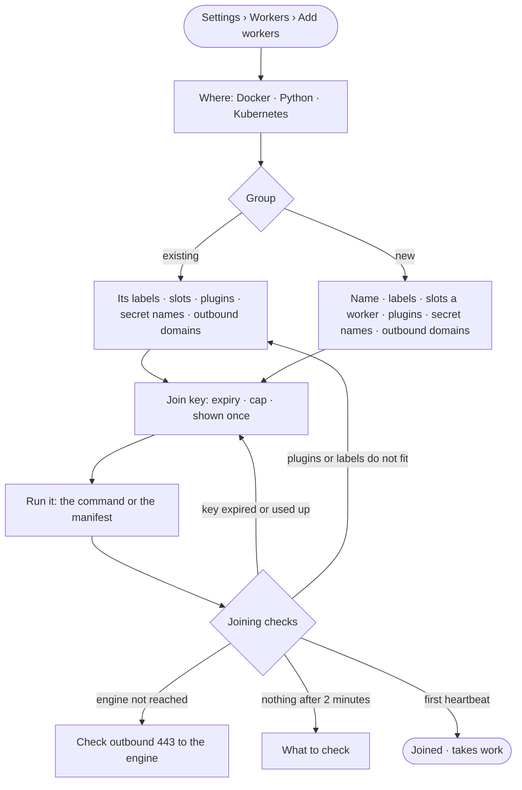

# RT-10 · Add workers on my own machines with one command

**As** an install admin **I want** to add workers on my own machines with one command, and watch them join **so that**
capacity is a command away, not a code change.

Tasks: [task.md](task.md) · Feature: [RT-F03](../../feature.md)

## Who can

| Lens | Can | Otherwise sees |
|---|---|---|
| Admin | Add workers: pick where, a group (or make one), mint a join key, run the command, watch it join | — |
| Operator | — | *Add workers* disabled — *Install admins add and scale workers* |

## Flow

## Acceptance criteria

| # | Given | When | Then |
|---|---|---|---|
| RT-10.1 | An Admin | they press *Add workers* | a modal opens on *Where*, Docker first, then *Group*, *Join key*, *Run it*, *Joined* |
| RT-10.2 | *Add workers* from a short group | it opens | that group is chosen |
| RT-10.3 | A new group | it is made | it has a name unique on the install, labels from `cpu · llm · egress · gpu · code`, slots a worker, plugins, secret names and outbound domains |
| RT-10.4 | A join key | it is minted | it is scoped to the group, with an expiry and a cap; its secret shows once, in the command; afterwards only its prefix reads |
| RT-10.5 | *Run it* | it is read | Docker reads one `docker run` line; Python an install and one command, and a service install; Kubernetes three lines and a manifest to download — each carrying the group, labels and slots |
| RT-10.6 | A worker joining | each check passes or fails | key used · engine reached · plugins loaded · labels fit · first heartbeat show as they happen, each failure with what to check |
| RT-10.7 | Nothing after two minutes | *Joined* waits | a checklist of what to check reads |
| RT-10.8 | A refused join — expired or used-up key, labels outside the group, plugins missing | the worker tries | no worker is made, and the worker is told the reason |
| RT-10.9 | A joined worker | it heartbeats | it takes work its group covers, holding no database credential and no inbound port |
| RT-10.10 | An Operator | they look for *Add workers* | it is disabled — *Install admins add and scale workers* |
| RT-10.11 | A key minted or a worker joined | it is done | History records who and when (AC-F06) |

## Screens

| Surface | Lens | First use | Empty after a filter | Loading | Has data | Failed | Agent working or proposing | No access |
|---|---|---|---|---|---|---|---|---|
| Add workers | Admin | settings.workers · Add workers | — | settings.workers · Waiting to join | settings.workers · Joined | settings.workers · Join failed | — | — |
| Add workers | Operator | — | — | — | — | — | — | settings.workers · Read only |
