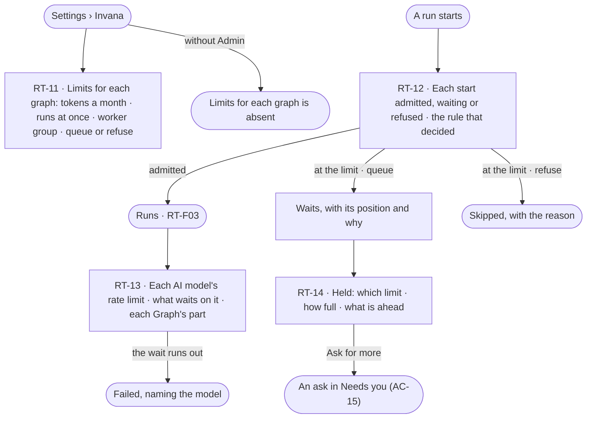

# Limits

> What each Graph may spend and how many runs it may have going — set once by an install admin, read everywhere — and
> why a run started, waits or was refused. The decision it helps make: *do we raise a Graph's limit, or let it queue?*

## User journey

Journeys this feature is a step of: [J07 · Ready an install for its Graphs](../../../../journeys/J07-ready-an-install-for-its-graphs.md)

## Stories

| ID | Story | Status |
|---|---|---|
| RT-11 | [Set each graph's tokens, runs at once and workers](stories/RT-11-set-each-graphs-tokens-runs-at-once-and-workers/story.md) | idea |
| RT-12 | [See why a run started, waits or was refused](stories/RT-12-see-why-a-run-started-waits-or-was-refused/story.md) | idea |
| RT-13 | [See each AI model's rate limit and what waits on it](stories/RT-13-see-each-ai-models-rate-limit-and-what-waits-on-it/story.md) | idea |
| RT-14 | [Know why my run is held and ask for more](stories/RT-14-know-why-my-run-is-held-and-ask-for-more/story.md) | idea |

## Access

| Act | Role (`.claude/team/TEAM.md` §7) | Everyone else sees |
|---|---|---|
| Read this Graph's limits | Operator — every member (GR-14) | — |
| Set each Graph's tokens a month, runs at once, worker group and *queue or refuse* | Admin | *Limits for each graph* is absent |
| Ask for a higher limit from a held run | The person who started the run | — |
| Allow that ask | Admin, in Needs you (AC-15) | As AC-F05 |

## States

| State | What the person sees |
|---|---|
| First use | Every Graph on the default limits |
| Empty after a filter | — no filter on this surface |
| Loading | The section opens at once; rows fill in place |
| Has data | Each Graph's limits; each start admitted, waiting or refused with the rule that decided; each AI model's rate limit and what waits on it |
| Failed | A run refused at the limit, naming the limit; a rate-limit wait that ran out, naming the model |
| Agent working or proposing | A run held by a limit says which, how full, and what is ahead, with *Ask for more* |
| No access | Everything reads but *Limits for each graph*, which only an Admin sees |

## Rules

| Rule | Detail |
|---|---|
| Limits are set once, read everywhere | An Admin sets each Graph's tokens a month, runs at once, worker group and *queue or refuse*; the Graph reads them in Usage and limits and never changes them |
| At the limit, the Graph's policy decides | *Queue* — the run waits, with its position and why; *refuse* — the firing is recorded as skipped, with the reason. The default is four at once, queue |
| An agent at its own limit is refused, not queued | And told about its own limit before the Graph's |
| Tokens are held before a call | The engine sets aside a call's most tokens before it runs and returns what it did not spend, so calls at once never pass a limit; Allow never passes one ([Allow never passes a limit](../../../access/product.md#decisions)) |
| Helpers never make room | A helper an agent makes draws on the same runs at once as its parent |
| A run's sub-tasks are bounded by its agent | An agent's sub-tasks stop at its own depth (2 levels by default), count (12 in all) and tokens a run — the limits whoever can build agents sets on it (AG-F01); the install adds none. People's sub-tasks have no limit |
| A rate limit is a wait, not a failure | Backed off and shown as waiting; a failure only when the wait runs out, naming the model |
| Leans on | Workers and the queue (RT-F03) · this Graph's usage (GR-F04) · asks (AC-F05) · runs (AG-F03) |

## Data touched

| Record | Read or write |
|---|---|
| Each Graph's limits — tokens a month, runs at once, policy, worker groups | Read · write |
| Waiting and refused runs with their reasons (AG-F03) | Read |

## Engine

The low-level design: what this feature stores, serves and refuses. Conventions — naming, errors, lists, events — are
[system-design.md](../../../../system-design.md) §§ 6–8; this section only fills them in.

### Records

| Table | Columns | Notes |
|---|---|---|
| `runtime_graph_limits` | `graph_id` (unique) · `monthly_tokens` · `max_concurrent_runs` (4) · `policy` (`queue` · `refuse`) · `pools[]` (the worker groups it may use) · `worker_seconds?` · `updated_by_id` · `updated_at` | Each Graph's limits; a new Graph gets the defaults. The Graph never writes it |
| `runtime_capacity_pools` | `graph_id` · `name` · `slots` | Named capacity inside a Graph; unique (`graph_id`, `name`); `llm` (20) · `graphdb` (50) · `heavy` (4) ship. Who waits on which, with position, is read — never stored twice |
| `runtime_llm_rate_limits` | `llm_id` · `requests_per_minute` · `tokens_per_minute` | One row per offered model version that has a limit |
| `runtime_limit_grants` | `graph_id` · `limit` (`monthly_tokens` · `max_concurrent_runs` · `worker_seconds`) · `value` · `run_id?` · `until?` · `ask_id` · `granted_by_id` · `granted_at` | A raise an Admin allowed from *Ask for more*: for one run, until a date, or — *always* — written to `runtime_graph_limits` instead |

### Reads

| Record | Owner |
|---|---|
| Runs — `status`, `queued_at`, `triggered_by`, tokens, the reason a run waits | [AG-F03](../../../../capabilities/agents/features/AG-F03-runs-and-how-the-agents-are-doing/feature.md#engine) |
| An agent's own limits — `max_concurrent_runs`, `max_tokens_run`, `max_tokens_month`, `max_depth`, `max_descendants`, `max_fanout` — and their refusal | [AG-F01](../../../../capabilities/agents/features/AG-F01-build-an-agent/feature.md#engine) |
| Limits on an access rule — the tightest binds | [AC-F02](../../../access/features/AC-F02-access-rules/feature.md#engine) |
| The ask *Ask for more* raises and its answer | [AC-F05](../../../access/features/AC-F05-asks-and-approvals/feature.md#engine) |
| Worker groups, the queue order and suggested workers | [RT-F03](../RT-F03-workers-and-the-queue/feature.md#engine) |
| Model versions a rate limit sits on | [RT-F01](../RT-F01-ai-models/feature.md#engine) |
| An agent's sub-tasks and their refusal | [PJ-F01](../../../../capabilities/projects/features/PJ-F01-projects-and-tasks/feature.md#engine) |
| History rows of every limit change and grant | [AC-F06](../../../access/features/AC-F06-history/feature.md#engine) |

### Routes

| Route, after `/api/v1/u/{u}/{g}/runtime` | Does | Story |
|---|---|---|
| `GET /limits` | This Graph's limits, any grant in force, and its spend this month — every member reads | RT-11 |
| `GET /contention` | `ceiling` · `policy` · `running` (run ids) · `queued` (`run_id` · `position` · `triggered_by` · `queued_at` · `reason`) · `running_count` · `queued_count` · `pools` — every capacity pool with `size` and `in_use`, idle ones included | RT-12 · RT-14 |
| `GET /starts` | Each start — admitted, waiting or refused — with the rule that decided it, newest first | RT-12 |
| `POST /limits/asks` | *Ask for more* from a held run `{run_id, limit, span (run · days · always), days?}` → an ask in Needs you | RT-14 |

| Route, install-wide, after `/api/v1/runtime` | Does | Story |
|---|---|---|
| `GET /limits` · `PUT /limits/{graph_id}` | Every Graph's limits and spend · set one Graph's `monthly_tokens` · `max_concurrent_runs` · `policy` · `pools` | RT-11 |
| `GET /llm-limits` · `PUT /llm-limits/{llm_id}` | Each offered model version's rate limit, how much is used, steps waiting on it and each Graph's part · set one | RT-13 |

### Events

| Event | When |
|---|---|
| `runtime.limits.update` | An Admin sets a Graph's limits — old and new |
| `runtime.limits.grant` | An ask for more is allowed, with its span |
| `runtime.runs.queue` · `.admit` · `.refuse` | A start waits, is admitted, or is refused — naming the bound (`graph` · `agent` · `pool`) |
| `runtime.pools.saturated` | A capacity pool has had no free slot for a stated interval |
| `runtime.llms.wait` | A step waits on a model version's rate limit, naming it |

### Refusals

| Status | When | Sentence | Criterion |
|---|---|---|---|
| 403 | Setting a Graph's limits, or a model's rate limit, by anyone but an install Admin | *Only an Admin sets limits.* | RT-11.10 |
| run skipped | A start at the Graph's runs at once, policy `refuse` | *Skipped — {graph} is at {n} runs at once.* | RT-11.5 |
| run held | A Graph at its tokens a month — an agent's run | *{graph} has used its {n} tokens this month.* | RT-11.9 |
| step failed | A rate-limit wait that runs out | *{model} stayed at its rate limit past {wait}.* | RT-13.3 |
| step refused | A step needing more slots than its pool has | *{step} needs {n} slots — {pool} has {size}.* | API only — a plan is checked before it runs, and the refusal reads on the run's Plan step (AG-18.17) |
| 403 | *Ask for more* by anyone but the person who started the run | *Only {person} can ask for more for this run.* | RT-14.6 |

### CLI

| Command | Does |
|---|---|
| — | No command of its own; limits are set in Settings or through the routes |

### Mechanisms

| Mechanism | How |
|---|---|
| Admission | At a run's start, in order: access (AC-F02) · the view or the key's rule · the agent's `max_concurrent_runs` — refused, never queued (AG-21.32) · the Graph's `max_concurrent_runs` — `queue` or `refuse` by `policy` · the Graph's `monthly_tokens`. Each outcome is a `runtime.runs.*` event and a row of `GET /starts`; waiting is never a refusal |
| A slot | Counted at admission for the agent, the Graph and each capacity pool; a waiting or paused run holds none. Lowering a limit below what runs stops new starts until the count is under it |
| A helper's slot | Counted against its parent's Graph and agent like any run; its wait or refusal carries `parent_run_id` |
| A run's sub-tasks | Checked when a run writes a sub-task: levels below the run's task against `max_depth`, the run's sub-tasks in all against `max_descendants`, tokens against `max_tokens_run`; one past any is PJ-F01's 422, and the run carries on |
| Capacity pools | A step declares its pool and `pool_slots` (default 1; the function gives the default pool). A slot is taken after the view has passed and released when the crossing ends; any left are swept when the run settles. Slots go round-robin across runs, then by the order work is taken (RT-F03); the lowest of pool · step `max_parallel` · run · agent · Graph wins. A pool never spans Graphs |
| Holding tokens | A call's `max_tokens` is held against the run, the agent's month and the Graph's month before it is sent, and the unspent part returned when it settles |
| Rate limits are backpressure | Per model version, requests and tokens a minute: a step that would pass the bucket waits before dispatch, `queued`, holding no slot and no worker, and is not counted in suggested workers; past its wait it fails naming the model |
| A month | `monthly_tokens` counts the Graph's runs since 00:00 UTC on the first of the month; at it, an agent's run waits *held*, a person's question still answers |
| A run past twenty agents | Checked before admission: its projected tokens and agents show on its start before it is let in |
| Ask for more | Raises an AC-F05 ask to every install Admin naming the run, the limit, how full it is and the span; allowed, it writes a grant (or the limit for *always*) and the held run is admitted; declined, the run keeps waiting and says so |
| Admission survives a restart | Queued runs and their positions are rows; the coordinator that takes over (RT-F03) re-admits them in order |

## System impact

| HLD section | Change | NFRs |
|---|---|---|
| § 6 Data and storage | Four tables: each Graph's limits, capacity pools, model rate limits, grants | — |
| § 8 APIs and events | Graph and install-wide limit routes; `runtime.limits.*` · `runtime.runs.*` · `runtime.pools.saturated` · `runtime.llms.wait` events | — |
| § 9 Distributed execution | Admission and slots at the coordinator; a waiting run holds nothing; rate limits wait before dispatch | — |
| § 10 AI and agents | Tokens are held before each call; a run's sub-tasks are bounded by its agent's depth, count and tokens | — |
| § 12 Qualities | Cost: every limit in tokens; Allow never passes a limit | — |

## Decisions

| Decision | Detail |
|---|---|
| Limits for each graph sit with Usage | An Admin reads them under *Usage and limits*; nobody else sees the table |
| Sub-tasks reuse the agent's helper limits | Depth and count of an agent's sub-tasks are its `max_depth` and `max_descendants`; one set of numbers bounds what an agent spawns, helpers or sub-tasks |

## Open questions

| Question | Who answers |
|---|---|
| RT-12 · RT-13 wait on the scale-out proposal with RT-05 · RT-06 · RT-07 ([RT-F03 › Open questions](../RT-F03-workers-and-the-queue/feature.md#open-questions)); the rest of the feature stands without them | Ravi |

## Not building

| Item | Why not |
|---|---|
| A Graph raising its own limits | The install controls cost and capacity |
| Budgets or runs at once set per agent by a Graph | Spend is per Graph; a Graph shapes its agents through access |
| A limit per project | The Graph owns the database connection |
