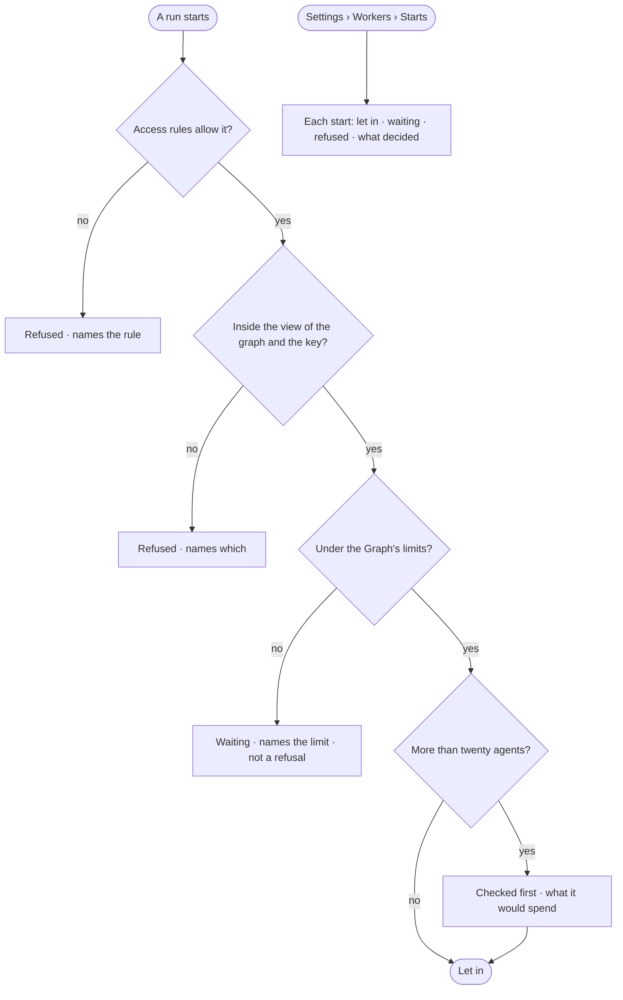

# RT-12 · See why a run started, waits or was refused

**As** an install admin **I want** every start let in, waiting or refused, with the rule that decided **so that** letting
work in is something I can explain.

Tasks: [task.md](task.md) · Feature: [RT-F04](../../feature.md)

## Who can

| Lens | Can | Otherwise sees |
|---|---|---|
| Admin | Read every start and what decided it | — |
| Operator | Read every start and what decided it | — |

## Flow

## Acceptance criteria

| # | Given | When | Then |
|---|---|---|---|
| RT-12.1 | A member | they open *Starts* | each start reads as let in, waiting or refused, with what decided it |
| RT-12.2 | A start no access rule allows | it is decided | it is refused, naming the rule (AC-F02) |
| RT-12.3 | A start outside the view of the graph or the key's rule | it is decided | it is refused, naming which |
| RT-12.4 | A start over a Graph's limit | it is decided | it waits, naming the limit; waiting is never a refusal |
| RT-12.5 | A run of more than twenty agents | it starts | it is checked first, showing what it would spend, before it is let in |
| RT-12.6 | No starts yet | the list opens | it says nothing has started |

## Screens

| Surface | Lens | First use | Empty after a filter | Loading | Has data | Failed | Agent working or proposing | No access |
|---|---|---|---|---|---|---|---|---|
| Starts | Admin | settings.workers · Nothing running | — | settings.workers · Loading | settings.workers · Starts | settings.workers · Could not load | — | — |
| Starts | Operator | settings.workers · Nothing running | — | settings.workers · Loading | settings.workers · Starts | settings.workers · Could not load | — | — |
