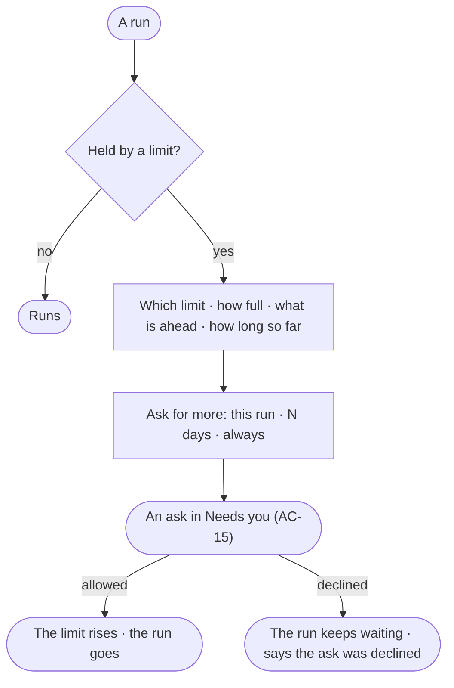

# RT-14 · Know why my run is held and ask for more

**As** an agent builder **I want** a run held by a limit to say which limit, how full it is and what is ahead of it,
and to ask for more from there **so that** waiting is never a mystery.

Tasks: [task.md](task.md) · Feature: [RT-F04](../../feature.md)

## Who can

| Lens | Can | Otherwise sees |
|---|---|---|
| Admin | Read why any run is held; allow an ask for more in Needs you | — |
| Operator | Read why their run is held; *Ask for more* on a run they started | *Ask for more* is absent on a run someone else started |

## Flow

## Acceptance criteria

| # | Given | When | Then |
|---|---|---|---|
| RT-14.1 | A run held by a limit | it is opened | it says which limit — the Graph's runs at once, its tokens a month, an AI model's rate limit, or workers — how full it is, and what is ahead of it |
| RT-14.2 | A held run | it is read | it says how long it has waited; waiting is never shown as failed |
| RT-14.3 | The person who started it | they press *Ask for more* | they pick this run · N days · always, and an ask reaches Needs you (AC-15) |
| RT-14.4 | The ask allowed | an Admin allows it | the limit rises for that span and the run goes |
| RT-14.5 | The ask declined | an Admin declines it | the run keeps waiting and says the ask was declined |
| RT-14.6 | A run someone else started | an Operator opens it | why it is held reads; *Ask for more* is absent |

## Screens

| Surface | Lens | First use | Empty after a filter | Loading | Has data | Failed | Agent working or proposing | No access |
|---|---|---|---|---|---|---|---|---|
| A held run | Admin | — | — | agents.run · Loading | agents.run · Held by a limit | agents.run · Ask declined | agents.run · Held by a limit | — |
| A held run | Operator | — | — | agents.run · Loading | agents.run · Held by a limit | agents.run · Ask declined | agents.run · Held by a limit | agents.run · Read only |
