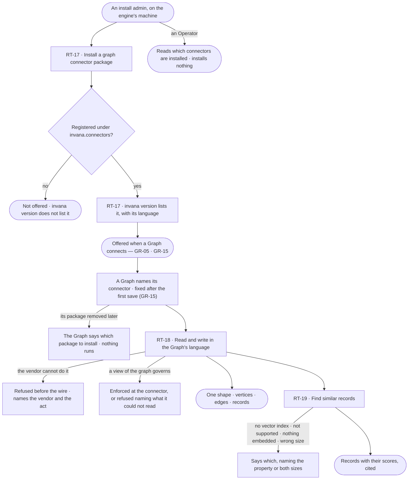

# Graph database connectors

> The packages that let a Graph speak to its graph database — one per database, installed beside the engine, each
> registering itself by name — and what every Graph can then read, write and search, whatever the vendor. The
> decision it helps make: *which databases can this install serve, and what can each of them do?*

## User journey

Journeys this feature is a step of: [J01 · From an empty install to a first answer](../../../../journeys/J01-from-an-empty-install-to-a-first-answer.md) · [J07 · Ready an install for its Graphs](../../../../journeys/J07-ready-an-install-for-its-graphs.md)

## Stories

| ID | Story | Status |
|---|---|---|
| RT-17 | [Install a graph connector and see it offered](stories/RT-17-install-a-graph-connector-and-see-it-offered/story.md) | idea |
| RT-18 | [Read and write any supported database in its own language](stories/RT-18-read-and-write-any-supported-database-in-its-own-language/story.md) | idea |
| RT-19 | [Find similar records with the database's own vector index](stories/RT-19-find-similar-records-with-the-databases-own-vector-index/story.md) | idea |

## Access

| Act | Role (`.claude/team/TEAM.md` §7) | Everyone else sees |
|---|---|---|
| Install or remove a graph connector package | Admin — on the engine's machine, outside Studio | — |
| Read which connectors are installed, with their language | Operator — every member, where a Graph is connected (GR-05 · GR-15) and in `invana version` | — |
| Pick a Graph's connector | As GR-15 — the Graph's Owner | As GR-15 |
| Read, write and search a Graph through its connector | As the reader's access rules (AC-F02) and the Graph's view (SE-F09) | As AC-F02 |

## States

| State | What the person sees |
|---|---|
| First use | No connector installed: connecting a Graph names the package to install |
| Empty after a filter | — no filter |
| Loading | — no surface of its own; a query's loading is the asking surface's |
| Has data | Each installed connector by name, with its language |
| Failed | A connector a Graph names that is not installed, naming its package; an act the vendor cannot do, naming the vendor and the act |
| Agent working or proposing | — no agent installs connectors |
| No access | — reading is every member's; installing happens outside Invana |

## Rules

| Rule | Detail |
|---|---|
| One package per database | `invana-<db>` — `invana-neo4j`, `invana-memgraph`, `invana-arcadedb`, `invana-janusgraph`, `invana-neptune`, `invana-tinkergraph` — installed beside the engine; the engine depends on no driver |
| Registered by entry point | A package declares its connectors under the Python entry-point group `invana.connectors`; the engine finds installed connectors there and nowhere else, and loads one by its name |
| A Graph names its connector | By its registered name, never a code path; the name is fixed after the first save (GR-15) |
| Two languages | openCypher and Gremlin, each complete in the engine; a package adds only a driver and what the language cannot say. ArcadeDB has a connector in each |
| One shape | Every vendor answers in vertices, edges and records; nobody downstream sees a driver's types |
| Unsupported is declared | An act a vendor cannot do is refused before the wire, naming the vendor and the act — never a driver error |
| Capabilities are the server's | What a database version can hold is read from the server, or declared by its Owner (GR-15), and enforced when a model is authored (SE-F01) |
| A view is enforced at the connector | Or the query is refused — never answered as if it were enforced ([SE-F09](../../../../capabilities/semantics/features/SE-F09-views-of-the-graph/feature.md#engine)) |
| Vector search is the database's | Its own index; no store beside the graph |
| Proven against a live database | Every package passes the same conformance tests against a running database, never mocked |
| Leans on | Connecting a Graph (GR-05 · GR-15) · capabilities in the model (SE-F01) · views of the graph (SE-F09) · access rules (AC-F02) |

## Data touched

| Record | Read or write |
|---|---|
| Installed connectors — name, language, package, version | Read (from the install's packages) |
| A Graph's connection — its connector's name (GR-F04) | Read |
| The Graph's database | Read · write, as the reader's access allows |

## Engine

The low-level design: what this feature stores, serves and refuses. Conventions — naming, errors, lists, events — are
[system-design.md](../../../../system-design.md) §§ 6–8; this section only fills them in.

### Records

| Table | Columns | Notes |
|---|---|---|
| — | — | No table: installed connectors are read from the entry-point group at start; a Graph's connection is GR-F04's; capabilities are cached in process with the live connection |

### Reads

| Record | Owner |
|---|---|
| A Graph's connection — `graphs_connections.connector`, its server version, acknowledged or declared | [GR-F04](../../../graph/features/GR-F04-this-graph/feature.md#engine) |
| A connection tested before a Graph exists | [GR-F02](../../../graph/features/GR-F02-create-a-graph/feature.md#engine) |
| The composed view a query runs under — types, properties, record filters, `counts_only` | [SE-F09](../../../../capabilities/semantics/features/SE-F09-views-of-the-graph/feature.md#engine) |
| Property types and features a model may use | [SE-F01](../../../../capabilities/semantics/features/SE-F01-start-a-model/feature.md#engine) |
| The query step that calls the connector and records both query texts | [AG-F06](../../../../capabilities/agents/features/AG-F06-plans-and-functions/feature.md#engine) |

### Routes

| Route, install-wide, after `/api/v1/runtime` | Does | Story |
|---|---|---|
| `GET /connectors` | Every installed connector — `name` · `language` (`opencypher` · `gremlin`) · `package` · `version` · `state` (`loaded` · `failed`) · `error?` — for the connect step | RT-17 |

### Events

| Event | When |
|---|---|
| — | No event of its own: a connection's version events are GR-F04's |

### Refusals

| Status | When | Sentence | Criterion |
|---|---|---|---|
| 409 | A Graph whose connector is not installed | *{connector} is not installed — install {package}.* | RT-17.7 |
| 422 | An act the vendor declares unsupported | *{vendor} cannot {act}.* | RT-18.4 · RT-19.2 |
| 403 | `lens_type_denied` — a query naming a type outside the view | *{type} is outside this view of the graph.* | RT-19.6 |
| 403 | `lens_property_excluded` — a query naming an excluded property anywhere | *{type}.{property} is outside this view of the graph.* | RT-18.7 |
| 422 | `lens_unreadable` — a query shape the compiler cannot bound under a view | *Cannot read {fragment} under this view.* | RT-18.6 |
| 422 | A vector search on a property with no vector index | *{property} has no vector index — it needs {index}.* | RT-19.3 |
| 422 | A query vector of another dimension than the index | *The index holds {n} dimensions; the query has {m}.* | RT-19.4 |
| 502 | The database refuses or fails a query | *{connector}: {the database's own message}.* | RT-18.8 |

### CLI

| Command | Does |
|---|---|
| `invana version` | The engine version and every installed connector — name, language, package version — a failed one named with its package and error |

### Mechanisms

| Mechanism | How |
|---|---|
| Supported databases | openCypher — Neo4j (`neo4j`) · Memgraph (`memgraph`) · ArcadeDB (`arcadedb-cypher`) · Gremlin — JanusGraph (`janusgraph`) · Amazon Neptune (`neptune`) · TinkerGraph (`tinkergraph`) · ArcadeDB (`arcadedb-gremlin`); vector search where the database has an index |
| Three layers | **Base** (core) — lifecycle, transactions, health, the queryset contracts · **language** (core) — a complete openCypher or Gremlin connector with its reference driver, `neo4j` or `gremlinpython` · **integration** (`integrations/invana-<db>/`, its own manifest, dependencies and tests) — a driver the reference one cannot replace, a schema dialect, an algorithm library, a vector index. No code above the connector branches on a database's name |
| Registration | `[project.entry-points."invana.connectors"]` `<name> = "invana_<db>.connector:<Class>"`; read once at start. Names are lowercase and unique on the install; two packages declaring one name both fail to load, named; a connector that cannot be imported is listed `failed` and the engine still starts |
| The contract | A connector subclasses a language connector. `_create_driver` · `_close_driver` · `execute` · `health_check` are implemented already; a package overrides one only where its vendor differs, and any queryset method, or marks it unsupported. Vendor hooks: `message_serializer()` · `query_builder` · `coerce_id()` · `classify_error()` · the serializer's `coerce_element_id()` |
| Querysets | Data reader (vertices and edges, filtered, paged; neighbours, counts, resolve) · data writer (creates, updates, deletes, bulk) · schema (labels, relationship types, property keys, constraints, indexes) · algorithms · vector. Every method is `async` |
| Filters | A `FilterGroup` — a nested AND / OR of conditions — compiled by each language's query builder; nothing is concatenated from strings |
| One shape | A serializer per language turns driver records into the engine's vertices and edges; anything else — a scalar, a map, a list, a count — is a record. Driver types never leave the connector |
| `execute()` is the one door | `execute(query, parameters, *, timeout_s, lens=None)` runs any raw query in its language's raw form — openCypher over Bolt; Gremlin as a script with bindings. The querysets compose traversals and send bytecode (`execute_traversal`). A raw query is validated against the model, then run as written; a vendor procedure inside it passes |
| Lifecycle | The driver owns the TCP pool; the engine owns connect, disconnect, health and reconnection — retried with a doubling delay (1 s, 2 s, 4 s …) up to `INVANA_GRAPH_RETRY_MAX_INTERVAL_S` (60); a failed attempt never cancels its own retry |
| Vendor differences | Wire serializer: GraphBinary by default, GraphSON for JanusGraph (its `RelationIdentifier`) · identity function: `elementId()` by default, Memgraph's `id()` via its builder's `ELEMENT_ID` · every id passes `coerce_id` · a construct spelled differently is overridden (Memgraph's `-[*BFS ..n]-`), never refused · a server that does not evaluate scripts is declared (Amazon Neptune) |
| The view at execution | `QueryLens` (`bounds: {type → TypeBound}` · `allowed_types`) and `TypeBound` (`type_name` · `declared` · `excluded` · `counts_only` · `predicates` as a `FilterGroup`) arrive composed. One compiler per language — `lens_compiler()`: `CypherLensCompiler` · `GremlinLensCompiler` · `UnsupportedLensCompiler` at the base — reads the query once and composes, projects and rejects in one pass, returning `ComposedQuery` (`generated` · `executed` · `rewritten` · two `sha256:` digests). No lens: the query runs byte-identical, the digests equal |
| Compose and project | Each governed binding gets its predicate at a `WITH * WHERE` barrier after the clauses that bind it; a whole-node return becomes a map projection over `declared − excluded − counts_only` in the serializer's own shape (`element_id` · `labels` · `properties`; `type` · `start_node_element_id` · `end_node_element_id`); a whole vertex a `valueMap` with keys; an explicit map projection is checked, not rewritten. A type with exclusions and no declared set is refused. An edit spans to the next clause keyword, never welding an alias to it |
| The readable subset | String literals and comments are masked first. Under a view a query must: name a type on every binding pattern · access properties literally · use no whole-bag function (`properties` · `keys` · `elementMap`) on a governed binding · only count or identify a governed element whole (`count` · `id` · `elementId` · `labels` · `type`) · name its `RETURN` items · keep `WITH` items to the binding, an alias or a projection · bind nothing narrowed by record in an `OPTIONAL MATCH` · arrive as a Gremlin traversal, never a script. Otherwise it is refused; a named exclusion outranks an unreadable shape |
| Structured readers take the view | `read_neighbors` and `count_neighbors` take the `lens` and build it into their own query, once per language, so a count of *X of N* is counted inside the view |
| The rewrite is recorded | Both texts and digests ride the result as a private attribute into the trace — never a field of the serialised response. `LensViolationError(code, type, property)` is raised before the wire and never flattened into a query error |
| Capabilities | Property types and features — constraints, index kinds, algorithms, vector search — keyed by connector and server version, resolved from the server on connect and on demand, or declared by the Owner (GR-15), and cached with the connection. Enforced at authoring, publish and import: a model version validated against a database that has since changed is refused naming the difference; a model whose types the target cannot hold arrives as an unpublishable draft listing them; a downgrade raises a banner naming the models and loads affected; an untested version locks the connection read-only until acknowledged (GR-F04) |
| Vector search | A queryset in each language connector, overridden per vendor; the database's own index. Results are records with scores, cited; an index with nothing embedded returns none, worded *nothing embedded*. Memgraph declares none |
| Conformance | One shared suite every package runs against a live database, never mocked; a method left unimplemented fails it, named |

## System impact

| HLD section | Change | NFRs |
|---|---|---|
| § 4 Constraints | One Graph binds to one database in one language; the core depends on no driver | — |
| § 7 Architecture and components | Connector packages found by entry point; base · language · integration layers | — |
| § 11 Failure modes and the outside boundary | Invana inherits the database's availability and capabilities; a lost connection retries with a doubling delay; an unsupported act is refused before the wire | — |
| § 12 Qualities | Security and privacy: a view is enforced at the connector or the query is refused, never filtered after return | — |

## Decisions

| Decision | Detail |
|---|---|
| Connectors are runtime | They reach the graph database, not the outside, so they are not plugins (RT-F02) and need no switch |
| Installed is the switch | A connector is offered once its package is installed; nothing in Studio installs or turns one on |
| No board | Every surface a connector shows is another story's — connecting a Graph (GR-05 · GR-15), authoring a model (SE-F01), the command line |

## Open questions

| Question | Who answers |
|---|---|
| Amazon Neptune has no package yet, and ArcadeDB and TinkerGraph ship empty ones. Recommend: offer only a connector whose package registers one; the rest stay listed in [Engine › Mechanisms](#mechanisms) as supported once built | Ravi |

## Not building

| Item | Why not |
|---|---|
| Installing a connector from Studio | Installs on premises run only what an Admin installed on the machine |
| A board of installed connectors | `invana version` and the connect step already say which are installed |
| Translating between openCypher and Gremlin | A Graph binds to one database |
| SQL or SPARQL databases | Not families Invana targets |
| A vector store beside the graph · embeddings made by the engine | Two stores are two truths; embeddings arrive with the data |
| A Python fallback for an algorithm a database lacks | The honest answer is that it cannot |
