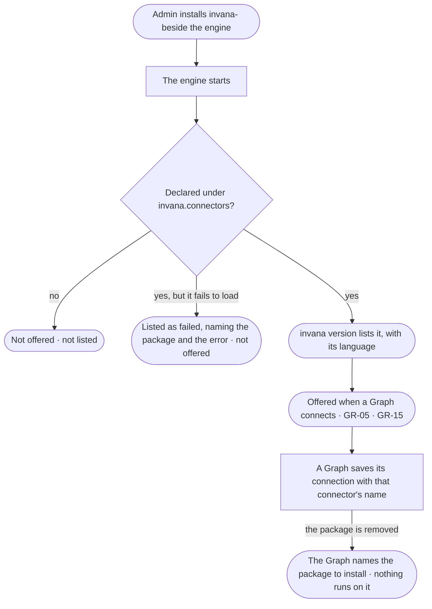

# RT-17 · Install a graph connector and see it offered

**As** an install admin **I want** to install the package for our graph database and have every Graph offered it
by name **so that** owners connect their Graphs to the databases we run, and to no connector we never installed.

Tasks: [task.md](task.md) · Feature: [RT-F05](../../feature.md)

## Who can

| Lens | Can | Otherwise sees |
|---|---|---|
| Admin | Install or remove a connector package on the engine's machine; read which connectors are installed | — |
| Operator | Read which connectors are installed, with their language, where a Graph connects and in `invana version` | Installs nothing — installing happens on the engine's machine, outside Invana |

## Flow

## Acceptance criteria

| # | Given | When | Then |
|---|---|---|---|
| RT-17.1 | A connector package installed beside the engine that declares a connector under the entry-point group `invana.connectors` | the engine starts | the connector is found by its registered name; no list in the engine names it |
| RT-17.2 | Installed connectors | someone runs `invana version` | it lists the engine version and every installed connector — its name, language and package version |
| RT-17.3 | A Graph being connected (GR-05 · GR-15) | the database choice draws | it offers every installed connector by name with its language, and only those |
| RT-17.4 | A database kind whose package is not installed | someone looks for it while connecting | it is not offered; the step names the package that would add it |
| RT-17.5 | A package whose connector fails to load | the engine starts | the engine starts; `invana version` lists that connector as failed, naming the package and the error, and it is not offered |
| RT-17.6 | A Graph's saved connection | it is stored | it names its connector by the registered name, never by a code path |
| RT-17.7 | A Graph whose connector's package was removed | it opens or a run reaches its database | it says the connector is not installed, naming the package; nothing runs against the database |
| RT-17.8 | Two packages that register the same name | the engine starts | neither is offered under that name; `invana version` names both packages |
| RT-17.9 | An Operator | they connect or open a Graph | they read which connectors are installed; installing one is not offered anywhere in Invana |

## Screens

No board: the connect step is GR-05's and GR-15's, and the rest is the command line.

| Surface | Lens | First use | Empty after a filter | Loading | Has data | Failed | Agent working or proposing | No access |
|---|---|---|---|---|---|---|---|---|
| `invana version` | Admin | — | — | — | — | — | — | — |
| `invana version` | Operator | — | — | — | — | — | — | — |
