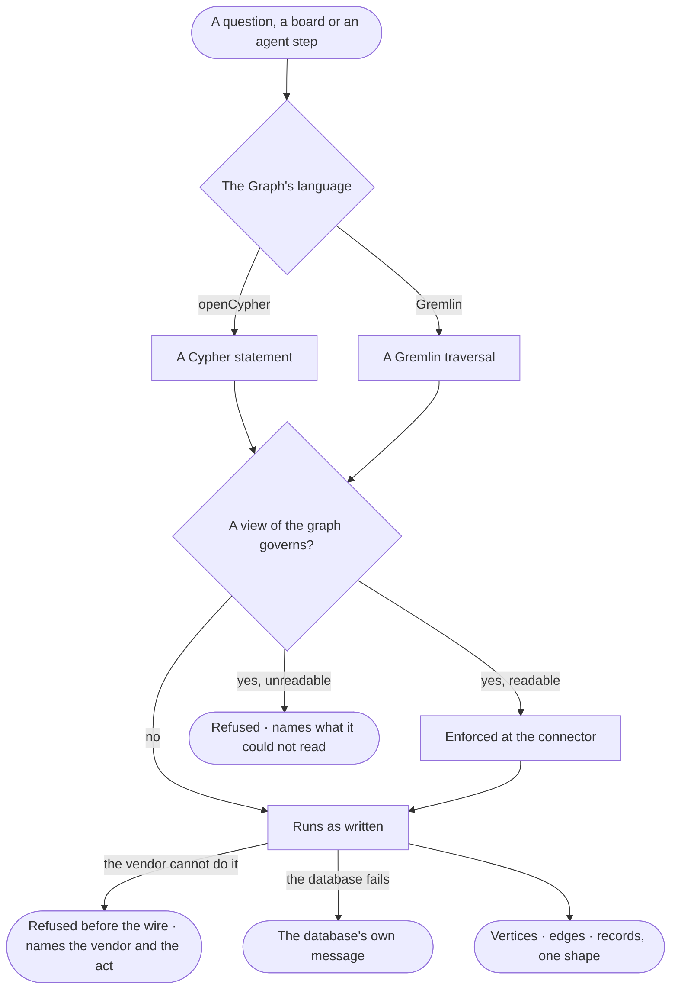

# RT-18 · Read and write any supported database in its own language

**As** an analyst **I want** every question, board and agent step on my Graph to read and write its database in that
database's own language, with one shape of answer whatever the vendor **so that** what I decide on does not depend
on which database we happen to run.

Tasks: [task.md](task.md) · Feature: [RT-F05](../../feature.md)

## Who can

| Lens | Can | Otherwise sees |
|---|---|---|
| Admin | Read and write the Graph's database through its connector, as their access allows | — |
| Operator | Read the Graph's database through its connector, inside their view of the graph | A write is refused as AC-F02 says; a type or property outside their view is refused, named |

## Flow

## Acceptance criteria

| # | Given | When | Then |
|---|---|---|---|
| RT-18.1 | A Graph | it is connected | it speaks one language — openCypher or Gremlin — the one its connector declares; it never switches |
| RT-18.2 | The same question on two Graphs whose databases differ | each answers | both answer in vertices, edges and records of one shape; no driver type reaches anyone |
| RT-18.3 | A raw query in the Graph's language | it runs | it is checked against the Graph's model, then runs as written |
| RT-18.4 | An act the vendor cannot do — a raw Gremlin script on a server that does not run scripts, an algorithm its library lacks | it is asked for | it is refused before reaching the database, naming the vendor and the act |
| RT-18.5 | A query under a view of the graph | it runs | the view's types, properties and record filter are enforced at the connector; the run's trace shows the query as asked and as run when they differ |
| RT-18.6 | A query under a view whose shape the connector cannot read | it runs | it is refused, naming the part it could not read; nothing reaches the database |
| RT-18.7 | A query naming a property the view excludes | it runs | it is refused, naming the type and the property |
| RT-18.8 | The database refuses or fails | a query runs | the person reads the database's own message, naming the Graph's connector |
| RT-18.9 | An Operator | they ask a question that would write | it is refused as their access rules say (AC-F02), naming the act |
| RT-18.10 | An agent's step that queried | its run is read | How it got here shows the query, the connector and what came back |

## Screens

No board: the asking surface — Explore, a board, a run — is its own story's.

| Surface | Lens | First use | Empty after a filter | Loading | Has data | Failed | Agent working or proposing | No access |
|---|---|---|---|---|---|---|---|---|
| A query through the connector | Admin | — | — | — | — | — | — | — |
| A query through the connector | Operator | — | — | — | — | — | — | — |
