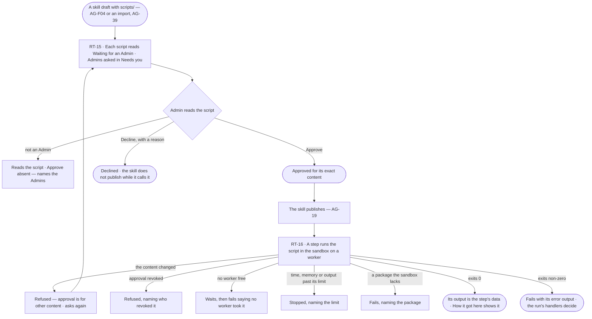
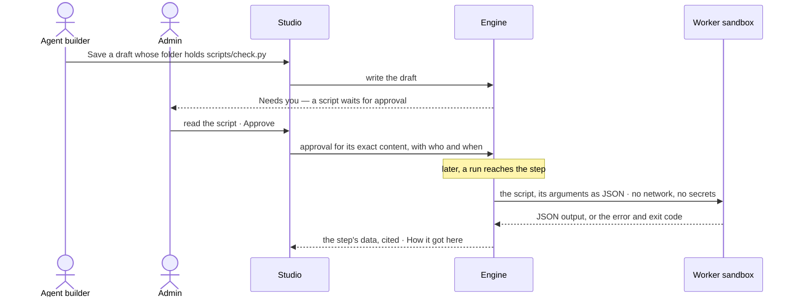

# Skill scripts

> A skill's `scripts/*.py` run exactly as written, in a sandbox on a worker, once an Admin has approved each one — no
> rewrite into a function, no code Invana generates. The decision it helps make: *may this script run on our
> machines, and did it do what the step needed?*

## User journey

## Stories

| ID | Story | Status |
|---|---|---|
| RT-15 | [Approve a skill's script once and let it run unchanged](stories/RT-15-approve-a-skills-script-once-and-let-it-run-unchanged/story.md) | idea |
| RT-16 | [See what a skill's script did and why it stopped](stories/RT-16-see-what-a-skills-script-did-and-why-it-stopped/story.md) | idea |

## Access

| Act | Role (`.claude/team/TEAM.md` §7) | Everyone else sees |
|---|---|---|
| Read a skill's scripts and whether each is approved | Operator — every member | — |
| Approve, decline or revoke a script | Admin | *Approve*, *Decline* and *Revoke* are absent; the script reads *Waiting for an Admin*, naming the Admins |
| Add or change a script in a skill's draft | `builder` · shown as *Can build agents* · Admin (AG-F04) | As AG-F04 |
| Read a script step on a run — its arguments, output, exit and limits | Anyone who can open the run | A run they cannot open reads *not found* |

## States

| State | What the person sees |
|---|---|
| First use | A skill with no `scripts/` shows no Scripts list; Needs you holds no script asks |
| Empty after a filter | — |
| Loading | The Scripts list holds its rows; a script step reads *Running in the sandbox…* |
| Has data | Each script with its approval — approved by whom and when, waiting, declined with the reason — and its content; a script step with its arguments, output, exit code, time and memory |
| Failed | A declined or revoked script names who and why; a stopped step names the limit; a missing package is named |
| Agent working or proposing | A script step running in the sandbox |
| No access | Scripts read; approval acts are absent, naming the Admins |

## Rules

| Rule | Detail |
|---|---|
| Run as written | A script runs byte for byte as the skill folder holds it; Invana never rewrites, wraps or generates code |
| One approval per content | An Admin approves a script's exact content once; every skill version carrying the same content keeps it; a changed byte waits for approval again |
| No approval, no run | A script waiting, declined or revoked never runs; a skill whose plan calls one does not publish, and a published one whose approval is revoked refuses that step |
| Sandboxed on a worker | It runs on a worker (RT-F03), never in the engine serving Studio: no network, no secrets, no graph connection; it reads its arguments and its own skill folder, writes only a scratch folder dropped when it ends |
| Bounded | Time, memory and output size are capped by the install; past a cap the script is stopped, naming it |
| Python the worker runs | The standard library and the packages the sandbox carries; an import of anything else fails, naming the package |
| JSON in, JSON out | Arguments arrive as JSON on standard input; the output is the JSON it prints; anything else on standard output fails the step |
| Output is data | What a script returns is cited by the step, never obeyed as an instruction |
| A step, like any step | Planned skills call a script as a step of their plan; guided skills offer it as a tool; either way it is checked against what the agent may do |
| Every run records it | The script's content fingerprint, its arguments, output, exit code, time and memory are kept on the step |
| Leans on | Skills (AG-F04) · import (AG-F08) · workers (RT-F03) · Needs you (AC-F05) · History (AC-F06) |

## Data touched

| Record | Read or write |
|---|---|
| A skill version's folder — its `scripts/` | Read |
| Script approvals — content fingerprint, state, by whom, when, reason | Write (Admin) · read |
| A script step on a run — fingerprint, arguments, output, exit code, time, memory, the limit that stopped it | Write · read |
| Asks for approval in Needs you (AC-F05) | Write · read |
| History rows of every approve, decline and revoke (AC-F06) | Write |

## Decisions

| Decision | Detail |
|---|---|
| Approval lives on the skill's sheet | A *Scripts* list on the skill's folder, each script readable in full, with *Approve* and *Decline* for an Admin |
| Admins are asked | A script waiting for approval is an ask in Needs you for every Admin; the first answer settles it |
| The sandbox is the install's | Its caps and its packages are set once for the install and read on every script step |
| A fingerprint, not a version | Approval keys on the script's content, so moving it between skill versions unchanged asks nothing |
| Not built yet | Approvals, the sandbox and script steps have no engine yet |

## Open questions

| Question | Who answers |
|---|---|
| Which packages does the sandbox carry beyond the standard library — none (recommended for the first build), or a list Ravi names? | Ravi |
| May an Admin allow network for one script? Recommend: no — a script that needs the outside is a tool plugin (RT-F02) | Ravi |

## Not building

| Item | Why not |
|---|---|
| Turning a script into a function | It runs unchanged; a library's functions are AG-F08 |
| Languages other than Python | The skill folders Invana reads carry Python; one sandbox is enough |
| Network, secrets or a graph connection inside the sandbox | A script that reaches out is a tool plugin, governed as one |
| Installing packages per script | Installs on premises run only what an Admin approved; the sandbox's packages are fixed |
| Approving all of a skill's scripts at once | Each script is code an Admin reads |
| Running scripts in the engine | Outside code runs on workers |
