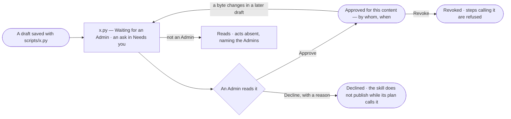

# RT-15 · Approve a skill's script once and let it run unchanged

**As** an install admin **I want** to read each script a skill carries and approve it once, for its exact content
**so that** skills keep the scripts they were written with, and no code runs on our machines that an Admin did not read.

Tasks: [task.md](task.md) · Feature: [RT-F06](../../feature.md)

## Who can

| Lens | Can | Otherwise sees |
|---|---|---|
| Admin | Read a script in full; approve it, decline it with a reason, revoke an approval | — |
| Operator | Read every script and its approval | *Approve*, *Decline* and *Revoke* are absent; a waiting script reads *Waiting for an Admin*, naming the Admins. No grant adds them |

## Flow

## Acceptance criteria

| # | Given | When | Then |
|---|---|---|---|
| RT-15.1 | A skill draft whose folder holds `scripts/*.py`, saved or imported (AG-39) | it is saved | each script reads *Waiting for an Admin* on the skill's *Scripts* list, and every Admin has an ask in Needs you naming the skill and the script |
| RT-15.2 | A waiting script | an Admin opens it | its whole content reads, with the skill, the version and who added it, and *Approve* and *Decline* |
| RT-15.3 | A waiting script | the Admin presses *Approve* | it is approved for its exact content; History records who and when; the ask closes for every Admin |
| RT-15.4 | A waiting script | the Admin presses *Decline* with a reason | it reads *Declined*, with who and the reason; a plan that calls it does not publish, naming the script |
| RT-15.5 | An approved script carried unchanged into a later version | that version is saved | it stays approved; nothing is asked |
| RT-15.6 | An approved script changed by one byte | the draft is saved | the changed script waits for approval again; the earlier content keeps its approval for the versions that carry it |
| RT-15.7 | A draft whose plan calls a script not approved | the builder publishes | publishing is refused, naming the script and *Waiting for an Admin* or *Declined* |
| RT-15.8 | An approved script | an Admin presses *Revoke* with a reason | every step that would run it is refused from then, naming who revoked it; runs in flight finish; History records it |
| RT-15.9 | Nothing is ever approved | a script would run | it does not run |
| RT-15.10 | An Operator | they open a skill's *Scripts* | every script and its approval read; *Approve*, *Decline* and *Revoke* are absent and a waiting script names the Admins |

## Screens

| Surface | Lens | First use | Empty after a filter | Loading | Has data | Failed | Agent working or proposing | No access |
|---|---|---|---|---|---|---|---|---|
| Scripts — on the skill | Admin | — | — | agents.skill · Loading | agents.skill · Scripts | agents.skill · Script declined | — | — |
| Scripts — on the skill | Operator | — | — | agents.skill · Loading | agents.skill · Scripts read only | agents.skill · Script declined | — | agents.skill · Scripts read only |
| A script to approve | Admin | agents.skill · Script waiting | — | agents.skill · Loading | agents.skill · Script approved | agents.skill · Script revoked | — | — |
| A script to approve | Operator | agents.skill · Scripts read only | — | agents.skill · Loading | agents.skill · Scripts read only | agents.skill · Script revoked | — | agents.skill · Scripts read only |
| The ask in Needs you | Admin | — | — | inbox · Loading | inbox · Script waits | inbox · Could not load | — | — |
| The ask in Needs you | Operator | — | — | — | — | — | — | — |
| Publish with a script not approved | Admin | — | — | — | agents.skill · Publish refused | agents.skill · Publish refused | — | — |
| Publish with a script not approved | Operator | — | — | — | — | — | — | agents.skill · Read only |
