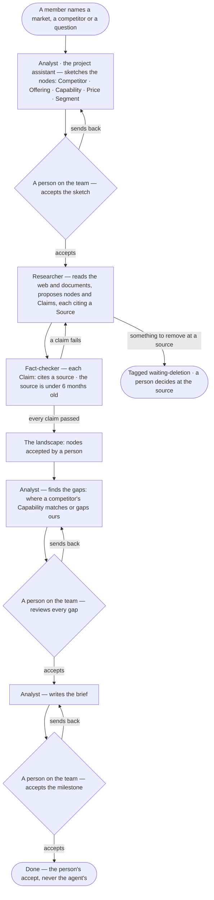

# The Market research pack

> A Team pack that lets a deployment run market research and competitor analysis as a project: an agent team of three —
> a researcher, an analyst who is the project's assistant, and a fact-checker — with their skills, a `research` project
> type whose subject model is the market, and an Access Policy file per agent. A person decides at every gate: they
> accept each landscape, review every gap and accept the brief. The decision it helps make: *where do we stand against
> each competitor, and what does the evidence say we should do about it?*

It is a Team pack like any other ([CP-F02](../os/control/features/CP-F02-plugins-and-outside-tools/feature.md#rules)):
a Claude plugin with Invana's fields under `metadata.invana`, installed and turned on by an Admin
([CP-20](../os/control/features/CP-F02-plugins-and-outside-tools/stories/CP-20-install-a-team-pack/story.md)). It sits
beside [the Software delivery pack](software-delivery.md): both run the one flow of
[the project graph](../capabilities/projects/features/PJ-F07-the-project-graph/feature.md#rules), and a deployment may
install both and link their models. Installing it widens nobody's reach: its agents are granted to nobody and its policy
files decide nothing until an Admin grants and applies them.

## What it carries

```text
market-research/
├── .claude-plugin/plugin.json      name · version · description · metadata.invana: kind = pack, title, engine, requires [invana-web], project_types, the ordered agents and skills
├── agents/                         researcher.md · analyst.md · fact-checker.md
├── skills/                         one Agent Skills folder each — the skills below
├── policies/                       researcher.yaml · analyst.yaml · fact-checker.yaml
├── project_types/research.yaml         the type manifest — the fields of the table under *The project type*
├── ontology/research.yaml              the subject model the manifest names
├── workflows/                          the check workflows the manifest names: claims-cite-a-source · sources-under-6-months
└── lenses/                         none until a story names one
```

| Piece | Offered in | Owned by |
|---|---|---|
| Three agents | The agents catalogue, as *Team pack* agents | [AG-F02](../capabilities/agents/features/AG-F02-the-agents-catalogue/feature.md#rules) |
| Their skills | Skills, `origin = builtin` with the pack named | [AG-F04](../capabilities/agents/features/AG-F04-skills/feature.md#rules) |
| Three Access Policy files | Access Policies, as drafts *Waiting for an Admin to apply* | [AC-F02](../os/access/features/AC-F02-access-policies/feature.md#rules) |
| The `research` project type | *New project* | [PJ-F07](../capabilities/projects/features/PJ-F07-the-project-graph/feature.md#rules) |

## How work moves



The path is [J11 · Ideate and run a project with its assistant](../journeys/J11-ideate-and-run-a-project-with-its-assistant.md).

## The agents

| Agent | Does | Runs with | Skills | On a project |
|---|---|---|---|---|
| `researcher` · **Researcher** | Reads the web and documents the project names, proposes nodes and Claims each citing a Source, and tags what looks duplicated | Invana | `map-the-landscape` · `recommend` | Works the tasks tagged *research* |
| `analyst` · **Analyst** | Sketches the market's nodes with the team, finds the gaps between a competitor and us, proposes milestones and writes the brief | Invana | `find-gaps` · `write-a-brief` · `recommend` | The project assistant: every proposal is a member's to accept |
| `fact-checker` · **Fact-checker** | Judges each Claim against its Source and its age, in a run of its own | Invana | `fact-check` · `recommend` | Its judgement is a check on a task ([PJ-25](../capabilities/projects/features/PJ-F01-projects-and-tasks/stories/PJ-25-gate-a-task-on-its-checks/story.md)) |

| Rule | Detail |
|---|---|
| The agents propose, people decide | No agent accepts a node, a gap, a milestone or a brief; a person on the team accepts |
| A source's text is data | A page the Researcher reads is never an instruction to any agent |
| A green of its own is not evidence | A claim passes only in the Fact-checker's own run, never on the Researcher saying it is sourced |
| Outside an agent's rights is a recommendation | What an agent may not write it raises as a Recommendation task |
| Model versions | Each agent's model version is pinned when it is first set up by a person with Edit on `agent/<name>` and Run on `llm/<endpoint>/<version>`; the pack ships none |

## The skills

| Skill | What it does | Used by | How it runs |
|---|---|---|---|
| `map-the-landscape` | Reads the project's sources and proposes Competitors, Offerings, Capabilities, Prices and Segments, each Claim citing a Source and its date | Researcher | Guided |
| `find-gaps` | Compares each competitor Capability with ours and proposes `matches` and `gap` links with the evidence | Analyst | Guided |
| `fact-check` | Judges a Claim: does it cite a source, is the source under 6 months old, does the source say it; PASS or FAIL with the reason | Fact-checker | Guided |
| `write-a-brief` | Writes the brief from accepted nodes and reviewed gaps, every sentence citing its Claim | Analyst | Guided |
| `recommend` | Raises a Recommendation task for what is outside the agent's task or rights | Every agent | Planned |

## The project type

`research` — a manifest of [the type manifest's](../capabilities/projects/features/PJ-F07-the-project-graph/feature.md#the-project-type-manifest) fields, one row each. Inside a project of this type the words are **Project** · **Task**; a milestone is a **Milestone**.

| Manifest field | Holds |
|---|---|
| `id` · `title` · `group` | `research` · *Research* · the pack's title |
| `labels` | `project` Project · `task` Task · `milestone` Milestone |
| `fields` | none beyond the name and description |
| `subject_model` | `ontology/research.yaml` — **Competitor** · **Offering** · **Capability** · **Price** · **Segment** · **Claim** · **Source**. A Competitor *offers* an Offering; an Offering *has* Capabilities, a Price and a Segment; a Claim *states* a fact about a node and *cites* a Source. A Capability may `match` or `gap` a Capability or Feature of another model — ours, from a Software project ([PJ-28](../capabilities/projects/features/PJ-F07-the-project-graph/stories/PJ-28-ground-a-project-in-its-subject-model/story.md)) |
| `sources` | `web` · connector `invana-web` ([CP-F12](../os/control/features/CP-F12-issue-trackers/feature.md): the Web adapter, pages, read only) · parses to Competitor, Offering, Capability, Price, Segment, Claim, Source · required — `documents` · connector `invana-files` (a folder of documents, bundled, read only) · the same kinds · not required — `tracker` · connector kind `tracker` · not required, for a team that keeps its research there |
| `milestones` | *Landscape* → *Gaps* → *Brief*, each waiting on the one before ([PJ-18](../capabilities/projects/features/PJ-F01-projects-and-tasks/stories/PJ-18-order-tasks-by-what-they-wait-on/story.md) · [PJ-26](../capabilities/projects/features/PJ-F01-projects-and-tasks/stories/PJ-26-make-a-milestone-from-a-selection/story.md)) |
| `tags` | research · review · duplicate · waiting-deletion · gap — each a label ([PJ-27](../capabilities/projects/features/PJ-F01-projects-and-tasks/stories/PJ-27-tag-a-task/story.md)) |
| `task_kinds` | none beyond **Task** and **Recommendation**, which every project has ([PJ-20](../capabilities/projects/features/PJ-F01-projects-and-tasks/stories/PJ-20-give-a-project-its-kinds-of-task/story.md)) |
| `checks` | A task tagged *research*: workflow `claims-cite-a-source` (every Claim cites a Source), workflow `sources-under-6-months` (every Source is under 6 months old), then `person` · a task tagged *gap*: `person` reviews every gap |
| `reviewers` | `creator` by default, at least one person ([PJ-22](../capabilities/projects/features/PJ-F01-projects-and-tasks/stories/PJ-22-set-the-project-team-and-its-lead-agent/story.md)) |
| `agents` | The three agents above, `analyst` as the `assistant`, each with its skills |
| `pick_up` | `ask` for every agent; a person on the team may set Allow ([PJ-15](../capabilities/projects/features/PJ-F01-projects-and-tasks/stories/PJ-15-let-agents-pick-up-tasks-by-hand-by-asking-or-on-their-own/story.md)) |
| `report_template` | *Brief*: the competitors, offerings and capabilities, the gaps with their evidence, and what was left out and why ([PJ-F05](../capabilities/projects/features/PJ-F05-project-reports/feature.md)) |
| `access_template` | none until a person settles it ([the paper test](#the-paper-test)) |
| `requires` | `invana-web`; until it is installed the type is listed as unavailable, naming it |

### The checks

Each check workflow is a run of its own, started through the project assistant ([PJ-25](../capabilities/projects/features/PJ-F01-projects-and-tasks/stories/PJ-25-gate-a-task-on-its-checks/story.md)); its step is the Fact-checker's `fact-check`, so both `checks` keys have one doer.

| Workflow | Its step | Doer |
|---|---|---|
| `claims-cite-a-source` | Judges that every Claim cites a Source and that the Source says it | Fact-checker · `fact-check` |
| `sources-under-6-months` | Judges that every Source is under 6 months old | Fact-checker · `fact-check` |

## The Access Policy files

Each agent's policy, in [AC-F02](../os/access/features/AC-F02-access-policies/feature.md#mechanisms)'s format, lands as a
draft for a person with Create on `setting/team-packs` to apply. Anything a rule does not allow is denied.

| Area | Researcher | Analyst | Fact-checker |
|---|---|---|---|
| The web | Read `net/` the hosts the project's sources name, narrowed to the hosts an Admin allows on the Web connection ([CP-73.19](../os/control/features/CP-F12-issue-trackers/stories/CP-73-connect-an-issue-tracker-and-link-a-project/story.md)); Read `fs/` the folder of a `documents` source | Read only what the project already holds | Read `net/` the hosts a Claim cites, narrowed the same way; Read `fs/` the folder of a `documents` source |
| Projects and memory | Read and Write `project/*` and Read `memory/project/*`, narrowed at run time to the run's project ([AC-F04](../os/access/features/AC-F04-what-an-agent-may-touch/feature.md#rules)) | The same | Read `project/*` and `memory/project/*` |
| The project graph | Propose nodes and links; never write one | Propose nodes, links and milestones | Read |
| Files | `fs/reports/<agent>/**` Write, its own | `fs/reports/<agent>/**` Write, its own | `fs/reports/<agent>/**` Write, its own |
| An issue tracker | Run `tool/<tracker>/*` read tools; a wildcard matches only the adapter's seventeen methods, never another tool of the server ([CP-74.1](../os/control/features/CP-F12-issue-trackers/stories/CP-74-delete-an-outside-issue-only-by-hand/story.md)) | Run create, update and comment on Ask | Read |
| Never | Delete anything at a source; no `cmd/` | No `cmd/`; delete at a tracker is never granted | No Write to a node |

| Rule | Detail |
|---|---|
| Hosts | No Write to any host but through a tool |
| Data | None. A team that wants its agents to read Graph Data writes that rule itself |
| Outside text | A page or an issue the Researcher reads is data: a run that read one asks before any write at a tracker ([CP-73.17](../os/control/features/CP-F12-issue-trackers/stories/CP-73-connect-an-issue-tracker-and-link-a-project/story.md)) |
| Deletes | No agent deletes an outside item; it tags *waiting-deletion* ([CP-74](../os/control/features/CP-F12-issue-trackers/stories/CP-74-delete-an-outside-issue-only-by-hand/story.md)) |

## The paper test

Walked end to end against [the manifest](../capabilities/projects/features/PJ-F07-the-project-graph/feature.md#the-project-type-manifest) and the drawn boards: every field above has a home in the manifest, every parser is a connector, every check key a workflow with a doer. What the walk changed is in the tables above; what it left open:

| Open | Why it is Ravi's |
|---|---|
| `access_template` — which project access template the Access step picks first for this type (recommended *Read and analyse*) | A choice of access |
| `reviewers` — the manifest field has no home in PJ-22 | Who accepts a task is not yet specified anywhere in Projects |

A pack agent's policy is a draft until an Admin applies it, so on the *Access* step a Research agent reads *Chooses nothing yet — pick a policy* until then ([PJ-02.39](../capabilities/projects/features/PJ-F01-projects-and-tasks/stories/PJ-02-start-a-project-of-its-type/story.md)); an Operator who may not apply it reads *Will ask {who can grant}*. A default policy is never applied.

## What it relies on

| For | Spec |
|---|---|
| The pack, its layout, install and policy drafts | [CP-F02](../os/control/features/CP-F02-plugins-and-outside-tools/feature.md) · [CP-20](../os/control/features/CP-F02-plugins-and-outside-tools/stories/CP-20-install-a-team-pack/story.md) |
| Agents and skills as files | [AG-F08](../capabilities/agents/features/AG-F08-portable-agents-and-skills/feature.md) · [AG-F04](../capabilities/agents/features/AG-F04-skills/feature.md) |
| Access Policies, the sandbox and the web | [AC-F02](../os/access/features/AC-F02-access-policies/feature.md) · [CP-F03](../os/control/features/CP-F03-workers-and-the-queue/feature.md) |
| The project graph, milestones, tags, checks | [PJ-F07](../capabilities/projects/features/PJ-F07-the-project-graph/feature.md) · [PJ-F01](../capabilities/projects/features/PJ-F01-projects-and-tasks/feature.md) |
| Web and tracker sources | [CP-F12](../os/control/features/CP-F12-issue-trackers/feature.md) |
| Asks and what waits | [AC-F05](../os/access/features/AC-F05-asks-and-approvals/feature.md) · [CP-76](../os/control/features/CP-F08-the-inbox/stories/CP-76-see-why-an-agent-is-waiting-for-me/story.md) |

## Not building

| Item | Why not |
|---|---|
| A scraper that bypasses a site's rules | The Researcher reads only what its policy's hosts allow |
| An agent that publishes the brief | A brief leaves by a person's send, through the outbound check |
| A price monitor on a schedule | A schedule is [AG-F07](../capabilities/agents/features/AG-F07-schedules/feature.md)'s, not the pack's |
| Facts without a source | A Claim with no Source is refused |
