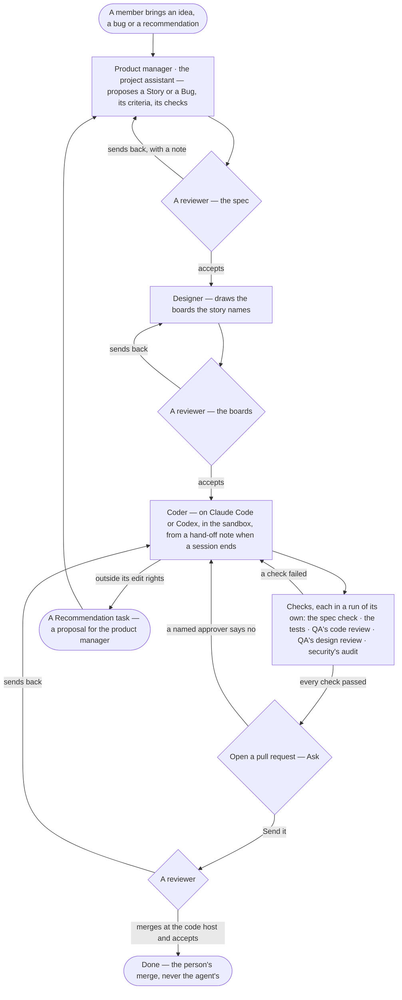

# The Software delivery pack

> A Team pack that lets a deployment run software work as a project: an agent team of five — a product manager who is
> the project's assistant, a designer, a coder, QA and security — with their skills, a `software` project type, and an
> Access Policy file per agent whose `fs/` rules follow the team's edit rights. A person decides at every gate: they
> approve the spec, approve the boards, merge the pull request and accept the result. The decision it helps make:
> *is this change specified, drawn, built and proven well enough for a person to accept it?*

It is a Team pack like any other ([CP-F02](../os/control/features/CP-F02-plugins-and-outside-tools/feature.md#rules)):
a Claude plugin with Invana's fields under `metadata`, installed and turned on by an Admin
([CP-20](../os/control/features/CP-F02-plugins-and-outside-tools/stories/CP-20-install-a-team-pack/story.md)). Installing
it widens nobody's reach: its agents are granted to nobody and its policy files decide nothing until an Admin grants
and applies them.

## What it carries

```text
software-delivery/
├── .claude-plugin/plugin.json      name · version · description · metadata: kind = pack, title, engine, the ordered agents and skills
├── agents/                         product-manager.md · designer.md · coder.md · qa.md · security.md
├── skills/                         one Agent Skills folder each — the skills below
├── policies/                       product-manager.yaml · designer.yaml · coder.yaml · qa.yaml · security.yaml
└── project_types/software/         fields · task kinds · default checks · labels · suggested agents and skills · report template
```

| Piece | Offered in | Owned by |
|---|---|---|
| Five agents | The agents catalogue, as *Team pack* agents | [AG-F02](../capabilities/agents/features/AG-F02-the-agents-catalogue/feature.md#rules) |
| Their skills | Skills, `origin = builtin` with the pack named | [AG-F04](../capabilities/agents/features/AG-F04-skills/feature.md#rules) |
| Five Access Policy files | Access Policies, as drafts *Waiting for an Admin to apply* | [AC-F02](../os/access/features/AC-F02-access-policies/feature.md#rules) |
| The `software` project type | *New project* | [PJ-F01](../capabilities/projects/features/PJ-F01-projects-and-tasks/feature.md#rules) |

## How work moves



The path is [J10 · Fix a reported bug with an agent](../journeys/J10-fix-a-reported-bug-with-an-agent.md) for a bug and
[J11 · Ideate and run a project with its assistant](../journeys/J11-ideate-and-run-a-project-with-its-assistant.md) for a
new piece of work.

## The agents

| Agent | Does | Runs with | Skills | On a project |
|---|---|---|---|---|
| `product-manager` · **Product manager** | Turns ideas, bugs and recommendations into stories — who can, flow, criteria, screens — and the system design; proposes tasks and their order; takes up recommendations | Invana | `product-spec` · `system-design` · `recommend` | The project assistant ([PJ-22](../capabilities/projects/features/PJ-F01-projects-and-tasks/stories/PJ-22-name-the-project-assistant-and-its-reviewers/story.md)): every proposal is a member's to accept |
| `designer` · **Designer** | Draws exactly the boards a story names, every state and lens, from the team's design kit | Invana | `design-story` · `recommend` | Picks up the tasks of the *Design* group |
| `coder` · **Coder** | Builds the story — code, every test and a changeset — in the task's workspace, and opens a pull request | Claude Code or Codex ([AG-61](../capabilities/agents/features/AG-F01-build-an-agent/stories/AG-61-choose-what-an-agent-runs-with/story.md)), set by a Modeller | `build-feature` · `build-ui` · `recommend` | Picks up the tasks of the *Build* group and *Bug* tasks |
| `qa` · **QA** | Runs the tests and reviews the code against the criteria; compares what was built against its boards; writes PASS or FAIL | Invana | `code-review` · `design-qa` · `recommend` | Its reviews are checks on a task ([PJ-25](../capabilities/projects/features/PJ-F01-projects-and-tasks/stories/PJ-25-gate-a-task-on-its-checks/story.md)) |
| `security` · **Security** | Threat-models a story that touches access, data, agents or an outside system; audits a change before it is accepted | Invana | `security-audit` · `recommend` | Its audit is a check on a task |

| Rule | Detail |
|---|---|
| The agents propose, people decide | No agent accepts a task, merges a pull request or applies a policy; a reviewer accepts, a person merges, an Admin applies |
| The same agent for everyone | Each agent reaches only what its own Access Policy allows, whoever it works for ([AC-F02](../os/access/features/AC-F02-access-policies/feature.md#rules)) |
| A green of its own is not evidence | A task closes on its checks, each a run of its own — never on an agent saying it is done ([PJ-F01](../capabilities/projects/features/PJ-F01-projects-and-tasks/feature.md#rules)) |
| A long build continues | At its session budget the Coder continues in a fresh session from a hand-off note ([AG-62](../capabilities/agents/features/AG-F05-delegation-and-outside-agents/stories/AG-62-continue-in-a-fresh-session-from-a-hand-off-note/story.md)) |
| Outside an agent's rights is a recommendation | What an agent may not write it raises as a Recommendation task, a proposal for the product manager |
| Model versions | Each agent's model version is pinned by a Modeller when it is first set up; the pack ships none |

## The skills

| Skill | What it does | Used by | How it runs |
|---|---|---|---|
| `product-spec` | Writes or changes a product, a feature, a story or a journey: reads what exists, asks in one batch with a recommendation, flags breaking changes, writes from the templates, runs the spec check | Product manager | Guided |
| `system-design` | Writes the high-level design, the non-functional requirements and a feature's low-level design | Product manager | Guided |
| `design-story` | Draws one story's boards — its flow, every state and lens — from the design kit only | Designer | Guided |
| `build-feature` | Builds a designed story: its scope, decisions, access, tests never mocked, a changeset, one commit per step | Coder | Guided |
| `build-ui` | The team's UI rules: compose from the design kit, tokens only, one story per component | Coder | Guided |
| `code-review` | Reviews a change against its story's criteria and the team's standards; PASS or FAIL | QA | Guided |
| `design-qa` | Compares each built screen with its board in every state and lens; PASS or FAIL | QA | Guided |
| `security-audit` | Threat-models a story; audits a change — code, dependencies, secrets, the running API, the agents | Security | Guided |
| `recommend` | Raises a Recommendation task for what is outside the agent's task or rights | Every agent | Planned |

## The project type

`software` — the words inside a project of this type: **Project** · **Story**.

| Part | Holds |
|---|---|
| Fields | `repository` — the code host's address · `default_branch` · `product_owner` — the reviewer who accepts specs and boards |
| Task kinds | **Story** — a person's need with its criteria · **Bug** — a fault against criteria that exist · **Task** — one piece of work · **Recommendation** — every project has it ([PJ-20](../capabilities/projects/features/PJ-F01-projects-and-tasks/stories/PJ-20-give-a-project-its-kinds-of-task/story.md)) |
| Groups | *Spec* → *Design* → *Build* → *Verify*, each waiting on the one before ([PJ-18](../capabilities/projects/features/PJ-F01-projects-and-tasks/stories/PJ-18-order-tasks-by-what-they-wait-on/story.md)) |
| Default checks | Story: the spec check, then a reviewer · a Bug, and a Task of the *Build* group: the tests, QA's code review, and QA's design review when a screen changed · a story touching access, data, agents or an outside system: security's audit |
| Reviewers | At least one person; the product owner by default ([PJ-22](../capabilities/projects/features/PJ-F01-projects-and-tasks/stories/PJ-22-name-the-project-assistant-and-its-reviewers/story.md)) |
| Suggested agents and skills | The five agents above, the product manager as the project assistant |
| Pick-up | Ask by default for every agent; a member may set Allow ([PJ-15](../capabilities/projects/features/PJ-F01-projects-and-tasks/stories/PJ-15-let-agents-pick-up-tasks-by-hand-by-asking-or-on-their-own/story.md)) |
| Report template | *Release notes*: the stories done, their criteria and checks, the bugs fixed, what was left out and why ([PJ-F05](../capabilities/projects/features/PJ-F05-project-reports/feature.md)) |

## The Access Policy files

Each agent's policy, in [AC-F02](../os/access/features/AC-F02-access-policies/feature.md#mechanisms)'s format, lands as a
draft for an Admin to apply. The `fs/` rules follow the team's edit rights — each role writes only its own files — over
paths relative to the task's workspace ([AC-37](../os/access/features/AC-F02-access-policies/stories/AC-37-say-what-an-agent-may-touch-on-a-worker/story.md));
an Admin edits the paths to the repository's own before applying them. Anything a rule does not allow is denied.

| Area | Paths | Product manager | Designer | Coder | QA | Security |
|---|---|---|---|---|---|---|
| Product code | `fs/src/**` · `fs/app/**` · `fs/packages/**` · build and CI files | Read | Read | Write | Read | Read |
| Tests and evals | `fs/tests/**` · `fs/e2e/**` · `fs/evals/**` | Read | Read | Write | Read | Read |
| Changesets | `fs/.changeset/**` | Read | — | Write | Read | Read |
| Specs | `fs/specs/**` | Write | Read | Read | Read | Read |
| Other docs | `fs/docs/**` · `fs/README.md` · `fs/CONTRIBUTING.md` | Write | Read | Read | Read | Read |
| Boards | `fs/.design/**` | Read | Write | Read | Read | Read |
| Own reports | `fs/reports/<agent>/**` | Write, its own | Write, its own | Write, its own | Write, its own | Write, its own |
| Team rules | `fs/CLAUDE.md` · `fs/AGENTS.md` · `fs/.claude/**` | Read | Read | Read | Read | Read |

| Rule | Detail |
|---|---|
| Programs | The Coder and QA: Run `cmd/git` and the repository's build and test programs, named by an Admin; Security: Run its scanners. No other `cmd/` |
| Hosts | Read `net/` the package registries the repository uses; no Write to any host but through a tool |
| The code host | Run `tool/<code host>/*` on Ask for the Coder — opening a pull request is an outbound act, with its text through the outbound check ([AC-F09](../os/access/features/AC-F09-what-left-the-platform/feature.md#rules)); through a work connection an Admin made ([CP-F02](../os/control/features/CP-F02-plugins-and-outside-tools/feature.md#rules)) |
| Projects and memory | Read and Write `project/*` and Read `memory/project/*` — narrowed at run time to the run's project and the ones related to it ([AC-F04](../os/access/features/AC-F04-what-an-agent-may-touch/feature.md#rules)) |
| Data | None. A team that wants its agents to read the Graph writes that rule itself |
| Rows within a file | Each role adds only its own rows of a story's tasks; the sandbox guards files, so a row is the spec check's to guard, not a rule's |
| Never | No agent may Write `fs/.claude/**`, `fs/CLAUDE.md` or `fs/AGENTS.md`: the team's rules are a person's to change |

## What it relies on

| For | Spec |
|---|---|
| The pack, its layout, install and policy drafts | [CP-F02](../os/control/features/CP-F02-plugins-and-outside-tools/feature.md) · [CP-20](../os/control/features/CP-F02-plugins-and-outside-tools/stories/CP-20-install-a-team-pack/story.md) |
| Agents and skills as files | [AG-F08](../capabilities/agents/features/AG-F08-portable-agents-and-skills/feature.md) · [AG-F04](../capabilities/agents/features/AG-F04-skills/feature.md) |
| The catalogue and grants | [AG-F02](../capabilities/agents/features/AG-F02-the-agents-catalogue/feature.md) · [AC-F03](../os/access/features/AC-F03-directory/feature.md) |
| Access Policies, `fs/` · `cmd/` · `net/` and the sandbox | [AC-F02](../os/access/features/AC-F02-access-policies/feature.md) · [CP-F03](../os/control/features/CP-F03-workers-and-the-queue/feature.md) |
| Runtimes and continuation | [AG-F01](../capabilities/agents/features/AG-F01-build-an-agent/feature.md) · [AG-F05](../capabilities/agents/features/AG-F05-delegation-and-outside-agents/feature.md) · [CP-F10](../os/control/features/CP-F10-runs-and-how-the-agents-are-doing/feature.md) |
| Projects, task kinds, the assistant, reviewers and checks | [PJ-F01](../capabilities/projects/features/PJ-F01-projects-and-tasks/feature.md) |
| Asks and the outbound check | [AC-F05](../os/access/features/AC-F05-asks-and-approvals/feature.md) · [AC-F09](../os/access/features/AC-F09-what-left-the-platform/feature.md) |
| Alerts when work stops | [CP-F11](../os/control/features/CP-F11-ops-alerting/feature.md) |

## Not building

| Item | Why not |
|---|---|
| A project lead agent | A project's groups, pick-up and checks run its work; a person starts and stops it |
| An agent that merges or deploys | A merge and a release are a person's |
| Policy rules in the agent files | Only an Access Policy grants; the files declare |
| Paths for one repository | The pack is general; an Admin sets the paths before applying the policies |
| Graph data for the team's agents | Software work needs files and a code host; a team adds data rules itself |
