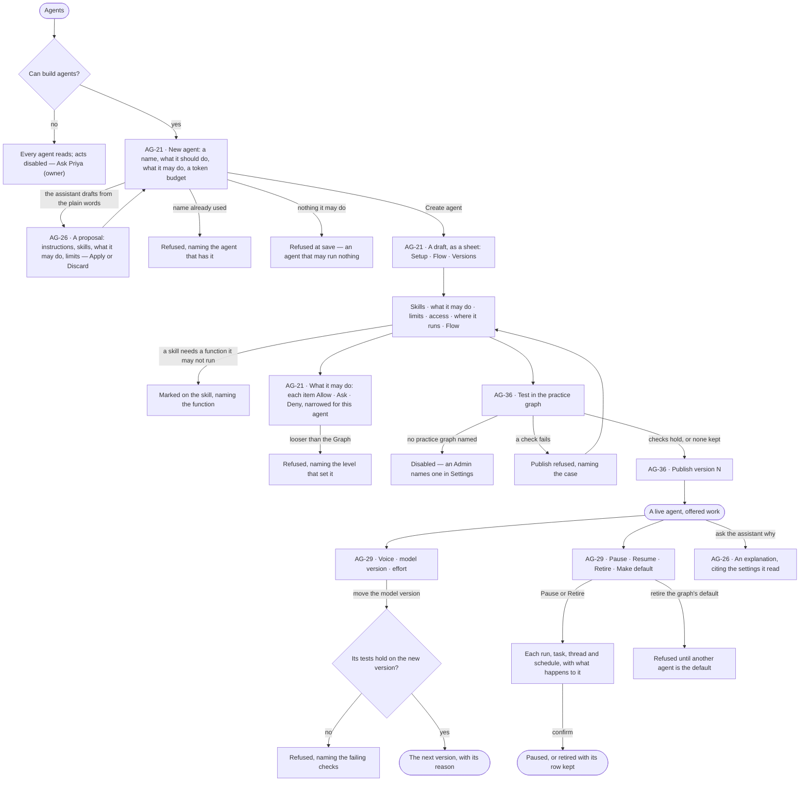
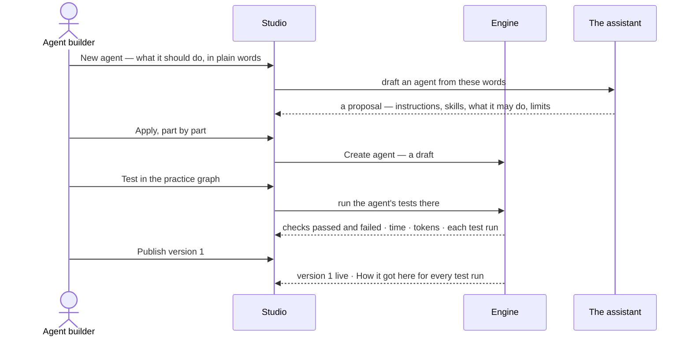

# Build an agent

> Make an agent from plain words — what it should do, what it may do, what it may spend — read what it will do before
> it runs, test it in the practice graph and publish a version; then tune its voice, model version and effort, and
> pause or retire it with its open work named. The decision it helps make: *is this agent ready to be given work, and
> is this change to it safe to publish?*

## User journey

Journeys this feature is a step of: [J04 · Build an agent and improve it from what runs teach](../../../../journeys/J04-build-an-agent-and-improve-it-from-what-runs-teach.md) · [J06 · Set what an agent may touch](../../../../journeys/J06-set-what-an-agent-may-touch.md)

## Stories

| ID | Story | Status |
|---|---|---|
| AG-21 | [Draft an agent and see what it will do](stories/AG-21-draft-an-agent-and-see-what-it-will-do/story.md) | idea |
| AG-36 | [Test an agent and publish a version](stories/AG-36-test-an-agent-and-publish-a-version/story.md) | idea |
| AG-29 | [Tune an agent's voice, model and effort, and retire it](stories/AG-29-tune-an-agents-voice-model-and-effort-and-retire-it/story.md) | idea |
| AG-26 | [Let the assistant draft and explain an agent](stories/AG-26-let-the-assistant-draft-and-explain-an-agent/story.md) | idea |

## Access

| Act | Role (`.claude/team/TEAM.md` §7) | Everyone else sees |
|---|---|---|
| Read every agent — its setup, what it may do, its limits, voice, model version, Flow and versions | Operator — every member of the graph | — |
| Create an agent, edit a draft, test it, publish a version, discard a draft | `builder` · shown as *Can build agents* · Admin | *New agent*, *Test* and *Publish* disabled, naming *Can build agents* — *Ask Priya (owner)* |
| Change voice, model version, effort or limits · Pause · Resume · Retire · Make default | `builder` · *Can build agents* · Admin | The setting reads as saved; the act is disabled, naming *Can build agents* |
| Narrow the agent's own modes — tighten, or loosen back to what the Graph set | `builder` · *Can build agents* · Admin | Each mode reads; changing it is disabled, naming *Can build agents* |
| Give the agent an access rule | `iam-admin` · shown as *Can manage people* · Admin | The rules it holds read; *Add an access rule* disabled, naming *Can manage people* |
| Give the agent a rule of its own that must always hold | Who may change the graph's rules (MO-F05) | The rule reads; editing it is disabled, naming who may |
| Offer model versions to pin | Admin, in Settings › AI and connections | A version not offered cannot be picked |
| Name the practice graph | Admin, in Settings › Invana | *Test in the practice graph* disabled, naming the Admin |
| Ask the assistant to explain an agent | Operator | — |
| Ask the assistant to draft or change an agent | `builder` · *Can build agents* · Admin | The assistant explains and says it cannot change the agent, naming *Can build agents* |

## States

| State | What the person sees |
|---|---|
| First use | Agents with only the graph's own assistants: *New agent* and a line on what an agent is. A new agent's sheet with no skill reads that it runs on the graph's own plans alone |
| Empty after a filter | *No agents match* — the filters (kind · status · helpers shown) named, with *Clear filters* |
| Loading | The sheet's head and tabs drawn at once; the body loads in place |
| Has data | An agent as a sheet: Setup (instructions, voice, skills, model version and effort, limits, lifecycle) · Flow · Versions; a live agent's tokens today and this month as meters |
| Failed | The tab names what it could not read, in the engine's words; a refused save names the field and why |
| Agent working or proposing | The assistant drafting the agent, then its proposal beside the form; a test running in the practice graph with its checks filling in |
| No access | Every tab reads; each act is disabled, naming the grant it needs, with *Ask Priya (owner)* |

## Rules

| Rule | Detail |
|---|---|
| No unbounded agent | Every agent starts from a template that brings what it may do; there is no agent that may run anything |
| What it may do is modes | Each thing the agent may touch carries Allow · Ask · Deny ([the three modes](../../../settings/product.md#decisions)). A builder narrows a single agent from its sheet; its own modes are lines of its own access rule — *An agent's own*, a fifth kind beside *A key's own* (ST-F02) — which only tightens what the Graph set |
| What it may do is checked before it runs | A plan that names a function the agent may not run, an argument it must not change, or a limit it would pass is refused before anything is dispatched — nothing is spent |
| A refusal names its side | The agent's own limits, the view of the graph the work runs in, or a rule that must always hold — whichever bound it |
| Bounds nest | An agent's own limits ∩ the work's view of the graph ∩ the graph's rules, frozen when a run opens; a run's helpers may only narrow them |
| Standing and situational | What an agent may ever do — functions, effort, tokens a month, runs at once, helpers, its own rule — is on the agent. What one piece of work may see and spend comes with the work: a thread, a task, a schedule |
| Tighten, never loosen | An agent may propose narrowing its own limits; widening them is a person's act |
| Tokens, never currency | Every budget, meter and refusal counts tokens |
| Declared is not enforced | The limits table says which limits stop a run and which are only drawn against |
| An agent sees no provider | Its model version is a pin or comes from the view of the graph; it holds no AI connection of its own |
| Skills reach an agent only when added to it | A template suggests skills; it adds none |
| A skill's needs come from its plan | The functions a skill needs are read from its current plan, never typed beside it |
| Voice is words only | The voice reaches the steps whose words a person reads — the question back, the reason, the answer — and never what is queried, planned, seen or refused |
| Instructions and voice differ | Instructions say what to do and reach the steps that read the question and write the query, after the graph's own; the voice says who is speaking |
| Humour is off when something went wrong | A refusal, a cannot-answer, an error and a budget pause are said without humour, whatever the voice says |
| A run keeps what it opened with | Its voice, model version and limits are the ones it opened with; a change reaches the next run |
| A pin is exact | A model version is the provider's own name, never an alias; a pinned version the graph does not offer refuses the run — nothing falls back |
| Moving a pin is a change | It runs the agent's tests on the new version first and becomes a version with its reason |
| A draft takes no work | A draft is never asked, assigned a task, scheduled or made the default |
| Nothing is deleted once it ran | Retiring keeps the agent's row, so every run, trace and helper still resolves; the name stays taken |
| Pausing kills nothing | Runs in flight finish; open work is named item by item before the act |
| One default | Every graph has one default agent, and it can answer questions |
| A default way of reasoning | An agent may carry a default stance once stances exist (EX-F05); the person asking may change it for one ask |
| No AI model offered | *New agent* says no model version is offered yet and opens Settings › AI and connections for an Admin |
| A model version not offered at run time | The run is refused before it starts, naming the version and the view of the graph or pin that chose it |
| A skill removed | It leaves every agent it was added to; the agent keeps working on the rest |
| No default agent | The first published agent is offered as the graph's default |
| The engine counts | Tokens today and this month, served, p95 and every number on the sheet are the engine's; Studio formats them |
| Leans on | Skills (AG-F04) · runs and how agents are doing (AG-F03) · helpers and delegation (AG-F05) · access rules (ST-F02) · AI models (ST-F05) · rules that must always hold (MO-F05) · the catalogue and inviting (AG-F02) |

## Data touched

| Record | Read or write |
|---|---|
| Agent — name, kind, status, instructions, voice, voice dials, what it may do, limits, effort, model pin | Write · read |
| The agent's own modes — lines of its own access rule, *An agent's own* (ST-F02) | Write · read |
| Agent version and its reason | Write · read |
| Skills added to the agent | Write · read |
| The agent's tests and their runs in the practice graph | Write · read |
| Access rules it holds | Read (written in ST-F02) |
| Model versions offered | Read (written in ST-F05) |
| Open work it holds — runs, tasks, threads, schedules | Read · write on Pause and Retire |
| Runs it opened — tokens, model version called, outcome | Read |

## Decisions

| Decision | Detail |
|---|---|
| New agent is a modal, the agent a sheet | *New agent* asks for a name, what it should do in plain words, what it may do and a token budget; *Create agent* saves a draft and opens it as a sheet |
| The sheet's tabs | Setup · Flow · Versions. Setup holds instructions, voice, skills, model version and effort, limits, access, where it runs and lifecycle |
| Draft, test, publish | Every change is a draft of the next version; *Test in the practice graph* runs its tests; *Publish version N* makes it live |
| One draft across the sheet | Edits on every part of Setup are one draft and one Save; Save sends only what moved; adding a skill is its own act, so a refusal names the one skill |
| Flow is drawn from records | Triggers → the agent → its skills → the helpers it may create; its foot says it is drawn from the agent's instructions and skills and that a run may replan within them, never wider |
| Reach is read, never stored | What it may do, what each skill needs and what is missing are read on every open |
| Callable over MCP | A switch under where it runs; disabled for a draft |
| The pause preview | One list for Pause and Retire — each run, task, thread and schedule, with what that act does to it: finishes · blocked · unchanged · refused · paused |
| Pause asks, Resume does not | Pause and Retire confirm; Resume is one click |
| Retire takes a reason | Its *Why* is kept in Versions |
| The preview of a voice is not a run | Two answers to one sample ask, current and draft, stating no fact from the data; nothing is recorded or drawn against any budget |
| An empty voice is the default voice | Invana's voice — warm, plain, brief — shown as the placeholder and never stored, so a change to it reaches every agent that wrote none |
| Studio cannot clear a pin | Once set, a model version is moved, never cleared |
| Discard a draft | A draft that never ran is deleted; an agent that ran is retired instead |
| Who may change the graph's rules | Gives an agent a rule of its own that holds whoever asks it |

## Open questions

| Question | Who answers |
|---|---|
| Who builds agents — *Can build agents* in a graph (the engine today) or an Admin only, once agents are install-wide (AG-F02)? The spec states the engine's rule meanwhile | Ravi |
| Effort is drawn as *Low · Medium · High*; the engine stores steps, replans and questions. Presets over the three numbers, or the numbers alone? | Ravi |
| The boards show tokens *today*; the engine budgets a run and a month. Add a daily budget, or draw the run and the month? | Ravi |

## Not building

| Item | Why not |
|---|---|
| Avatars, names as characters, voice audio | An agent's character is how it writes; a face adds nothing a reader can check |
| Per-person voices | The agent is the same colleague for everyone who asks it |
| A shared library of voices | A voice belongs to one agent; copy its words if two should sound alike |
| A voice that grants or asks for access | Access is the access rules' and the graph's rules' alone |
| Dials that take any value | That is the written voice with a worse editor |
| A length dial | How long an answer runs is the answer's shape (EX-F04) |
| Cloning an agent with its history | Starting from the same template is the honest path |
| Bounds argued at run time | A bound that can be argued with is not one |
| Limits per task | The agent carries the limits; the task carries the goal |
| Warnings instead of refusals | A warning when work is dispatched has already spent the tokens |
| Deleting an agent that ran | Its runs and helpers must resolve |
| Pausing on spend | The limit's own rule decides what happens at it |
| Scheduled pause windows | A schedule that stops work is a policy engine |
| Following a provider's *latest* | A pin that moves by itself is the surprise pinning removes |
| Falling back to another model | A silent model change is a change nobody approved |
| Splitting traffic across two versions | A version is published to every graph that takes it |
| *Run now* on an agent | A run starts from a question, a task or a schedule; with no question there is nothing to answer |
| *Try it once* on New agent | An agent is tried by its tests in the practice graph; one-off test runs are a skill's |
| An estimate of what a run will cost | The engine stores none, and Studio never derives a number |
| Remote agents in Flow and access | AG-F05 |
