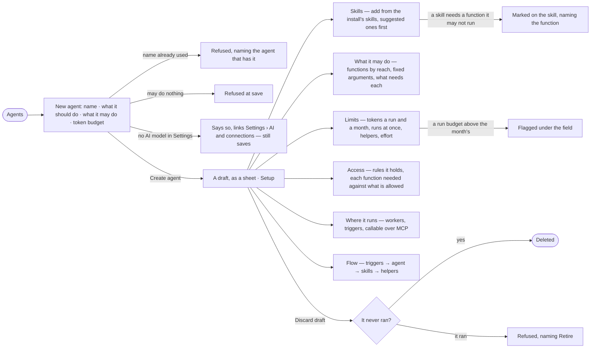

# AG-21 · Draft an agent and see what it will do

**As** an agent builder **I want** to make an agent from plain words — what it should do, what it may do, what it may
spend — and read, before it ever runs, which skills it has, what each needs, how far it reaches and what it does
**so that** giving it work is a choice I can predict, not a guess, and a refusal never surprises me.

Tasks: [task.md](task.md) · Feature: [AG-F01](../../feature.md)

## Who can

| Lens | Can | Otherwise sees |
|---|---|---|
| Admin | Create an agent, edit its draft, add and remove skills, set what it may do and its limits, make it the default, discard a draft | — |
| Operator | Read every agent's setup, what it may do, its limits, access and Flow | *New agent*, every edit and *Make default* disabled, naming *Can build agents* — *Ask Priya (owner)*. With *Can build agents*: every act an Admin has here |

## Flow

## Acceptance criteria

| # | Given | When | Then |
|---|---|---|---|
| AG-21.1 | A builder in Agents | they open *New agent* | a modal asks for a name, what it should do in plain words, what it may do (read the graph · tell people · change data · use the internet, each a switch) and a token budget |
| AG-21.2 | A filled *New agent* | they press *Create agent* | a draft is saved from a template whose *What it may do* comes with it, and opens as a sheet on Setup with a *Draft* chip |
| AG-21.3 | A name another agent already has, retired or not | they save | it is refused, naming the agent that has it |
| AG-21.4 | *What it may do* with nothing allowed | they save | it is refused: an agent that may run nothing is a mistake |
| AG-21.5 | No AI model offered in the install | they create an agent | it saves and says it has no model to think with, linking Settings › AI and connections |
| AG-21.6 | A draft | its Setup opens | it shows instructions, voice, skills, model version and effort, limits, access, where it runs and lifecycle; an agent with no skill says it runs on the graph's own plans alone |
| AG-21.7 | The skills of the install | the builder presses *Add a skill* | the picker lists published and draft skills, the template's suggested skills first; the added skill shows its version, when to use it, the functions it needs, and offered against applied — *too few to read* below the threshold |
| AG-21.8 | A skill that needs a function the agent may not run | it is added | its row marks the need, naming the function, with *Edit what it may do* — before any run is refused |
| AG-21.9 | *What it may do* | it opens | it reads *6 of 25 functions*, grouped by what each reaches (reads the graph · writes the graph · sends · …), each with the arguments fixed for this agent and what needs it; a function nothing needs reads *nothing needs it* |
| AG-21.10 | A function allowed only with an argument fixed | a plan sets that argument otherwise | the plan is refused before it runs, naming the function and the argument |
| AG-21.11 | Limits | they open | tokens a run and a month, runs at once, may create helpers, how deep and how many, and effort (steps, replans, questions) each sit beside what they bound and whether a run is stopped at it; an empty cell shows the number a run reads, never a dash |
| AG-21.12 | A run budget above the month budget | they type it | it is flagged under the field and Save is refused until it holds |
| AG-21.13 | The agent's own limits, the work's view of the graph and the graph's rules | Setup opens | they read as three rows that nest, so a refusal is predictable before it happens |
| AG-21.14 | A plan that names a function the agent may not run, or would pass a limit | it is about to run | it is refused before anything is dispatched, naming the bound and its side — the agent, the view of the graph, or a rule — and nothing is spent |
| AG-21.15 | An agent that proposes a change to its own limits | the proposal arrives | a narrowing is offered to apply; a widening is never proposed by the agent — only a person widens a limit |
| AG-21.16 | Access | it opens | the access rules it holds, then each function — its skills need it · its rules allow it · the person who started the run · the view of the graph · in effect · why not — and who it may hand work to (always · asks · never) |
| AG-21.17 | Where it runs | it opens | each kind of work its functions do, the workers that run it and their free slots; its triggers — the schedules that start it, *Can be given tasks*, *Runs with nobody to ask*; *Callable over MCP* disabled while it is a draft |
| AG-21.18 | Flow | it opens | triggers → the agent → its skills → the helpers it may create, drawn from records; the foot says it is drawn from the agent's instructions and skills, and that a run may replan within them, never wider |
| AG-21.19 | Edits on several parts of Setup | they press Save | one version is saved, carrying only what moved; adding a skill is saved on its own so a refusal names that skill |
| AG-21.20 | The graph's first agent able to answer questions | it is published | it is offered as the graph's default; making an agent the default that cannot answer questions is refused, naming why |
| AG-21.21 | A draft that never ran | they press *Discard draft* and confirm | it is deleted and Agents opens; an agent that has run or ships with Invana is refused, naming *Retire* |
| AG-21.22 | An Operator without *Can build agents* | they open an agent | every tab reads; *New agent*, every edit, *Make default* and *Discard draft* are disabled, naming *Can build agents*, with *Ask Priya (owner)* |
| AG-21.23 | A sheet whose engine read fails | it opens | the tab names what it could not read, in the engine's words; the rest of the sheet still reads |
| AG-21.24 | A run refused by the agent's limits | the person opens *How it got here* | its steps show the refused step, the bound and whose it was |

## Screens

| Surface | Lens | First use | Empty after a filter | Loading | Has data | Failed | Agent working or proposing | No access |
|---|---|---|---|---|---|---|---|---|
| Agents | Admin | agents · Only the graph's assistants | agents · No agents match | agents · Loading | agents | agents · Could not load | — | — |
| Agents | Operator | agents · Only the graph's assistants | agents · No agents match | agents · Loading | agents | agents · Could not load | — | agents · New agent disabled |
| New agent | Admin | agents.new | — | agents.new · Saving | agents.new | agents.new · Name taken | — | — |
| New agent | Operator | — | — | — | — | — | — | agents · New agent disabled |
| The agent · Setup | Admin | agents.agent · No skills yet | — | agents.agent · Loading | agents.agent | agents.agent · Could not load | — | — |
| The agent · Setup | Operator | agents.agent · No skills yet | — | agents.agent · Loading | agents.agent · Read only | agents.agent · Could not load | — | agents.agent · Read only |
| What it may do · limits | Admin | agents.agent · Template's limits | — | agents.agent · Loading | agents.agent · What it may do | agents.agent · Limit cannot hold | — | — |
| What it may do · limits | Operator | agents.agent · Template's limits | — | agents.agent · Loading | agents.agent · What it may do | agents.agent · Could not load | — | agents.agent · Read only |
| Access · where it runs | Admin | agents.agent · Access | — | agents.agent · Loading | agents.agent · Access | agents.agent · Could not load | — | — |
| Access · where it runs | Operator | agents.agent · Access | — | agents.agent · Loading | agents.agent · Access | agents.agent · Could not load | — | agents.agent · Read only |
| Flow | Admin | agents.agent · Flow empty | — | agents.agent · Loading | agents.agent · Flow | agents.agent · Could not load | — | — |
| Flow | Operator | agents.agent · Flow empty | — | agents.agent · Loading | agents.agent · Flow | agents.agent · Could not load | — | agents.agent · Flow |
