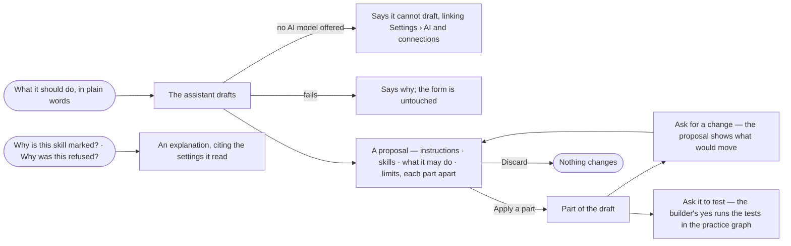

# AG-26 · Let the assistant draft and explain an agent

**As** an agent builder **I want** the assistant to draft an agent from what I say it should do, propose changes I
apply or discard, and explain any setting or refusal **so that** I start from a working draft and keep every decision
about it myself. *The assistant proposes → the builder decides.*

Tasks: [task.md](task.md) · Feature: [AG-F01](../../feature.md)

## Who can

| Lens | Can | Otherwise sees |
|---|---|---|
| Admin | Ask the assistant to draft an agent, propose changes, run its tests in the practice graph and explain; apply or discard every proposal | — |
| Operator | Ask the assistant to explain an agent — a setting, a skill's mark, a refusal | A request to draft or change an agent is answered with an explanation and *I can't change this agent — that needs Can build agents*, with *Ask Priya (owner)*. With *Can build agents*: drafts and proposals as an Admin |

## Flow

## Acceptance criteria

| # | Given | When | Then |
|---|---|---|---|
| AG-26.1 | *New agent* with what it should do in plain words | the builder asks the assistant to draft it | the assistant proposes instructions, skills to add, what it may do and limits, each part shown apart with *Apply* and *Discard*; nothing is saved until a part is applied |
| AG-26.2 | A proposal being drafted | the modal is open | it says the assistant is drafting and fills in each part as it lands; the form stays editable |
| AG-26.3 | A proposed part | the builder presses *Apply* | it joins the draft and can be edited like anything typed; *Discard* leaves the draft as it was |
| AG-26.4 | An agent's sheet | the builder asks for a change — *make it ask before sending* | the assistant proposes what would move, shown against what is saved, and applies nothing until the builder does |
| AG-26.5 | A proposal that would widen what the agent may do or its limits | it is shown | the widening is marked as the builder's act, never applied with the rest |
| AG-26.6 | A draft | the builder asks the assistant to test it | it asks first, then runs the agent's tests in the practice graph and reports the checks; it never publishes |
| AG-26.7 | Any member | they ask why a skill is marked, why a run was refused or what a limit does | the assistant explains, citing the settings and the refusal it read |
| AG-26.8 | No AI model offered in the install | the builder asks for a draft | the assistant says it cannot draft, linking Settings › AI and connections; the form still saves by hand |
| AG-26.9 | A draft that fails | it ends | the assistant says why in a sentence; the form is untouched |
| AG-26.10 | A proposal | the builder opens *How it got here* | its steps and the sources it read are shown, each assumption marked *Challenge this* |
| AG-26.11 | An Operator without *Can build agents* | they ask the assistant to draft or change an agent | it explains instead and says it cannot change the agent, naming *Can build agents*, with *Ask Priya (owner)* |

## Screens

| Surface | Lens | First use | Empty after a filter | Loading | Has data | Failed | Agent working or proposing | No access |
|---|---|---|---|---|---|---|---|---|
| The assistant's draft in New agent | Admin | agents.new | — | — | agents.new · Proposal | agents.new · Could not draft | agents.new · Drafting | — |
| The assistant's draft in New agent | Operator | — | — | — | — | — | — | agents · New agent disabled |
| A proposed change on the sheet | Admin | — | — | — | agents.agent · Proposal | agents.agent · Could not draft | agents.agent · Drafting | — |
| A proposed change on the sheet | Operator | — | — | — | — | — | — | agents.agent · Read only |
| An explanation | Admin | — | — | — | agents.agent · Explained | agents.agent · Could not load | agents.agent · Drafting | — |
| An explanation | Operator | — | — | — | agents.agent · Explained | agents.agent · Could not load | agents.agent · Drafting | — |
