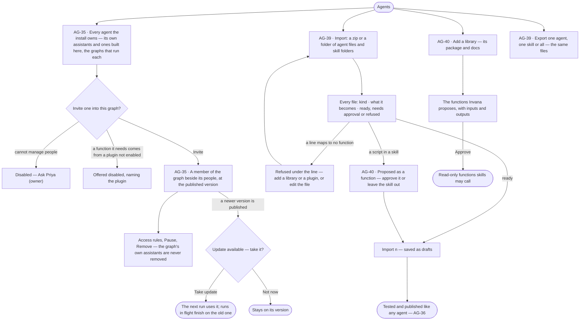
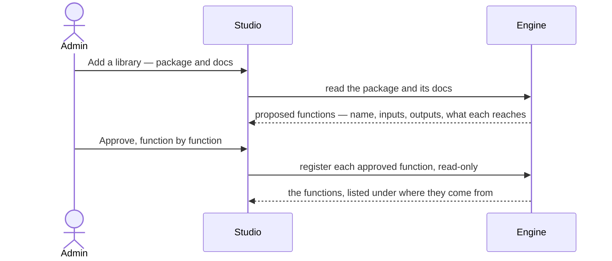

# The agents catalogue — import, export, invite

> Every agent and skill the install owns, built once and versioned; a graph invites the agents it needs the way it
> invites people, at a pinned version, and takes an update only when its owner chooses. Agents and skills come in as
> standard files and go out the same way; a library becomes functions only once an Admin approves them. The decision
> it helps make: *which agent should this graph have, at which version — and is this outside agent or library safe to
> let in?*

## User journey

## Stories

| ID | Story | Status |
|---|---|---|
| AG-35 | [See every agent the install owns and invite one into a graph](stories/AG-35-see-every-agent-the-install-owns-and-invite-one-into-a-graph/story.md) | idea |
| AG-39 | [Bring agents and skills in as standard files, and export them](stories/AG-39-bring-agents-and-skills-in-as-standard-files-and-export-them/story.md) | idea |
| AG-40 | [Turn a library into functions an Admin approves](stories/AG-40-turn-a-library-into-functions-an-admin-approves/story.md) | idea |

## Access

| Act | Role (`.claude/team/TEAM.md` §7) | Everyone else sees |
|---|---|---|
| Read every agent and skill in the install, its versions and the graphs that run each | Operator — every member of the install | — |
| Invite an agent into a graph · give it access rules · pause it there · remove it · take an update | `iam-admin` · shown as *Can manage people* · Owner · Admin | The graph's agents and what they did read; *Invite agent*, *Pause*, *Remove* and *Take update* disabled — *Ask Priya (owner)* |
| Import agents and skills · export them | Admin | *Import* and *Export* are absent |
| Add a library · approve the functions it proposes · approve a script as a function | Admin | *Add a library* is absent; proposed functions read *Waiting for an Admin* |
| Build or change an agent or skill in the catalogue | As AG-F01 and AG-F04 | As AG-F01 and AG-F04 |

## States

| State | What the person sees |
|---|---|
| First use | Agents holds only the assistants Invana ships, each marked *Included in every graph*. Import reads *Drop a zip or a folder* with what it takes |
| Empty after a filter | *No agents match* — the filters named, with *Clear filters* |
| Loading | Rows hold their shape; Import reads *Reading the files…* |
| Has data | Every agent with its version, kind (shipped · built here) and the graphs that run each; a graph's members with each agent's version and *Update available* where one is |
| Failed | A refused file names its line and what would make it map; a failed read names what could not load |
| Agent working or proposing | Invana reading a library and proposing its functions; Import mapping the files and compiling each skill's plan |
| No access | The catalogue reads; invite, update, pause and remove are disabled with *Ask Priya (owner)*; Import, Export and *Add a library* are an Admin's |

## Rules

| Rule | Detail |
|---|---|
| Agent → skills → functions | An agent carries skills, a skill calls functions, functions are code. Only an agent is added to a graph; a skill reaches a graph only inside an agent |
| Built once, invited everywhere | Agents and skills are built and versioned in the install's catalogue; a graph invites an agent as a member and gives it access — never its definition, budget or instructions |
| A graph never edits an agent | It invites, gives access rules, pauses and removes; the graph's own instructions and rules reach every agent in it |
| Pinned, with updates offered | A graph runs the version it invited; a newer published version is offered, and its owner moves to it in one act. Runs in flight finish on the version they opened with |
| The graph's own assistants | The assistants Invana ships are added to every new graph and stay: they may be paused there, never removed |
| The query skill follows the database | The assistants use the query skill of the language the graph's database speaks — Cypher, Gremlin or both |
| An agent has no graph role | Its reach is the access rules the graph gives it, and it always acts as the person who started the run ∩ the agent |
| Retired in the catalogue | Graphs that invited it keep their version; it is not offered to any other |
| The file is the standard | Agent files and skill folders round-trip unchanged; Invana's own fields ride under `metadata:`; plans, versions, tests and usage are kept beside them |
| A dry run first | Every file is mapped, every skill's plan compiled and every refusal named before anything is saved |
| Imported means draft | Imported agents and skills are drafts, tested and published like any other (AG-36) |
| Code only by approval | A library or a script reaches a plan only as a function an Admin approved; from then it is read-only |
| One plan everywhere | A skill version's plan reads only the function vocabulary, so it is the same in every graph |
| Leans on | Building an agent (AG-F01) · skills (AG-F04) · access rules (ST-F02) · plugins (ST-F04) · AI models (ST-F05) · a graph's members (ST-F01) |

## Data touched

| Record | Read or write |
|---|---|
| Agents and skills of the install, and their versions | Read · write on import |
| An agent invited into a graph — its version, status, who invited it | Write · read |
| The access rules it holds in that graph | Write (ST-F02) · read |
| An import's dry run — each file, what it maps to, its state | Read |
| A library, its proposed functions and their approval | Write · read |
| Exported files | Read |

## Decisions

| Decision | Detail |
|---|---|
| A graph's agents are its members | Invited in Settings › This graph › Members beside people, and in *Create a graph*'s people step; an agent's row opens its version, access, runs and tokens in this graph, with *Edit in Agents* |
| The catalogue shows where each agent runs | Each agent's row names the graphs that run it and at which version |
| An update is a chip | *Update available* on the agent's member row, and a line on its sheet saying what changed |
| A plugin not enabled | An agent whose functions need it is offered disabled, naming the plugin; an Admin enables it |
| Agent files | Markdown with YAML front-matter: `name` · `description` · `model` · `tools` · `skills`, the body its instructions; a TOML agent file is converted on import |
| Skill folders | `SKILL.md` and its folder become a draft version; a foreign `description` is split into what it does and when to use it, for the Admin to confirm |
| Model aliases on import | `sonnet` · `opus` · `inherit` resolve to an exact offered version, shown for the Admin to confirm |
| A name already in the catalogue | Offered as a new version of it, or a rename |
| Export | One agent, one skill or all — the same files with Invana's fields under `metadata:`; the plan is not exported |
| Not built yet | Inviting agents into a graph, updates, import, export and libraries have no engine yet |

## Open questions

| Question | Who answers |
|---|---|
| Who builds and publishes catalogue agents — an Admin only, or *Can build agents* in any graph? (AG-F01 states the engine's rule meanwhile) | Ravi |

## Not building

| Item | Why not |
|---|---|
| Creating or editing an agent or skill inside a graph | One place to build keeps the install simple; a graph shapes its agents through access rules, its instructions and its rules |
| Adding a skill to a graph | A skill only works inside an agent |
| Budgets or runs at once set per agent by a graph | Cost and capacity are set once, per graph, by an Admin (ST-F06) |
| Automatic updates in graphs | An update can change answers; the owner moves |
| Removing one of the graph's own assistants | Its product stops working without it; pause it instead |
| A graph role for an agent | It would let an agent do whatever that role may |
| A remote catalogue or hub | Later |
| A function editor | Functions are code |
| Running imported scripts without approval | Code reaches a plan only as an approved, read-only function |
| Code generated per run, or frozen into a plan at publish | Runs must reproduce, and installs on premises run only approved code |
| Importing `AGENTS.md` | It is instructions for a repository, not an agent; rules are written in Model |
| A shipped assistant for an experimental product | *Create a graph* promises nothing experimental |
