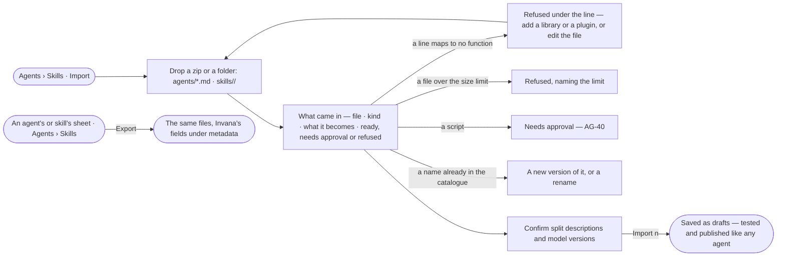

# AG-39 · Bring agents and skills in as standard files, and export them

**As** an install admin **I want** to bring agents and skills in as the standard files another agent system already
uses, see what each becomes before anything is saved, and export them the same way **so that** people move to Invana
without rewriting, and what Invana holds stays portable.

Tasks: [task.md](task.md) · Feature: [AG-F02](../../feature.md)

## Who can

| Lens | Can | Otherwise sees |
|---|---|---|
| Admin | Import a zip or a folder, confirm what each file becomes, import; export one agent, one skill or all | — |
| Operator | Read imported agents and skills once they are saved | *Import* and *Export* are absent. No grant adds them: they are an Admin's |

## Flow

## Acceptance criteria

| # | Given | When | Then |
|---|---|---|---|
| AG-39.1 | Agents › Skills | an Admin presses *Import* | a drop target takes a zip or a folder holding `agents/*.md` and `skills/<name>/`; nothing is saved until *Import* |
| AG-39.2 | Dropped files | they are read | *What came in* lists every file — its kind, what it becomes and its state: *ready*, *needs approval* or *refused* |
| AG-39.3 | An agent file | it is read | its front-matter `name` · `description` · `model` · `tools` · `skills` and its body become the agent and its instructions; Invana's own fields — voice, voice dials, effort, its tests — are read from `metadata:` when present; a TOML agent file is converted to the same shape |
| AG-39.4 | A skill folder | it is read | `SKILL.md` and its folder become a draft version; a foreign description is split into what it does and when to use it, shown for the Admin to confirm |
| AG-39.5 | A skill's instructions | the import is dry run | each skill's plan is compiled; a line that maps to no function is refused under that line, naming what would make it map — a library, a plugin or a rewrite |
| AG-39.6 | A file in a skill's `scripts/` | it is read | it is proposed as a function and reads *needs approval*; the skill imports only once it is approved or the skill is left out (AG-40) |
| AG-39.7 | A model alias — `sonnet`, `opus`, `inherit` | it is read | it resolves to an exact version offered in Settings › AI and connections, shown for the Admin to confirm; one no provider serves imports with no model to think with until a version is picked |
| AG-39.8 | A name already in the catalogue | it is read | it is offered as a new version of that agent or skill, or a rename |
| AG-39.9 | A `references/` file over the size limit | it is read | it is refused, naming the limit in characters |
| AG-39.10 | Nothing refused | the Admin presses *Import n* | every agent and skill is saved as a draft; a skill with no tests imports and waits for them before it publishes |
| AG-39.11 | An agent, a skill or the whole catalogue | the Admin presses *Export* | the same standard files are written, Invana's fields under `metadata:`; the plan is not exported |
| AG-39.12 | Files being read | the dry run is in progress | it reads *Reading the files…* and each row fills in as it is mapped |
| AG-39.13 | A member who is not an Admin | they open Agents › Skills or a sheet | *Import* and *Export* are absent |

## Screens

| Surface | Lens | First use | Empty after a filter | Loading | Has data | Failed | Agent working or proposing | No access |
|---|---|---|---|---|---|---|---|---|
| Import | Admin | agents.skills · Import | — | agents.skills · Reading the files | agents.skills · What came in | agents.skills · Refused line | agents.skills · Mapping | — |
| Import | Operator | — | — | — | — | — | — | agents.skills |
| Export — a skill | Admin | — | — | — | agents.skill · Export | agents.skill · Could not export | — | — |
| Export — a skill | Operator | — | — | — | — | — | — | agents.skill |
| Export — an agent | Admin | — | — | — | agents.agent · Export | agents.agent · Could not export | — | — |
| Export — an agent | Operator | — | — | — | — | — | — | agents.agent · Read only |
