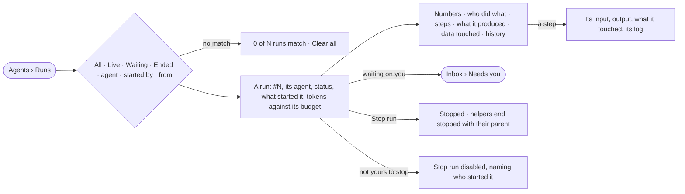

# AG-23 · Find a run and see where it stands

**As** an analyst **I want** every run in the graph in one list, and each run read the same way — its numbers, who did
what, each step's input and output, what it produced and touched, and what waits on me **so that** I know where a run
stands and can check any of it.

Tasks: [task.md](task.md) · Feature: [AG-F03](../../feature.md)

## Who can

| Lens | Can | Otherwise sees |
|---|---|---|
| Admin | Read every run; stop any run | — |
| Operator | Read every run they can open; stop a run they started | A run they cannot open is not listed and its link reads *not found*; *Stop run* on someone else's run is disabled, naming who started it |

## Flow

## Acceptance criteria

| # | Given | When | Then |
|---|---|---|---|
| AG-23.1 | Runs in the graph | the person opens Runs | tiles read live · waiting on you · served in 24 h · not served in 24 h · tokens in 24 h, over every run, newest first |
| AG-23.2 | The runs list | it is read | each row reads `#number` · agent · what was asked · from (Explore · Task · Schedule · Project · API) · started by · agents used · tokens · time · status, the reason it ended once it has |
| AG-23.3 | The list | the person picks *Live*, *Waiting* or *Ended*, or an agent, a starter or a from | only those runs list, each filter shown as a chip with ×, and *Clear all*; the filters ride the link |
| AG-23.4 | Filters that match nothing | the list is read | *0 of N runs match* with *Clear all* |
| AG-23.5 | Nothing ran | Runs opens | it says what a run is, and that a question, a task or a schedule starts one |
| AG-23.6 | A row | the person opens it | the run opens as a sheet titled `Run #N`: its agent, status, what started it (*Task by ravi · "…"*, *asked in Explore by meera*), tokens against its budget as a meter |
| AG-23.7 | A run's numbers | they read | time · tokens · agents · steps · what it produced · records touched, with a bar per agent over time, its state in words, and steps a minute |
| AG-23.8 | Who did what | it reads | who made whom: the task or question, the agent, every helper with its state and its tokens against what it was given |
| AG-23.9 | Steps | they read | one card per step of the plan, in order, with calls, how many ran side by side, time and counts in and out on each edge |
| AG-23.10 | A step | the person opens it | its input, output, what it touched and its log open inside the run; a step that fanned out opens on its first part with *All parts* |
| AG-23.11 | What it produced | it reads | every answer, file, branch and task the run made, with the step and agent that made it |
| AG-23.12 | Data touched | it reads | graph types read, written and refused · web domains and pages, refused and why · tokens by model version · secrets used, by name, and where |
| AG-23.13 | History | it reads | the run's history rows (IN-F03), filtered to it |
| AG-23.14 | An ask the run waits on, routed to the reader | the run is read | it is listed under *Waiting on you* and opens it in *Needs you* |
| AG-23.15 | A run still going | its sheet is open | it reads *running* with time so far, its agents and steps filling in, refreshed every few seconds |
| AG-23.16 | A run its starter stops | they press *Stop run* | the run ends *stopped*, each helper *stopped with its parent*, and both are history rows; an ended run offers no *Stop run* |
| AG-23.17 | An ended run with asks pending | it ends | each ask closes as expired and leaves *Needs you* |
| AG-23.18 | A run whose steps were cleared by retention | Steps is read | it says the steps were cleared; the numbers keep their stored values |
| AG-23.19 | A number the engine did not record | it is shown | it reads `—`, never `0` |
| AG-23.20 | An Operator on someone else's run | they open it | everything reads; *Stop run* is disabled, naming who started it |
| AG-23.21 | A run the person cannot open | they follow a link to it | it reads *not found*; the run is not listed |
| AG-23.22 | A run | its answer is opened | *How it got here* shows its steps and sources |

## Screens

| Surface | Lens | First use | Empty after a filter | Loading | Has data | Failed | Agent working or proposing | No access |
|---|---|---|---|---|---|---|---|---|
| Runs — the list | Admin | agents.runs · Nothing ran | agents.runs · No runs match | agents.runs · Loading | agents.runs | agents.runs · Could not load | agents.runs · Running | — |
| Runs — the list | Operator | agents.runs · Nothing ran | agents.runs · No runs match | agents.runs · Loading | agents.runs | agents.runs · Could not load | agents.runs · Running | agents.runs |
| A run — head and numbers | Admin | — | — | agents.run · Loading | agents.run | agents.run · Failed | agents.run · Running | — |
| A run — head and numbers | Operator | — | — | agents.run · Loading | agents.run · Not yours to stop | agents.run · Failed | agents.run · Running | agents.run · Not found |
| A run — who did what, steps, a step | Admin | — | — | agents.run · Loading | agents.run · Step | agents.run · Step failed | agents.run · Running | — |
| A run — who did what, steps, a step | Operator | — | — | agents.run · Loading | agents.run · Step | agents.run · Step failed | agents.run · Running | agents.run · Not found |
| A run — produced, data touched, history | Admin | — | — | agents.run · Loading | agents.run · Touched | agents.run · Could not load | — | — |
| A run — produced, data touched, history | Operator | — | — | agents.run · Loading | agents.run · Touched | agents.run · Could not load | — | agents.run · Not found |
| Waiting on you — the ask in Inbox | Admin | — | — | inbox · Loading | inbox | — | — | — |
| Waiting on you — the ask in Inbox | Operator | — | — | inbox · Loading | inbox | — | — | inbox · Not yours to answer |
