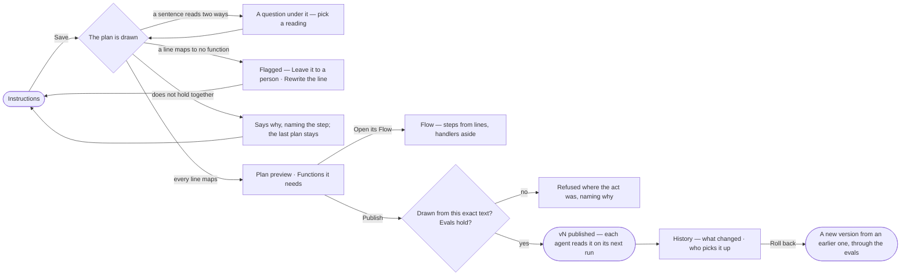

# AG-19 · Write a skill as a document and see the plan it becomes

**As** an agent builder **I want** to write a skill as a document, with the functions it needs beside it, see its Flow
— what the instructions resolve to — and publish or roll back a version with evidence **so that** the instructions are
the work, the flow is their consequence, and I never draw a plan by hand.

Tasks: [task.md](task.md) · Feature: [AG-F04](../../feature.md)

## Who can

| Lens | Can | Otherwise sees |
|---|---|---|
| Admin | Edit the draft, add functions, answer the planner's questions, choose for a flagged line, publish, roll back | — |
| Operator | Read the instructions, Plan preview, Functions it needs, Flow and History | The editor is read-only; *Add functions*, *Publish*, *Edit instructions* and *Roll back* are disabled, naming *Can build agents* — *Ask Priya (owner)*. With *Can build agents*: as Admin |

## Flow

## Acceptance criteria

| # | Given | When | Then |
|---|---|---|---|
| AG-19.1 | A draft | the builder saves the instructions | the draft is written and the plan is drawn again; the Plan preview reads *Drawing…* over the last plan, and the editor stays editable |
| AG-19.2 | A plan drawn | Instructions reads | the Plan preview lists the plan's steps with their bounds and each handler under the step it guards; *Functions it needs* lists the functions the plan calls, each with its bound |
| AG-19.3 | A builder | they press *Add functions* and pick some | the picker groups the install's functions by where they come from, a send marked *send*; *Add N* writes a step line naming each into Steps, and the next draw maps it |
| AG-19.4 | A sentence that matches two or more functions or plans | the plan is drawn | nothing is drawn; a question sits under that sentence, quoting it, each reading a button naming the step it would write |
| AG-19.5 | A question | the builder picks a reading | the answer is kept on the version so a redraw never asks again, the instructions are offered the edit that would have avoided it, and the plan draws again at once |
| AG-19.6 | A draw that would need a fourth question | it is drawn | the sentence still read two ways becomes a step a person does |
| AG-19.7 | A line no function can do | the plan is drawn | it is flagged under the document naming its line, with *Leave it to a person* and *Rewrite the line*; the preview says why it cannot draw and keeps the last plan, marked *from an earlier text*; Publish is disabled |
| AG-19.8 | A flagged line | the builder presses *Leave it to a person* | the line is rewritten as *A person does this: …* and the draft saved; the next draw maps it as a person's step |
| AG-19.9 | A drawn plan that does not hold together — a step that needs another first, or reads an output nothing writes | it is drawn | nothing is written; it says why where the flow would be, naming the step and what it wanted, and the plan that was there is untouched |
| AG-19.10 | A sentence that names a library plan | the plan is drawn | that plan's steps are copied into this skill's plan, each reading *from nl-single@1*; an argument the library plan does not declare refuses the draw, naming it |
| AG-19.11 | A plan that copied a library plan | the library publishes a newer version | the skill's plan does not move; *Composed* says *vN exists*, and only a redraw someone asks for takes it |
| AG-19.12 | Flow | it opens | the plan is drawn top-down, each step tied to the line it came from, handlers and gaps to their right; *From the instructions* maps every line to its step or handler; the foot says it is drawn from the instructions, vN, and that a run may replan within what the skill may use |
| AG-19.13 | Flow | the builder selects a step, or a line | a step shows its line, bound and side effect, and the line highlights; a line selects its step; a line that drew no step is marked unmapped |
| AG-19.14 | A plan drawn | the person opens it in Runs | the drawing is a run like any run; *How it got here* shows its steps, the sentences it read and the functions and plans it weighed |
| AG-19.15 | Instructions changed since the last draw | the builder publishes | publishing is refused — *the plan was drawn from an earlier text — draw again* |
| AG-19.16 | A draft whose evals hold | the builder presses *Publish vN* | the text, its answers and its plan publish as one version; each agent it is added to reads it on its next run, and a run in flight finishes on the version it opened with |
| AG-19.17 | A publish | History opens | *Regenerated — vN* lists steps added, removed and changed against the version before, or says *The plan did not change with this version*; *Who picks it up* lists every agent it is added to as *next run* |
| AG-19.18 | History | the builder presses *Roll back* on an earlier version, with a reason | a new version copies that version's instructions, model version and plan, through the evals; the version it copied is named on it |
| AG-19.19 | An open draft, or the current version | the builder rolls back | it is refused, naming the draft or that there is nothing to restore; the draft is never overwritten |
| AG-19.20 | An Operator without *Can build agents* | they open a skill | the sheet opens with *You can read this skill. Editing needs Can build agents — Ask Priya (owner)*; every tab reads; the editor is read-only and each act is disabled |

## Screens

| Surface | Lens | First use | Empty after a filter | Loading | Has data | Failed | Agent working or proposing | No access |
|---|---|---|---|---|---|---|---|---|
| Instructions — editor, Functions it needs, Plan preview | Admin | agents.skill · New draft | — | agents.skill · Loading | agents.skill · Draft | agents.skill · Does not hold together | agents.skill · Drawing | — |
| Instructions — editor, Functions it needs, Plan preview | Operator | agents.skill · Read only | — | agents.skill · Loading | agents.skill · Read only | agents.skill · Could not load | agents.skill · Drawing | agents.skill · Read only |
| A question under a sentence | Admin | — | — | — | agents.skill · A question | — | agents.skill · A question | — |
| A question under a sentence | Operator | — | — | — | agents.skill · Read only | — | agents.skill · Read only | agents.skill · Read only |
| A flagged line | Admin | — | — | — | agents.skill · Unmapped line | agents.skill · Unmapped line | — | — |
| A flagged line | Operator | — | — | — | agents.skill · Read only | agents.skill · Read only | — | agents.skill · Read only |
| Add functions | Admin | — | — | agents.skill · Loading | agents.skill · Add functions | agents.skill · Could not load | — | — |
| Add functions | Operator | — | — | — | — | — | — | agents.skill · Read only |
| Flow | Admin | agents.skill · Nothing drawn | — | agents.skill · Loading | agents.skill · Flow | agents.skill · Flow gap | agents.skill · Drawing | — |
| Flow | Operator | agents.skill · Nothing drawn | — | agents.skill · Loading | agents.skill · Flow | agents.skill · Flow gap | agents.skill · Drawing | agents.skill · Flow |
| A step selected | Admin | — | — | — | agents.skill · Flow step | — | — | — |
| A step selected | Operator | — | — | — | agents.skill · Flow step | — | — | agents.skill · Flow step |
| Publish | Admin | — | — | — | agents.skill · Publish | agents.skill · Publish refused | agents.skill · Eval running | — |
| Publish | Operator | — | — | — | — | — | — | agents.skill · Read only |
| History | Admin | agents.skill · History one version | — | agents.skill · Loading | agents.skill · History | agents.skill · Roll back refused | — | — |
| History | Operator | agents.skill · History one version | — | agents.skill · Loading | agents.skill · History | agents.skill · Could not load | — | agents.skill · History |
| The drawing as a run | Admin | — | — | agents.run · Loading | agents.run | agents.run · Failed | agents.run · Running | — |
| The drawing as a run | Operator | — | — | agents.run · Loading | agents.run | agents.run · Failed | agents.run · Running | agents.run · Not found |
