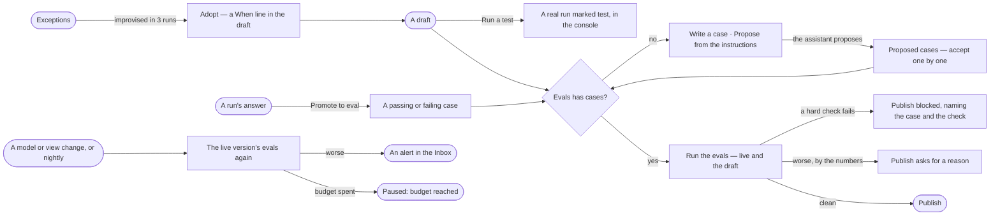

# AG-20 · Test a skill, keep its eval cases and adopt what runs improvise

**As** an agent builder **I want** to test a skill on real questions, keep eval cases every draft is replayed against
before it publishes and again when what it depends on changes, and adopt the handlers runs keep improvising **so that**
a skill improves from evidence and a change that makes it worse is caught the day it ships, not when someone notices.

Tasks: [task.md](task.md) · Feature: [AG-F04](../../feature.md)

## Who can

| Lens | Can | Otherwise sees |
|---|---|---|
| Admin | Run a test; write, accept and delete eval cases; ask for proposed cases; run the evals; promote a run's answer to a case; adopt a handler; set the graph's eval token budget | — |
| Operator | Read test runs, eval cases and results, exceptions and alerts | *Run a test*, *Run the evals*, *Propose from the instructions*, *Promote to eval* and *Adopt* disabled, naming *Can build agents* — *Ask Priya (owner)*. With *Can build agents*: as Admin, except the eval token budget, which stays the Owner's |

## Flow

## Acceptance criteria

| # | Given | When | Then |
|---|---|---|---|
| AG-20.1 | A draft | the builder presses *Run a test* with a question | a real run of the draft opens, marked *test*, paid from the eval token budget; it lists in the console under the document and on Tests, and counts in no agent's numbers |
| AG-20.2 | A test run | the builder opens it | it opens as a run; *How it got here* shows its steps and sources |
| AG-20.3 | Evals | it opens | the skill's cases read, each a question with its checks and *passing* or *failing*; a judged rubric names the model version that judges it |
| AG-20.4 | A case | the builder writes it | its checks are hard and counted — cites records · names the view of the graph · says *cannot answer* when it should · a rule held · expected records present · tokens under N · time under N |
| AG-20.5 | A judge set to the model version under test | the builder saves the set | it is refused, naming both |
| AG-20.6 | A skill with no cases | the builder presses *Propose from the instructions* | the assistant proposes up to five cases from the instructions, each waiting as *proposed* until a person accepts it; *How it got here* shows what it read and the model version that wrote them |
| AG-20.7 | Cases | the builder presses *Run the evals* | every case replays on live and on the draft; tiles read hard checks passed, changed answers, time p95 and tokens per case, and the draft against live as the engine states it — *▲ 11% vs live* or *same as live* |
| AG-20.8 | An eval run in progress | the sheet is open | the cases fill in as each ends; the rest of the sheet stays usable |
| AG-20.9 | A hard check that fails on the draft | the builder publishes | publishing is refused where the act was, naming the case, the check and the answer |
| AG-20.10 | Tokens or time over 20% above live, or a judged score 0.5 below it | the builder publishes | it warns with the numbers and asks for a reason, kept with the version |
| AG-20.11 | No eval run over this exact draft, or one still running | the builder publishes | it is refused, naming the case count, with *Run the evals* |
| AG-20.12 | A skill with no active case | the builder publishes | it publishes, and the gate says *No eval set — nothing checked* |
| AG-20.13 | A judged score | it is shown | it is labelled judged and kept apart from the hard checks; it warns, never blocks |
| AG-20.14 | A run's answer | a builder presses *Promote to eval*, *passing* or *failing* | it becomes a case of that skill with the question and checks, keeping its run; an agent never promotes |
| AG-20.15 | A case whose run is gone | it is read | it keeps its question and checks; its link reads *source gone* |
| AG-20.16 | The live version | its model version moves, the graph's model publishes, a view of the graph or rule it reads changes, or the night comes | its evals run again on live |
| AG-20.17 | A run of the evals again with fewer hard checks passing, or time or tokens past 1.5× the last | it settles | an alert names the skill, what changed and the numbers, in *Needs you* for the skill's builder and in History |
| AG-20.18 | The graph's eval token budget spent | a scheduled eval run would start | it settles *paused: budget* and says so; a publish-time run still runs, its result carrying the warning |
| AG-20.19 | Exceptions | it opens | runs · replanned · replans a run p95 · hit the limit over 30 days, then each exception with where it happened, how it was handled, where the handler came from, seen and served after; with none recorded it reads *No exceptions recorded yet* |
| AG-20.20 | The same improvised handler in 3 runs | Exceptions reads it | it proposes it as a *When* line; *Adopt* writes it into the draft and opens Instructions, and the evals gate its publish like any edit |
| AG-20.21 | The graph's Owner or an Admin | they open Settings › Usage | the graph's monthly eval token budget reads beside what evals and tests spent this month, apart from what its agents spent, and they may change it; Evals reads the same spent-of-budget line |
| AG-20.22 | A skill never run | Usage, Exceptions or Tests opens | each reads *Not run yet* with the act that fills it |
| AG-20.23 | An Operator without *Can build agents* | they open Tests, Evals or Exceptions | everything reads; every act is disabled, naming *Can build agents*, with *Ask Priya (owner)* |

## Screens

| Surface | Lens | First use | Empty after a filter | Loading | Has data | Failed | Agent working or proposing | No access |
|---|---|---|---|---|---|---|---|---|
| Tests — the console and the tab | Admin | agents.skill · Not run yet | — | agents.skill · Loading | agents.skill · Tests | agents.skill · Could not load | agents.skill · Testing | — |
| Tests — the console and the tab | Operator | agents.skill · Not run yet | — | agents.skill · Loading | agents.skill · Tests | agents.skill · Could not load | agents.skill · Testing | agents.skill · Tests |
| Evals | Admin | agents.skill · No eval set | — | agents.skill · Loading | agents.skill · Evals | agents.skill · Gate blocked | agents.skill · Proposing cases | — |
| Evals | Operator | agents.skill · No eval set | — | agents.skill · Loading | agents.skill · Evals | agents.skill · Gate blocked | agents.skill · Eval running | agents.skill · Evals |
| An eval run | Admin | — | — | agents.skill · Loading | agents.skill · Evals | agents.skill · Budget paused | agents.skill · Eval running | — |
| An eval run | Operator | — | — | agents.skill · Loading | agents.skill · Evals | agents.skill · Budget paused | agents.skill · Eval running | agents.skill · Evals |
| Promote to eval, on a run | Admin | — | — | agents.run · Loading | agents.run · Promote to eval | agents.run · Failed | — | — |
| Promote to eval, on a run | Operator | — | — | agents.run · Loading | agents.run | agents.run · Failed | — | agents.run |
| Exceptions | Admin | agents.skill · No exceptions recorded | — | agents.skill · Loading | agents.skill · Exceptions | agents.skill · Could not load | agents.skill · Adopt | — |
| Exceptions | Operator | agents.skill · No exceptions recorded | — | agents.skill · Loading | agents.skill · Exceptions | agents.skill · Could not load | agents.skill · Exceptions | agents.skill · Exceptions |
| The alert that a skill got worse | Admin | — | — | inbox · Loading | inbox · Skill got worse | — | — | — |
| The alert that a skill got worse | Operator | — | — | inbox · Loading | inbox · Skill got worse | — | — | inbox · Skill got worse |
| The eval token budget | Admin | settings.usage · No eval budget | — | settings.usage · Loading | settings.usage · Eval token budget | settings.usage · Could not load | — | — |
| The eval token budget | Operator | settings.usage · No eval budget | — | settings.usage · Loading | settings.usage · Read only | settings.usage · Could not load | — | settings.usage · Read only |
