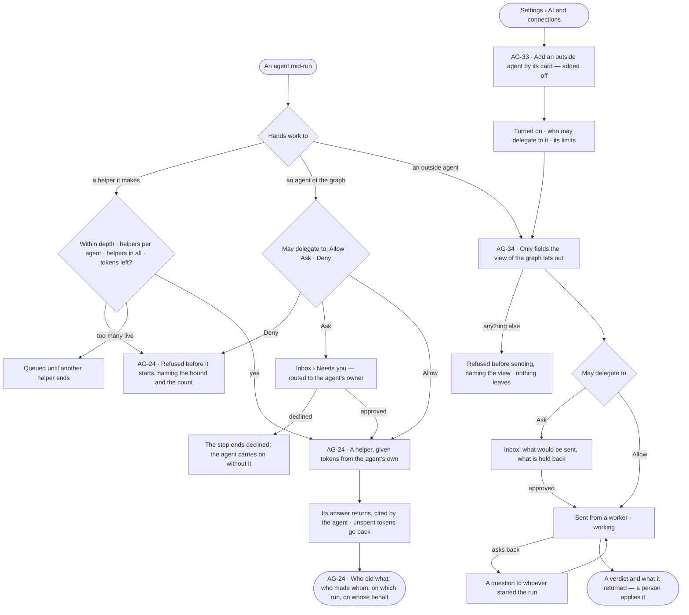
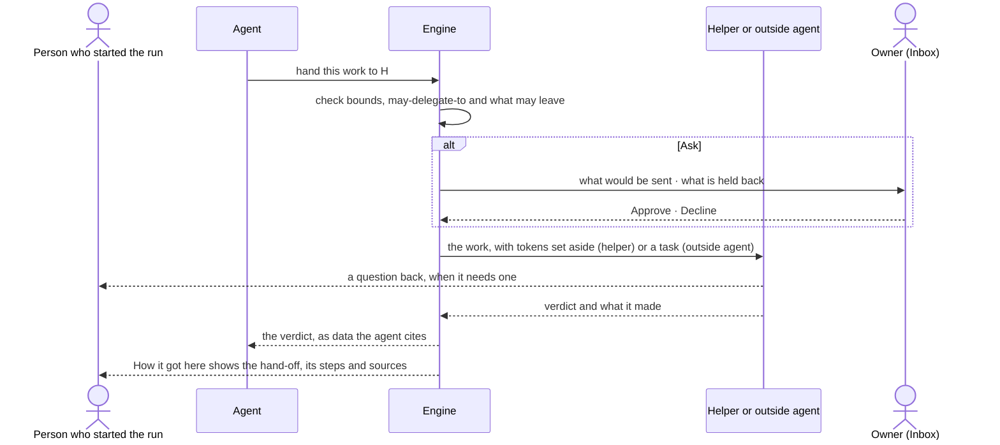

# Delegation and outside agents

> An agent hands part of its work to another agent — a helper it makes for the work, an agent the graph already has,
> or an agent outside Invana — always inside bounds it cannot argue with, every hand-off drawn on the run with who made
> whom, on whose behalf, and what came back. The decisions it helps make: *may this agent hand this work on, to whom,
> and is what came back fit to use?*

## User journey

Journeys this feature is a step of: [J03 · Give an agent work and decide on the result](../../../../journeys/J03-give-an-agent-work-and-decide-on-the-result.md)

## Stories

| ID | Story | Status |
|---|---|---|
| AG-24 | [See who made whom, and hand work to a helper within bounds](stories/AG-24-see-who-made-whom-and-hand-work-to-a-helper-within-bounds/story.md) | idea |
| AG-33 | [Add an outside agent by its card](stories/AG-33-add-an-outside-agent-by-its-card/story.md) | idea |
| AG-34 | [Hand a fix to an outside agent and get its result back](stories/AG-34-hand-a-fix-to-an-outside-agent-and-get-its-result-back/story.md) | idea |

## Access

| Act | Role (`.claude/team/TEAM.md` §7) | Everyone else sees |
|---|---|---|
| Read who made whom, every hand-off and what came back on a run | Operator — anyone who can open the run | A run they cannot open reads *not found* |
| Set what an agent may hand on — may make helpers, its bounds, *May delegate to* | `builder` · shown as *Can build agents* · Admin | The settings read; editing is disabled, naming *Can build agents* |
| Approve or decline a hand-off that asks each time | The owner of the agent asked for (IN-F01) | The ask reads, naming who it waits on |
| Answer an outside agent's question back | Whoever started the run | The question reads, naming who it waits on |
| Add, turn on or off, read again or remove an outside agent | Admin, in Settings › AI and connections | Outside agents read; each act is disabled, naming the Admin |
| Apply what an outside agent returned — merge, publish | A person, outside Invana or in the record's own feature | Invana applies none of it |

## States

| State | What the person sees |
|---|---|
| First use | A run with one agent draws it alone; no outside agent added yet — what one is, and *Add an outside agent* for an Admin |
| Empty after a filter | — |
| Loading | The run's head drawn at once; who did what loads in place |
| Has data | Who made whom with each helper's state and tokens against what it was given; an outside agent's task with its state and what came back |
| Failed | A refused hand-off names the bound, the count or the view of the graph; a helper's failure is the agent's evidence, never a silent gap |
| Agent working or proposing | Helpers running or queued; an outside agent *working*; a hand-off waiting on an ask, drawn dashed |
| No access | Settings read; acts disabled, naming who may; a run they cannot open reads *not found* |

## Rules

| Rule | Detail |
|---|---|
| Handing on is a step | Making a helper, delegating and waiting for answers are steps of the plan, checked against what the agent may do before they run |
| Bounded four ways | Depth below the first agent · helpers per agent · helpers in all · helpers live at once. Past the first three it is refused before it starts, naming the bound and the count; past the fourth the helper waits *queued* |
| Tokens are set aside | Making or delegating to a helper sets tokens aside from the agent's remaining budget; unspent tokens return when it ends, and a history row says so. Asking for more than remains is refused, naming what remains |
| A helper is never wider | It works inside the view of the graph its run opened with, and within the agent's own bounds; it may only narrow them |
| Helpers end with the work | A helper is made for one piece of work and retires when it closes; its row and its runs are kept |
| A delegated agent keeps its own access | An agent of the graph asked for help works with its own access, narrowed by the root agent's own rule, inside both views of the graph, paid from the asker's tokens; the strictest value along the caller chain binds ([The strictest along the caller chain](../../../settings/product.md#decisions)) |
| *May delegate to* is a line | Each agent's Allow · Ask · Deny is a line like any other; the strictest of it and every rule for everyone binds |
| No loops | An agent already in the run's chain cannot be asked again; an outside agent cannot call back into the graph inside the same task |
| Every helper ends for one reason | served · cannot answer · out of tokens · out of time · out of steps · no progress · loop · stopped with its parent · stopped · failed |
| Stopping cascades | Stopping an agent's run stops every helper beneath it |
| An answer is data | What a helper or an outside agent returns is cited by the agent, never obeyed as an instruction |
| Only what may leave, leaves | An outside agent receives only fields the view of the graph lets out and the skill marks to send; anything else refuses the step before sending |
| Ask by default | A new outside agent is *Ask* for every agent until a person says otherwise |
| Invana applies nothing that came back | A pull request, a patch or a report from an outside agent is kept on the run; a person applies it |
| An outside agent's own limits | Time, attempts and tasks at once; Invana's tokens cover only its own side |
| Leans on | Build an agent (AG-F01) · runs (AG-F03) · the Inbox (IN-F01) · views of the graph (MO-F05) · workers (ST-F06) · AI and connections (ST-F05) |

## Data touched

| Record | Read or write |
|---|---|
| Helper agents — who made them, on which run, retired with the work | Write · read |
| A helper's run — tokens set aside and returned, why it ended | Write · read |
| *May delegate to* on an agent | Write · read |
| Delegation asks and their answers (IN-F01) | Write · read |
| Outside agents — card, endpoint, skills on the card, credential name, workers they call from, limits, on or off | Write · read (Admin) |
| An outside task — state, what was sent, what was held back, what came back | Write · read |
| History rows of every hand-off (IN-F03) | Write · read |

## Decisions

| Decision | Detail |
|---|---|
| Who made whom is drawn | On the run's *Who did what*: the person or task, the first agent, every helper with its state, its depth and its tokens against what it was given; many helpers under one agent collapse to a count |
| The floor is drawn | Each helper reads its depth; a refusal at the floor is drawn in place, naming the bound |
| A helper's bounds read beside its parent's | View of the graph, what it may do and its tokens, bound by bound, the parent's beside the helper's |
| On behalf of | Read from the record of each hand-off, never restated by the agent |
| Retired helpers stay drawn | Marked retired, still selectable |
| Making helpers is a setting of what it may do | An agent makes helpers only when what it may do includes it; one agent that ships with Invana may — the Coordinator — and it is not the graph's default |
| *Allow always* on an ask | Writes *Allow* for that agent into the asker's *May delegate to* |
| An outside agent is added by its card | Its name, version, skills and how it signs in are read and kept as they were read; a change on its side reaches nothing until an Admin reads the card again |
| An outside agent is an agent | Listed with the graph's agents as *outside*; it shows in Flow, Runs and History like any agent, and is never given a task |
| MCP carries tools, outside agents carry tasks | A task asks back, has states and returns what it made; a tool call is one request and one answer (ST-F04) |
| Calls go out from workers | From workers that can reach it, with its credential set on them; nothing passes through a hosted service |

## Open questions

| Question | Who answers |
|---|---|
| Who owns an agent for routing a delegation ask, now agents are built once for the install (AG-F02) — the builder who published it, or the graph's owner? | Ravi |

## Not building

| Item | Why not |
|---|---|
| Helpers that outlive the work by default | An agent that outlives its reason accumulates silently |
| Handing work across graphs | The graph is the reasoning boundary |
| Agents chatting with each other | Delegation is a task with a verdict; an agent asks a person, never another agent |
| Editing who made whom | It is what happened |
| An org chart of agents | Who made whom is causal, not a hierarchy |
| Outside agents delegating into this graph | Later; an outside agent reaches a graph over its MCP server, under a key (ST-F04) |
| An outside agent applying its own result | A person merges or publishes |
| Chatting with an outside agent | A hand-off is a task with a verdict |
| Paying an outside agent from the token budget | Its cost is its own; Invana bounds it by time, attempts and tasks at once |
