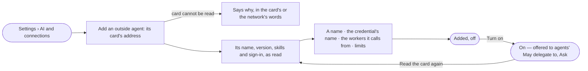

# AG-33 · Add an outside agent by its card

**As** an install admin **I want** to add an agent outside Invana by its agent card, and say which of our agents may
hand it work **so that** outside agents join the work under the same rules as ours.

Tasks: [task.md](task.md) · Feature: [AG-F05](../../feature.md)

## Who can

| Lens | Can | Otherwise sees |
|---|---|---|
| Admin | Add an outside agent, turn it on or off, read its card again, set its limits, remove it | — |
| Operator | Read every outside agent, its skills and its limits | *Add an outside agent* and every act disabled, naming the Admin |

## Flow

## Acceptance criteria

| # | Given | When | Then |
|---|---|---|---|
| AG-33.1 | An Admin | they give an outside agent's card address | its name, version, how it signs in and the skills on its card are read and shown before it is added |
| AG-33.2 | A card that cannot be read | they add it | it says why, and nothing is added |
| AG-33.3 | A card read | the Admin names it, the credential's name and the workers it calls from | it is added *off*, the card kept as it was read |
| AG-33.4 | An outside agent | the Admin turns it on | agents' *May delegate to* offers it, *Ask* by default, with the skills on its card |
| AG-33.5 | A card changed on the other side | nothing is done | nothing changes until an Admin presses *Read the card again*; a skill the card has dropped refuses, naming the card's date |
| AG-33.6 | An outside agent | it is read | it shows its endpoint, skills, credential name (never its value), workers it calls from, limits — time, attempts, tasks at once — and on or off |
| AG-33.7 | An outside agent | it is listed with the graph's agents | it reads *outside*, is never offered a task, and holds no token budget of its own |
| AG-33.8 | An Operator | they open AI and connections | outside agents read; *Add an outside agent*, *Turn on*, *Read the card again* and *Remove* are disabled, naming the Admin |

## Screens

| Surface | Lens | First use | Empty after a filter | Loading | Has data | Failed | Agent working or proposing | No access |
|---|---|---|---|---|---|---|---|---|
| Outside agents in AI and connections | Admin | settings.ai · No outside agents | — | settings.ai · Loading | settings.ai · Outside agents | settings.ai · Could not load | — | — |
| Outside agents in AI and connections | Operator | settings.ai · No outside agents | — | settings.ai · Loading | settings.ai · Read only | settings.ai · Could not load | — | settings.ai · Read only |
| Add an outside agent | Admin | settings.ai · Add an outside agent | — | settings.ai · Reading the card | settings.ai · Card read | settings.ai · Card unreadable | — | — |
| Add an outside agent | Operator | — | — | — | — | — | — | settings.ai · Read only |
