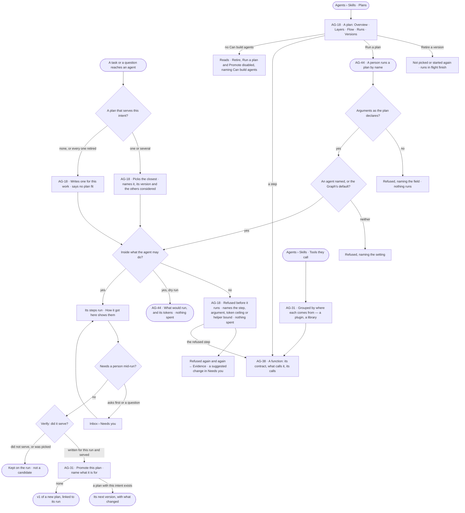
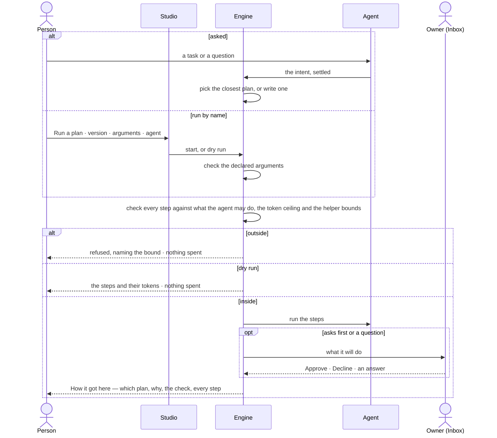

# Plans and functions

> The plans agents carry work out by — picked from the ones that served, written when none fit, checked against what
> the agent may do before anything runs — and the functions every plan is made of, each with its contract and what
> calls it. The decisions it helps make: *which plan should this work run, is it fit to run again or to retire, may
> this agent run it, and what can agents do at all?*

## User journey

## Stories

| ID | Story | Status |
|---|---|---|
| AG-18 | [Find a plan and read how it behaves](stories/AG-18-find-a-plan-and-read-how-it-behaves/story.md) | idea |
| AG-31 | [Keep a plan that served, and see where each plan and function comes from](stories/AG-31-keep-a-plan-that-served-and-see-where-each-comes-from/story.md) | idea |
| AG-38 | [Read every function and what calls it](stories/AG-38-read-every-function-and-what-calls-it/story.md) | idea |
| AG-44 | [Run a plan on demand with today's arguments](stories/AG-44-run-a-plan-on-demand-with-todays-arguments/story.md) | idea |

## Access

| Act | Role (`.claude/team/TEAM.md` §7) | Everyone else sees |
|---|---|---|
| Read plans, a plan's page, its versions and its export | Operator — any member of the Graph | — |
| Read functions, their contracts, calls and what calls them | Operator — any member of the Graph | — |
| Read which plan a run picked, why, and a refusal | Operator — anyone who can open the run | A run they cannot open reads *not found* |
| Retire a plan version | `builder` · shown as *Can build agents* · Admin | *Retire* disabled, naming *Can build agents* |
| Promote a run's plan | `builder` · shown as *Can build agents* · Admin | *Promote this plan* disabled, naming *Can build agents* |
| Run a plan · dry run | `builder` · shown as *Can build agents* · Admin | *Run a plan* disabled, naming *Can build agents* |
| Enable a plugin | Admin, in Settings (ST-F04) | The plugin reads; its switch is disabled, naming the Admin |
| Approve a library's functions | Admin (AG-40) | Proposals read *Waiting for an Admin* |
| Author an answer template | `builder` · shown as *Can build agents* · Admin (EX-03) | Templates read; *+* hidden |
| Decide a suggested change on a plan | `builder` · shown as *Can build agents* · Admin (EX-32) | *Ask Priya (owner)* |

## States

| State | What the person sees |
|---|---|
| First use | Only the plans Invana ships, each *packaged*; a plan never run lists its steps with every measure *—*; a function nothing calls reads *not used yet* |
| Empty after a filter | No plan or function matches the filter or search — the filter named, *Clear* |
| Loading | The list's head and filters drawn at once; rows and a page's numbers load in place |
| Has data | Plans with where each comes from, version, what it touches and who uses it; a plan's page over its window; functions grouped by what they touch |
| Failed | Could not load, with *Try again*; a refused plan names the bound it crossed and spends nothing; a step naming a function the install lacks reads *No such function* |
| Agent working or proposing | A run picking or writing its plan; a plan running from *Run a plan*; a suggested change proposing to promote or retire a plan |
| No access | Everything reads; *Retire*, *Promote this plan* and *Run a plan* are disabled, naming *Can build agents*; a run they cannot open reads *not found* |

## Rules

| Rule | Detail |
|---|---|
| Picked first, written when nothing fits | A run picks the published plan whose intent is closest; it writes a plan for this work only when none fits. Never part of one and part of another |
| Every plan is checked | Picked, written or run by hand, a plan is checked against what the agent may do before its first step: each step allowed · each argument pinned as required · projected tokens within the ceiling · helpers within their bounds. Coming from the plans list is not a pass |
| A refusal is an outcome | Recorded on the run as refused, naming the bound; nothing is spent and no step runs. Never half a plan |
| What it may do changes mid-run | Running steps finish; the next plan is checked against the new bounds |
| Published versions never change | A change is a new version; the old one stays readable, so every run that used it still opens |
| Plans are never drawn by hand | A plan is packaged with Invana or a plugin, written for one piece of work, or promoted from a run that served. There is no *New plan* and no plan editor |
| Only reusable plans are listed | A plan written for one piece of work is read from its run; a skill's own plan is read under its skill; the list holds what can be picked or run again |
| Origin is a badge | *Packaged* · *generated* · *promoted* — three ways a plan got into the list, one filter, never three lists |
| Retire stops picking, never a run | A retired version is not picked or started again; runs in flight finish; past runs still open. Retiring every version takes the plan out of the list, and that intent is written fresh, saying so |
| Promotion is a person's act | Verify judging a run served makes its plan a candidate; only a person promotes it, and the version keeps the run it came from |
| A skill uses a plan by copying it in | A skill that uses a plan carries it as steps of its own, with its own argument values; changing the plan never silently changes a skill |
| A plan declares arguments; a caller tunes them | Two skills or two starts may give the same plan different values; neither is a fork |
| Startable is not editable | *Run a plan* starts a published version with arguments; it never changes its steps |
| One way in | A run by name, a schedule on the plan and the command line open the same kind of run through the same check (AG-F07) |
| Functions are the vocabulary | Every step of every plan calls one function; the set is closed, comes from enabled plugins and approved libraries, and nothing in Studio adds, edits or disables one |
| A function touches one thing | Each function has one bound — what it touches — and what an agent may do grants bounds; a composite is a packaged plan, called like a function |
| Control flow is plan grammar | *if* · *loop* · *map* · *retry* · *stop* belong to a plan, never listed as functions |
| Leans on | Build an agent — what it may do (AG-F01) · the catalogue — libraries and imports (AG-F02) · runs (AG-F03) · skills (AG-F04) · schedules (AG-F07) · suggested changes (EX-F07) · answer templates (EX-F04) · the Inbox (IN-F01) · plugins (ST-F04) |

**The function library** — every function is named `namespace.verb`; the namespace names what it touches.

| Namespace | Functions | What it touches | Plugin |
|---|---|---|---|
| `graph.read` | `query` · `get_neighbors` · `types_count` · `resolve` · `validate` | Reads the graph (`validate` touches nothing) | Core |
| `graph.stitch` | `preview` · `declare` · `commit` · `withdraw` · `run` | `preview` reads the graph; the rest write it | Core |
| `graph.write` | `records` · `bulk` · `edits` | Writes the graph | Core |
| `data` | `bundle.check` · `records.validate` · `snapshot` | Brings data in | Core |
| `model` | `propose` · `understand_ask` · `validate_proposal` · `migrate` | Changes the model | Core |
| `nl` | `understand` · `translate` | Calls a model | Core |
| `plan` | `draft` · `compose` · `replan` · `verify` | Calls a model (`verify` touches nothing) | Core |
| `work` | `spawn_agent` · `delegate` · `create_task` · `await` | Hands out work (`await` touches nothing) | Core |
| `answer` | `shape` | Nothing outside | Core |
| `web` | `search` · `read_url` · `download_file` | Reaches outside | Web tools |
| `mail` | `read` · `send` — `send` always asks first | Reaches outside | Mail tools |
| `science` | `pubmed.search` · `uniprot.get` · `pubchem.get` | Reaches outside | Science tools |
| `sim` | `genomic_prediction` | Nothing outside | Genomic simulator |
| `mcp.<server>` | One per tool of an MCP server an Admin added — a read-only tool reads, every other tool sends | Reaches outside | That server |

| Packaged plan | Its steps | What it touches |
|---|---|---|
| `nl.query` | `nl.understand` → `nl.translate` → `graph.read.validate` → `graph.read.query` → `answer.shape` → `plan.verify` | Calls a model · reads the graph |
| `nl.compare` | The same, with two translate-and-query steps side by side | Calls a model · reads the graph |
| `graph.stitch.apply` · `graph.stitch.commit_flow` | The link-between-models flows | Reads and writes the graph |
| `data.bulk_load` · `model.import` · `model.migration` | The load and model flows | Brings data in · changes the model · writes the graph |

## Data touched

| Record | Read or write |
|---|---|
| Reusable plans — name, intent, where it comes from, status | Read · write (promote, retire) |
| Plan versions — steps, declared arguments, the run it was promoted from, published, retired | Read · write |
| A run's plan — picked or written, the version, the others considered, the check's result | Write · read |
| Runs of a plan — every run that ran it, by whom, called by, tokens, how it ended | Read |
| Functions — contract, plugin and version, what each touches, summary | Read |
| A function's calls and the plans and skills that call it | Read |
| Suggested changes to promote or retire a plan (EX-F07) | Write · read |
| History rows — promoted, retired, started (IN-F03) | Write · read |

## Decisions

| Decision | Detail |
|---|---|
| Plans live under Agents › Skills | *Plans* and *Tools they call* are sections of Skills, beside *Answer templates*; a plan opens as its own page, a function as its own page |
| A plan's page answers *how has it behaved* | Overview · Layers · Flow · Runs, over 7 · 30 · 90 days; what it is sits in its head — version, steps, what it matches, what it touches, who may run it, who uses it |
| *Used by* means copied in | The skills that use a plan; an agent that may run it is a permission, read in the plan's head, never in *Used by* |
| What changed is step by step | Each version against the one before: steps added, removed, moved or changed, each changed field before and after; declared arguments too; v1 reads *the first version* |
| Export is for review | A version exports as read-only YAML with *Copy* and *Download*; nothing imports a plan from YAML |
| Every plan names its version | A run, a start and a schedule record the version they ran; a start that names none takes the current one and records which |
| Starting by hand widens nothing | *Run a plan* takes the same check a picked plan does; there is no per-start override of what the agent may do |
| A run needs an agent | Named on the start, or the Graph's default; with neither it is refused, never run as nobody |
| The plan shows before it runs | Its steps, its arguments resolved and its projected tokens, at *Run a plan* and on the run before its first step |
| A dry run spends nothing | It checks, resolves and projects, refuses the same way, and starts no run |
| Run a plan adds no list | It starts from the plan; what it started is in Runs; what it asks is in the Inbox |
| A function's page | Its head names it, what it touches, its side effect and plugin; Contract · Used by · Calls; every number is this Graph's runs, read from the engine |
| A function is read where it is used | Its contract shows beside a run's step, a plan's step and a refusal, each linking to its page |
| Grouped by what it touches | Tools they call groups functions by their bound, never alphabetically — the group a person scans is the one the bound enforces |
| A plan, kept | A run's plan is promoted from the run, or from Plans by picking the run; it can be trimmed or have an argument pinned first, and the edit is recorded |
| Replans are bounded | A running plan may revise itself — an exception no handler fits, unmet criteria, a helper's result, a question only a person can answer — only within the skill's functions, checked before it runs, recorded on the run and never the skill, at most three a run |

## Open questions

| Question | Recommendation | Who answers |
|---|---|---|
| Is the plans list per Graph, or install-wide like agents and skills (AG-F02)? A skill copies a plan in, so an install-wide skill copying a per-Graph plan reads differently in each Graph | Install-wide list, numbers per Graph — the same as skills | Ravi |
| May an Operator run a plan by name? They may ask, which runs plans | *Can build agents* only — a start names its arguments and agent, which asking does not | Ravi |

## Not building

| Item | Why not |
|---|---|
| Drafting, composing or editing a plan by hand | Plans are packaged, generated or promoted; hand edits bypass the check and the trace |
| Editing a plan before it runs | The check is the gate; *Run a plan* starts it as published |
| Importing a plan from YAML | Promotion from a run that served is how a plan enters the list |
| Promoting automatically above a success rate | Promotion is a judgement about intent, not a threshold |
| Promoting a picked plan | It is already in the list |
| Learning the plan picker from feedback | Picking is deterministic and readable on purpose |
| Racing several plans against each other | Tokens and who did what become unreadable |
| Asking a person to let an out-of-bounds plan run | It turns a bound into a prompt |
| Running the allowed steps of a refused plan | Half a plan is not a plan |
| Trimming a refused plan automatically | The agent may propose it; a person decides |
| Branching plan versions | One line of versions per plan |
| Plans or promotion across Graphs | The Graph is the reasoning boundary |
| Starting a draft, retired or unnamed plan | Only published versions run; a plan no list holds is one no trace resolves |
| Overriding what the agent may do on one start | The bound would become advisory |
| A queue of pending starts | The Graph's runs at once already queue |
| Re-running from Runs by starting a plan | Re-run is AG-32's; *Run a plan* starts fresh with today's arguments |
| Adding, editing or disabling a function | The set is closed and ships with the plugins; a UI that changed it would make every bound advisory |
| Turning a function on or off per Graph | What an agent may do is the knob; two switches give two answers |
| *Try it* on a function | A function runs in a plan, under what an agent may do, with a run behind it |
| Editing what a function must come after | A plan legal in one Graph and refused in the next |
| Access rules on a function's page | Access rules are Settings › People and access |
