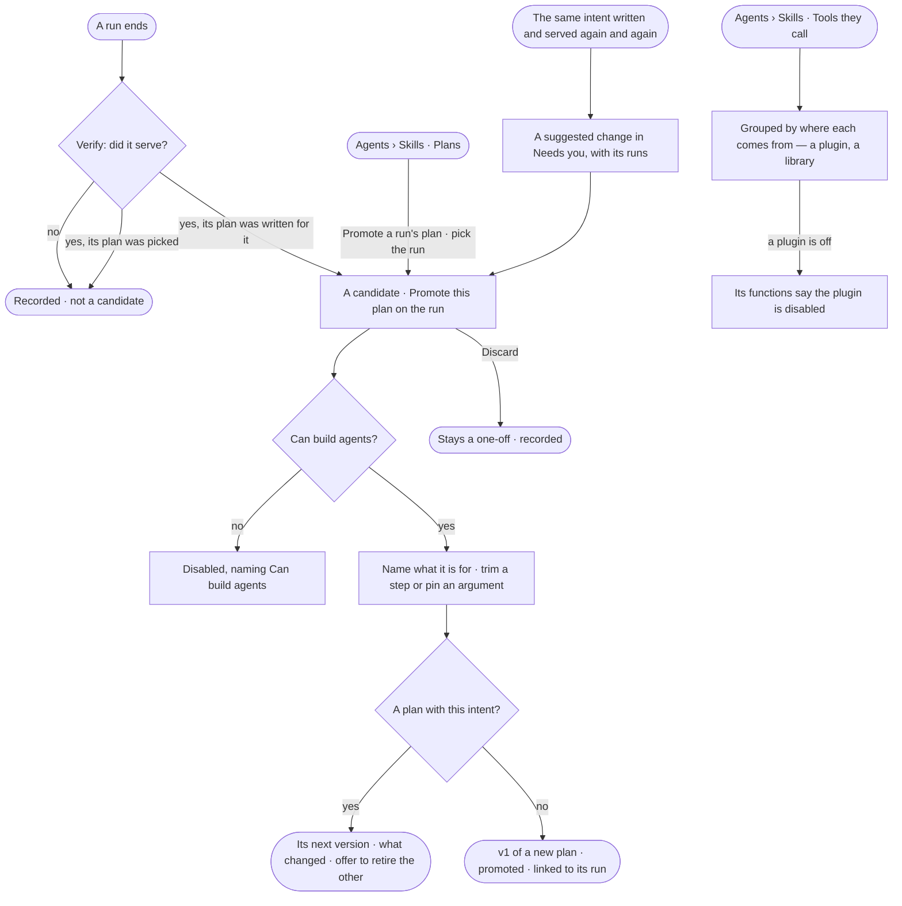

# AG-31 · Keep a plan that served, and see where each plan and function comes from

**As** an agent builder **I want** to keep a plan a run wrote that served, named by what it is for — and to see where
every plan and function comes from: packaged with Invana, a plugin, a library, or promoted from a run — beside the
answer templates that shape answers **so that** I see every source of what agents can do, and the next identical
question is answered the same way for a fraction of the tokens. *Verify judges a run served → a person promotes its
plan.*

Tasks: [task.md](task.md) · Feature: [AG-F06](../../feature.md)

## Who can

| Lens | Can | Otherwise sees |
|---|---|---|
| Admin | Promote a run's plan, trimming it first; discard a candidate; read where every plan and function comes from | — |
| Operator | Read candidates, where every plan and function comes from, and the run a promoted plan came from | *Promote this plan* disabled, naming *Can build agents*. With *Can build agents*: as Admin |

## Flow

## Acceptance criteria

| # | Given | When | Then |
|---|---|---|---|
| AG-31.1 | A run whose plan was written for it, and Verify judged it served | the run is read | it shows *Promote this plan*; a run that did not serve, or whose plan was picked, does not |
| AG-31.2 | A candidate | a person with *Can build agents* promotes it | they name what it is for — the intent future runs are matched on — and may trim a step or pin an argument first; the edit is recorded on the version |
| AG-31.3 | No plan with that intent | it is promoted | it publishes v1 of a new plan, *promoted*, linked to the run it came from |
| AG-31.4 | A plan with that intent | it is promoted | it publishes the plan's next version with what changed against the one before, and offers to retire the other when two serve one intent |
| AG-31.5 | A promoted plan | the next run with that intent plans | it picks the promoted plan and writes none |
| AG-31.6 | A candidate | the person discards it | it stays a one-off, recorded on the run; nothing is published |
| AG-31.7 | Plans | a person presses *Promote a run's plan* | it lists the candidate runs to pick from, newest first; none reads *No run to promote yet* |
| AG-31.8 | A plan with the same intent written and served again and again | the threshold is crossed | a suggested change in *Needs you* proposes promoting it, with the runs that wrote it (EX-31); nothing is promoted until a person does |
| AG-31.9 | Any plan | it is read | it says where it comes from — *packaged* · *generated* · *promoted* — and a promoted one links the run it came from, always |
| AG-31.10 | Tools they call | anyone opens it | functions group by where they come from — each plugin with its version and whether it is on, each library (AG-40) — and a function from a disabled plugin says so |
| AG-31.11 | A plugin to turn on or off | a person reads it here | it links to Settings, where an Admin enables it (ST-F04); nothing here switches it |
| AG-31.12 | Skills | anyone opens *Answer templates* | the templates that shape answers read beside plans and tools (EX-03 authors them) |
| AG-31.13 | An Operator without *Can build agents* | they open a candidate run | *Promote this plan* and *Discard* are disabled, naming *Can build agents* |
| AG-31.14 | A promoted version | a person opens *How it got here* on the run it came from | its steps show what was promoted, by whom, with the edit and the version it published |

## Screens

| Surface | Lens | First use | Empty after a filter | Loading | Has data | Failed | Agent working or proposing | No access |
|---|---|---|---|---|---|---|---|---|
| Promote this plan, on a run | Admin | — | — | agents.run · Loading | agents.run · Promote this plan | agents.run · Promote refused | agents.run · Running | — |
| Promote this plan, on a run | Operator | — | — | agents.run · Loading | agents.run · Promote this plan, read only | — | agents.run · Running | agents.run · Promote this plan, read only |
| Promote a run's plan, from Plans | Admin | agents.skills · No run to promote yet | — | agents.skills · Loading | agents.skills · Promote a run's plan | agents.skills · Could not load | — | — |
| Promote a run's plan, from Plans | Operator | — | — | — | — | — | — | agents.skills · Plans, read only |
| Where it comes from — plans and functions | Admin | agents.skills · Plans, packaged only | agents.skills · No plans match | agents.skills · Loading | agents.skills · Tools they call | agents.skills · Could not load | — | — |
| Where it comes from — plans and functions | Operator | agents.skills · Plans, packaged only | agents.skills · No plans match | agents.skills · Loading | agents.skills · Tools they call | agents.skills · Could not load | — | agents.skills · Tools they call |
| Answer templates | Admin | agents.skills · Shipped templates | agents.skills · No template matches | agents.skills · Loading | agents.skills · Answer templates | agents.skills · Could not load | — | — |
| Answer templates | Operator | agents.skills · Shipped templates | agents.skills · No template matches | agents.skills · Loading | agents.skills · Answer templates | agents.skills · Could not load | — | agents.skills · Read only |
| Suggested: promote this plan | Admin | inbox · Nothing suggested | — | inbox · Loading | inbox · Suggested change | — | inbox · Suggested change | — |
| Suggested: promote this plan | Operator | inbox · Nothing suggested | — | inbox · Loading | inbox · Suggested change | — | inbox · Suggested change | inbox · Not yours to answer |
