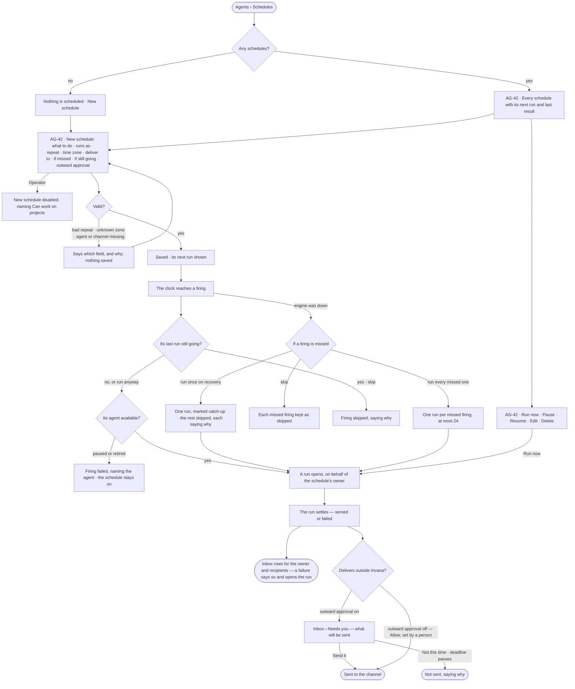
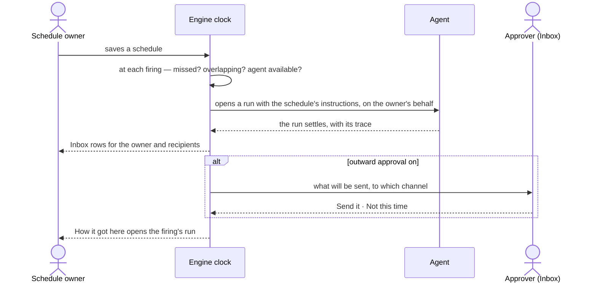

# Schedules

> Routine work — a morning digest, a weekly route report — runs itself on a clock and lands where people read it,
> with no project needed. Every firing is kept, whether it ran or not. The decisions it helps make: *what should run
> without me, when, and who should read it?* — and, when a firing goes outside Invana, *may this be sent?*

## User journey

Journeys this feature is a step of: [J04 · Build an agent and improve it from what runs teach](../../../../journeys/J04-build-an-agent-and-improve-it-from-what-runs-teach.md)

## Stories

| ID | Story | Status |
|---|---|---|
| AG-42 | [Put routine work on a schedule](stories/AG-42-put-routine-work-on-a-schedule/story.md) | idea |

## Access

| Act | Role (`.claude/team/TEAM.md` §7) | Everyone else sees |
|---|---|---|
| Read every schedule, its firings and their runs | Operator — every member | — |
| Create, edit, pause, resume, run now or delete a schedule | `contributor` · shown as *Can work on projects* · Admin | The list and each schedule read; every act is disabled, naming *Can work on projects* |
| Approve or decline an outward delivery | The schedule's approvers, else its owner (IN-F01) | The ask reads, naming who it waits on |
| Read a delivered result | The owner and the named recipients, in their Inbox | — |

## States

| State | What the person sees |
|---|---|
| First use | *Nothing is scheduled* — what a schedule does, and *New schedule* |
| Empty after a filter | — |
| Loading | The Schedules tab drawn at once; the rows load in place |
| Has data | Every schedule: what it does, who runs it, when as words, its next run, its last result, on or paused |
| Failed | The list could not load, saying why, with *Try again*; a schedule refused at save names its field; a failed firing names why, and a schedule whose last run failed is marked, with *Open the last run* |
| Agent working or proposing | A firing's run is running — its row reads *running*, and *Open run* follows it; an outward delivery waits in the Inbox |
| No access | Schedules read; *New schedule* and each act are disabled, naming *Can work on projects* |

## Rules

| Rule | Detail |
|---|---|
| One kind of schedule | A schedule needs no project. It names an agent and plain instructions; whatever the run produces is delivered. Whether the run creates work is the run's business |
| A firing is a run | A firing opens the same run a task opens, through the named agent, on behalf of the schedule's owner, and waits behind people's runs by the graph's runs-at-once rules |
| Every firing is kept | Queued · opened · skipped · failed, each with its reason, its run, and whether it was a catch-up or *Run now* |
| Repeat in a time zone | Daily · weekdays · weekly on a day · monthly on a date · a custom cron, at a time, read in the schedule's zone — *08:00 Europe/Berlin* stays 08:00 across a clock change |
| Missed firings | A firing reached more than five minutes late is missed. *Run once on recovery* (the default) runs the latest, marked catch-up, and keeps the rest as skipped · *Run every missed one* runs each, at most 24 · *Skip* runs none |
| If the last run is still going | *Skip* (the default) skips the firing, saying so · *Run anyway* opens it |
| Delivery follows the settled run | Inbox rows to the owner and recipients, and one delivery per channel. A failed run is delivered as a failure that opens the run, never dropped |
| Outward deliveries ask first | A delivery to a channel is Ask first: it waits in the Inbox for the approvers, else the owner, until its deadline (a day by default) — then it is not sent. A person may set it to Allow ([the three modes](../../../settings/product.md#decisions)) after seeing what goes where; the schedule records who set it |
| Pause and resume | Pausing keeps every firing; a run going when paused finishes and is delivered. Resuming fires from now — what fell while paused is not missed, because nobody wanted it |
| On whose behalf | The owner is whoever created the schedule; editing it never changes on whose behalf it runs |
| A paused or retired agent | Its schedule's firings fail, naming the agent; the schedule stays on |
| A channel in use | Removing a channel a schedule delivers to is refused, naming the schedule |
| Leans on | Build an agent (AG-F01) · runs (AG-F03) · the Inbox (IN-F01) · channels in Settings › Notifications |

## Data touched

| Record | Read or write |
|---|---|
| Schedules — name, agent, instructions, repeat, zone, on or paused, missed and overlap choices, delivery, outward approval and who set it, approvers, owner, next run | Write · read |
| Firings — when due, outcome, reason, catch-up or run now, the run, when delivered | Write · read |
| The run each firing opens (AG-F03) | Write · read |
| Inbox rows and outward-delivery asks (IN-F01) | Write · read |
| History rows of every create, edit, pause, resume, delete, firing and skip (IN-F03) | Write · read |

## Decisions

| Decision | Detail |
|---|---|
| Schedules sit in Agents | Agents › Schedules — routine work is an agent's run on a clock; anyone with *Can work on projects* schedules, from wherever they work |
| A schedule carries instructions, not a plan | The agent plans each firing's run as it plans any run; a schedule never names a plan or a skill |
| The list reads at a glance | What · who runs it · when as words · next run · last result · on — a failed last run is marked |
| No sources, tools or project to pick | Sources are written in the instructions, tools are the agent's, and a schedule needs no project |
| The result opens its run | Every delivered result and every firing opens the run behind it, with *How it got here* one click away |

## Open questions

| Question | Who answers |
|---|---|
| The Schedules board draws a schedule paused by itself after three failed runs in a row; no rule says a schedule pauses itself. Add it? Recommend: not now — each failed firing already reaches the owner's Inbox, and a self-pausing schedule hides routine work silently | Ravi |

## Not building

| Item | Why not |
|---|---|
| A schedule naming a skill or a plan | It carries instructions; the agent plans the run |
| Queuing overlapping firings | *Skip* or *Run anyway*; a queue of firings is a backlog nobody asked for |
| Replaying more than 24 missed firings | A day of hourly firings is the most a recovery replays |
| Calendar-aware scheduling | A repeat, a zone and a missed-firing choice are enough |
| Alerting on an answer's value | That is a monitoring product |
| A token budget per schedule | The agent's token budget bounds the run |
