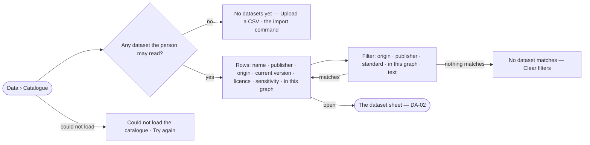

# DA-01 · Find a dataset to reuse

**As** a data curator **I want** one catalogue of every dataset in the install, filtered by origin, publisher,
standard and the graph it is in **so that** I reuse what a lab already gathered instead of gathering it again.

Tasks: [task.md](task.md) · Feature: [DA-F01](../../feature.md)

## Who can

| Lens | Can | Otherwise sees |
|---|---|---|
| Admin | Read every dataset in the install, private ones included; filter and open any | — |
| Operator | Read every dataset shared with the install and their own private ones; filter and open them | Someone else's private dataset is absent, never listed as locked |

## Flow

## Acceptance criteria

| # | Given | When | Then |
|---|---|---|---|
| DA-01.1 | An install with no dataset the person may read | they open Data › Catalogue | it reads *No datasets yet*, with *Upload a CSV* and the command that imports one |
| DA-01.2 | Datasets the person may read | the catalogue opens | each row shows its name, `publisher/name`, origin, current version, licence and sensitivity, and whether this graph has added it |
| DA-01.3 | A private dataset another person created | an Operator opens the catalogue or searches for it | it is absent — not listed, not counted, and opening its address reads *not found* |
| DA-01.4 | The catalogue | the person filters by origin, publisher, a standard it claims, *in this graph*, or text | only the datasets matching every filter are listed, and the count beside the filters is the engine's |
| DA-01.5 | Filters that match nothing | the list is empty | it reads *No dataset matches*, names the filters, and offers *Clear filters* |
| DA-01.6 | A dataset with no version yet | its creator opens the catalogue | it is listed to them alone, with licence and author chain empty and *No version yet* |
| DA-01.7 | The catalogue cannot be read | it opens | it says it could not load, with *Try again*; nothing stale is shown as current |
| DA-01.8 | A dataset whose standards cannot be read | the standard filter is used | it is counted as not readable beside the filter, never silently left out |

## Screens

| Surface | Lens | First use | Empty after a filter | Loading | Has data | Failed | Agent working or proposing | No access |
|---|---|---|---|---|---|---|---|---|
| Catalogue | Admin | data.catalogue · No datasets yet | data.catalogue · No dataset matches | data.catalogue · Loading | data.catalogue | data.catalogue · Could not load | — | — |
| Catalogue | Operator | data.catalogue · No datasets yet | data.catalogue · No dataset matches | data.catalogue · Loading | data.catalogue | data.catalogue · Could not load | — | — |
