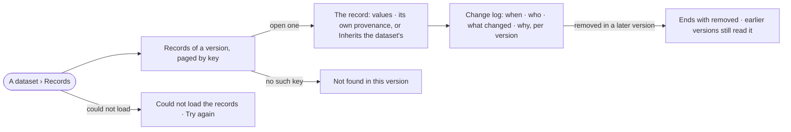

# DA-04 · Read a record and every change to it

**As** a data curator **I want** a record's values, where it differs in origin from its dataset, and every version
that changed it **so that** a fix is never silent.

Tasks: [task.md](task.md) · Feature: [DA-F01](../../feature.md)

## Who can

| Lens | Can | Otherwise sees |
|---|---|---|
| Admin | Read any record of any dataset and its change log | — |
| Operator | Read any record of a dataset they may read, and its change log | — |

## Flow

## Acceptance criteria

| # | Given | When | Then |
|---|---|---|---|
| DA-04.1 | A version's records | *Records* opens | they page in key order, the total the engine's |
| DA-04.2 | A record whose origin matches the dataset | it opens | its values show and its provenance reads *Inherits the dataset's* |
| DA-04.3 | A record taken from another source | it opens | its own origin, source and note show beside the values |
| DA-04.4 | A record changed in two later versions | its change log opens | it lists its first version and each version that changed it — *when · who · what changed (property, before → after) · why* — newest first, the who named |
| DA-04.5 | A record unchanged across versions | its change log opens | only the version that added it is listed |
| DA-04.6 | A record removed in a later version | its change log opens | it ends with *removed*; opening it at an earlier version still reads its values |
| DA-04.7 | A key not in the version | its address is opened | it reads *Not found in this version* |
| DA-04.8 | The records cannot be read | the tab opens | it says it could not load, with *Try again* |

## Screens

| Surface | Lens | First use | Empty after a filter | Loading | Has data | Failed | Agent working or proposing | No access |
|---|---|---|---|---|---|---|---|---|
| A dataset · Records | Admin | data.dataset · No version yet | — | data.dataset · Records loading | data.dataset · Records | data.dataset · Could not load | — | — |
| A dataset · Records | Operator | data.dataset · No version yet | — | data.dataset · Records loading | data.dataset · Records | data.dataset · Could not load | — | — |
| A record | Admin | — | — | data.dataset · Records loading | data.dataset · Record | data.dataset · Record not found | — | — |
| A record | Operator | — | — | data.dataset · Records loading | data.dataset · Record | data.dataset · Record not found | — | — |
