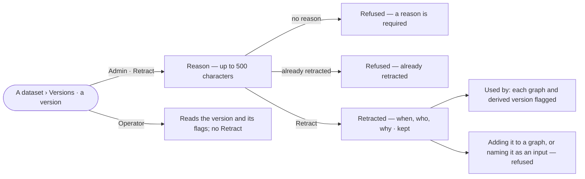

# DA-14 · Retract a version and flag what cites it

**As** an install admin **I want** a version its source withdrew kept, marked retracted with a reason, and
everything that cites it flagged **so that** conclusions built on withdrawn data never go unnoticed.

Tasks: [task.md](task.md) · Feature: [DA-F01](../../feature.md)

## Who can

| Lens | Can | Otherwise sees |
|---|---|---|
| Admin | Retract any version with a reason | — |
| Operator | Read a retracted version, its reason and what cites it | *Retract* absent, not disabled |

## Flow

## Acceptance criteria

| # | Given | When | Then |
|---|---|---|---|
| DA-14.1 | An Admin on a version | they pick *Retract* | a reason is asked for, up to 500 characters; *Retract* waits until one is written |
| DA-14.2 | A reason written | the Admin retracts | the version reads *retracted* with when, who and the reason; its records, history and compare still read; nothing is deleted |
| DA-14.3 | A version already retracted | it is retracted again | it is refused: *already retracted* |
| DA-14.4 | A retracted version | its *Used by* is read | every graph that added it and every version derived from it is listed, each flagged *retracted* |
| DA-14.5 | A graph that added a version later retracted | anyone reads what that graph added | it is flagged *retracted*, with the reason |
| DA-14.6 | A retracted version | someone adds it to a graph | it is refused: *this version is retracted* |
| DA-14.7 | A retracted version | a new version names it as an input | it is refused, naming the retracted input |
| DA-14.8 | A retracted current version | the dataset is read | it stays current until a newer version is published, with the banner on *About* |
| DA-14.9 | An Operator | they open a version | *Retract* is absent |

## Screens

| Surface | Lens | First use | Empty after a filter | Loading | Has data | Failed | Agent working or proposing | No access |
|---|---|---|---|---|---|---|---|---|
| A retracted version | Admin | — | — | data.dataset · Versions loading | data.dataset · Retracted | data.dataset · Could not load | — | — |
| A retracted version | Operator | — | — | data.dataset · Versions loading | data.dataset · Retracted | data.dataset · Could not load | — | — |
| Retract a version | Admin | data.dataset · Retract | — | — | data.dataset · Retract | data.dataset · Retract refused | — | — |
| Retract a version | Operator | — | — | — | — | — | — | data.dataset · Versions |
