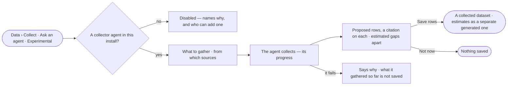

# DA-06 · Collect a dataset with an agent

**As** a data curator **I want** an agent to collect a dataset from the sources I name and cite each row it proposes
**so that** gathering takes minutes, not weeks, and I decide what is kept.

Tasks: [task.md](task.md) · Feature: [DA-F02](../../feature.md)

## Who can

| Lens | Can | Otherwise sees |
|---|---|---|
| Admin | Ask an agent to collect; save what it proposes | — |
| Operator | Ask an agent to collect; save what it proposes into a dataset they create | — |

## Flow

## Acceptance criteria

| # | Given | When | Then |
|---|---|---|---|
| DA-06.1 | An install with no collector agent | Data › Collect opens | *Ask an agent* is drawn disabled with an *Experimental* badge, naming why |
| DA-06.2 | A collector agent | the person says what to gather and from which sources | the agent collects in the background and its progress shows |
| DA-06.3 | A collection that finishes | the agent proposes rows | each row names its citation — the page and its author — and nothing is saved until the person decides |
| DA-06.4 | Gaps the agent estimated | it proposes | they are shown apart, and saving puts them in a separate `generated` dataset, never in the collected one |
| DA-06.5 | Proposed rows | the person picks *Save rows* | a `collected` dataset version is published, its author chain naming each page's author and the agent as *collected by* |
| DA-06.6 | Proposed rows | the person picks *Not now* | nothing is saved |
| DA-06.7 | A saved collection | the person opens *How it got here* | it shows the agent's sources, the steps it took and the citation behind each row |
| DA-06.8 | A collection that fails | it ends | it says why, and nothing is saved |

## Screens

| Surface | Lens | First use | Empty after a filter | Loading | Has data | Failed | Agent working or proposing | No access |
|---|---|---|---|---|---|---|---|---|
| Ask an agent to collect | Admin | data.collect · No collector agent | — | — | data.collect · Proposed rows | data.collect · Collect failed | data.collect · Collecting | — |
| Ask an agent to collect | Operator | data.collect · No collector agent | — | — | data.collect · Proposed rows | data.collect · Collect failed | data.collect · Collecting | — |
