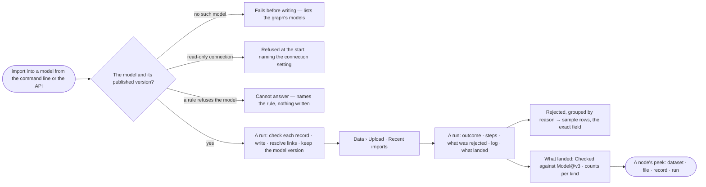

# DA-13 · See every import and what it rejected

**As** someone whose pipeline already produces data **I want** one command that loads it into a model, and one place
to see every import, what it rejected and why **so that** I can put the load in a pipeline, trust the result and fix
the source rather than guess at the graph.

Tasks: [task.md](task.md) · Feature: [DA-F02](../../feature.md)

## Who can

| Lens | Can | Otherwise sees |
|---|---|---|
| Admin | Load into any model; read every import in every graph | — |
| Operator | Read every import in the graphs they are in — its outcome, what was rejected, its log and what landed | Loading is refused before anything is written, naming who may load. With *Can shape the model*: loads from the command line or the API |

## Flow

## Acceptance criteria

| # | Given | When | Then |
|---|---|---|---|
| DA-13.1 | A load that names no model, or one the graph lacks | it starts | it fails before writing anything, listing the graph's models |
| DA-13.2 | A load against a read-only connection | it starts | it is refused at the start, naming the connection setting |
| DA-13.3 | A load whose records include bad ones | it runs | each good record is written; each bad one is rejected naming its record, field and reason; the load does not fail for them |
| DA-13.4 | A relationship whose end resolves nowhere | it loads | it is rejected naming both ends; nothing dangling is written |
| DA-13.5 | The same file loaded twice | the second run ends | records are matched by the model's keys and the report says how many were updated and how many created |
| DA-13.6 | A model published while a load runs | the load ends | it reports the version it checked against when it started |
| DA-13.7 | A load from the command line | it ends | it exits non-zero when rejections exceed the threshold, so a scheduler can branch on it; progress streams on a terminal |
| DA-13.8 | Imports in the graphs the person is in | they open *Recent imports* | each row reads the file or dataset, its graph, where it came from (CLI · API · here), who ran it, when, rows written and rejected — newest first; the tiles (imports · running · failed · median time) and *imports a day* are the engine's |
| DA-13.9 | No import yet | *Recent imports* opens | it reads *No imports yet*, what an import is, and the command to run one |
| DA-13.10 | A run with rejections | the person opens it | *What was rejected* groups them by reason with a count each; a group opens to sample rows and the exact field |
| DA-13.11 | A run | the person opens it | it reads *Outcome* (written of total · duration · who ran it · where the file came from), *Steps* in the same view every run uses, *Log* (time · level · step · message, filterable by level), and *What landed* (the model version checked against, counts per kind) |
| DA-13.12 | A run still going | its row is open | the steps paint and counts climb from the run's own events |
| DA-13.13 | A failed run | it is open | its diagnosis and next step sit with its counts, never a stack trace |
| DA-13.14 | A bulk load | it is listed | it reads *bulk load*, with counts, log and who ran it, and says it checked nothing and kept no provenance |
| DA-13.15 | A node a load wrote | its peek opens on the board | it names its dataset, file, record and run; a node a bulk load wrote says it carries no provenance |
| DA-13.16 | A run past retention | it is opened | its counts stay and it says the rows are gone |
| DA-13.17 | A graph whose imports cannot be read | *Recent imports* opens | it is counted as not readable in the status, never left out silently |
| DA-13.18 | A finished load | the person opens *How it got here* | the run's steps show what each one checked, wrote and rejected |

## Screens

| Surface | Lens | First use | Empty after a filter | Loading | Has data | Failed | Agent working or proposing | No access |
|---|---|---|---|---|---|---|---|---|
| Recent imports | Admin | data.upload · No imports yet | data.upload · No imports match | data.upload · Imports loading | data.upload | data.upload · Imports could not load | — | — |
| Recent imports | Operator | data.upload · No imports yet | data.upload · No imports match | data.upload · Imports loading | data.upload | data.upload · Imports could not load | — | — |
| An import run | Admin | — | — | agents.run · Import running | agents.run · Import | agents.run · Import failed | — | — |
| An import run | Operator | — | — | agents.run · Import running | agents.run · Import | agents.run · Import failed | — | — |
| What was rejected | Admin | — | — | agents.run · Import running | agents.run · Import rejected | agents.run · Import failed | — | — |
| What was rejected | Operator | — | — | agents.run · Import running | agents.run · Import rejected | agents.run · Import failed | — | — |
| A node's provenance | Admin | — | — | — | explore.board.menu · Provenance | explore.board.menu · No provenance | — | — |
| A node's provenance | Operator | — | — | — | explore.board.menu · Provenance | explore.board.menu · No provenance | — | — |
