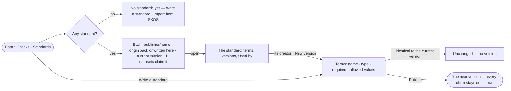

# DA-08 · Keep a library of standards

**As** a data curator **I want** a library of standards — the packs Invana ships and our own — each in immutable
versions **so that** data follows the rules our field agreed.

Tasks: [task.md](task.md) · Feature: [DA-F04](../../feature.md)

## Who can

| Lens | Can | Otherwise sees |
|---|---|---|
| Admin | Read every standard; write one; publish the next version of any; apply a shipped pack | — |
| Operator | Read every standard; write one; publish the next version of one they created | *New version* absent on a standard they did not create, naming its creator |

## Flow

## Acceptance criteria

| # | Given | When | Then |
|---|---|---|---|
| DA-08.1 | An install with no standard | Checks opens | it reads *No standards yet*, with *Write a standard* and *Import from SKOS*, and an *Experimental* badge |
| DA-08.2 | Standards | the library lists | each row shows `publisher/name`, whether it is a shipped pack or written here, its current version and how many datasets claim it — the engine's count |
| DA-08.3 | A person writing a standard | they add a term | it has a name unique in the version, a type (text · integer · number · boolean · date), whether it is required, and allowed values, each a code with a label |
| DA-08.4 | Terms identical to the current version | the person publishes | it is refused as *unchanged* and no version is minted |
| DA-08.5 | A changed standard | its creator publishes | the next version is minted; every dataset that claims it stays on the version it claimed |
| DA-08.6 | A standard | the person opens *Used by* | it lists each dataset that claims it, with the version and mode; datasets whose claims cannot be read are counted as not readable |
| DA-08.7 | An Operator on a standard they did not create | they open it | *New version* is absent and a line names its creator |
| DA-08.8 | The library cannot be read | Checks opens | it says it could not load, with *Try again* |

## Screens

| Surface | Lens | First use | Empty after a filter | Loading | Has data | Failed | Agent working or proposing | No access |
|---|---|---|---|---|---|---|---|---|
| Standards | Admin | data.checks · No standards yet | data.checks · No standard matches | data.checks · Loading | data.checks | data.checks · Could not load | — | — |
| Standards | Operator | data.checks · No standards yet | data.checks · No standard matches | data.checks · Loading | data.checks | data.checks · Could not load | — | — |
| A standard | Admin | — | — | data.checks · Loading | data.checks · Standard | data.checks · Could not load | — | — |
| A standard | Operator | — | — | data.checks · Loading | data.checks · Standard | data.checks · Could not load | — | data.checks · Standard read only |
| Write a standard | Admin | data.checks · Write a standard | — | — | data.checks · Write a standard | data.checks · Standard unchanged | — | — |
| Write a standard | Operator | data.checks · Write a standard | — | — | data.checks · Write a standard | data.checks · Standard unchanged | — | data.checks · Standard read only |
