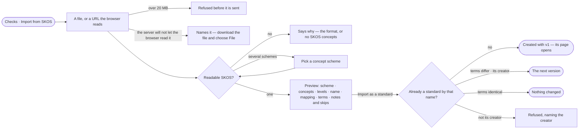

# DA-15 · Import a standard from a SKOS vocabulary

**As** a data curator **I want** to import a standard from a SKOS vocabulary **so that** published vocabularies
become standards without retyping.

Tasks: [task.md](task.md) · Feature: [DA-F04](../../feature.md)

## Who can

| Lens | Can | Otherwise sees |
|---|---|---|
| Admin | Import a vocabulary as a new standard, or as the next version of any | — |
| Operator | Import a vocabulary as a new standard, or as the next version of one they created | Importing over someone else's standard is refused, naming its creator |

## Flow

## Acceptance criteria

| # | Given | When | Then |
|---|---|---|---|
| DA-15.1 | Checks | the person picks *Import from SKOS* | a dialog with an *Experimental* badge takes a file or a URL; the browser reads it and sends the text, the engine fetches nothing |
| DA-15.2 | Text over 20 MB | it is read | it is refused before it is sent |
| DA-15.3 | A URL whose server will not let the browser read it | it is read | the dialog names it and says to download the file and choose *File* |
| DA-15.4 | A readable vocabulary in JSON-LD, Turtle or RDF/XML | it is read | it previews at once: the scheme, its concepts and levels, the name it will publish under, how SKOS maps to the standard, the terms, and the notes and skips; *Import as a standard* waits for the preview |
| DA-15.5 | A file with several concept schemes | it is read | a *Concept scheme* picker lists them; choosing one previews again |
| DA-15.6 | A file with no SKOS concepts, or one that cannot be read | it is read | it says why, naming the format |
| DA-15.7 | A hierarchical scheme | it previews | each top concept with narrower ones is a term, its descendants its values, each naming its broader code; leaf top concepts are the values of one term named after the scheme |
| DA-15.8 | Concepts | they map | the preferred label is the name or label, the notation the code (the IRI's local name when none), and each term and value keeps its source IRI |
| DA-15.9 | Related concepts, mappings, alternative labels or collections | it previews | they are listed as not imported, with their counts; a second concept with the same code in a term is skipped and listed |
| DA-15.10 | A preview | the person imports | a new name creates the standard with v1; an existing one the person created gets its next version; identical terms read *Nothing changed* — and the standard's page opens |
| DA-15.11 | A standard another person created | the person imports over it | it is refused, naming its creator |
| DA-15.12 | The name | the dialog shows it | it defaults to the slug of the scheme's title and is editable; the publisher is the person |

## Screens

| Surface | Lens | First use | Empty after a filter | Loading | Has data | Failed | Agent working or proposing | No access |
|---|---|---|---|---|---|---|---|---|
| Import from SKOS | Admin | data.checks · Import SKOS | — | data.checks · Reading the vocabulary | data.checks · SKOS preview | data.checks · SKOS refused | — | — |
| Import from SKOS | Operator | data.checks · Import SKOS | — | data.checks · Reading the vocabulary | data.checks · SKOS preview | data.checks · SKOS refused | — | data.checks · Not the creator |
| Pick a concept scheme | Admin | — | — | data.checks · Reading the vocabulary | data.checks · Pick a scheme | data.checks · SKOS refused | — | — |
| Pick a concept scheme | Operator | — | — | data.checks · Reading the vocabulary | data.checks · Pick a scheme | data.checks · SKOS refused | — | — |
