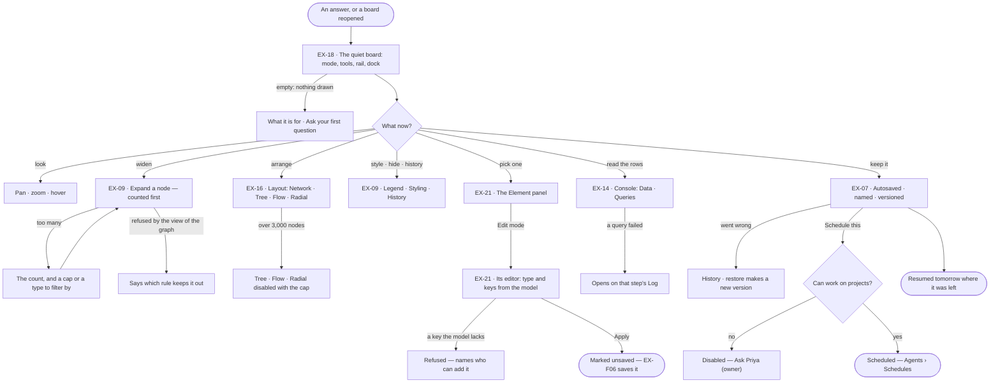
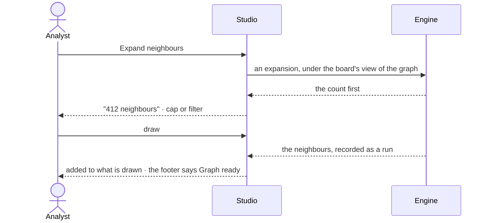

# The board and its canvas

> Where an answer is looked at: a quiet, saved board that draws what the Graph holds, lets the analyst move around it,
> pick things out and read the rows behind it — so they can judge what the answer says before deciding what to do with it.

## User journey

## Stories

| ID | Story | Status |
|---|---|---|
| EX-18 | [A quiet board](stories/EX-18-a-quiet-board/story.md) | idea |
| EX-09 | [Shape the board by hand](stories/EX-09-shape-the-board-by-hand/story.md) | idea |
| EX-16 | [Switch the layout](stories/EX-16-switch-the-layout/story.md) | idea |
| EX-21 | [See and edit one element](stories/EX-21-see-and-edit-one-element/story.md) | idea |
| EX-14 | [Read the rows and the queries](stories/EX-14-read-the-rows-and-the-queries/story.md) | idea |
| EX-07 | [Keep a board](stories/EX-07-keep-a-board/story.md) | idea |

## Access

| Act | Role (`.claude/team/TEAM.md` §7) | Everyone else sees |
|---|---|---|
| Open, look at, pan, zoom, select | Operator — every member | A non-member: the Graph's not-found page |
| Expand a node · change the layout · style · hide · switch modes | Operator — every member | — |
| Create, rename, delete a board · restore a version | Operator — every member | — |
| Read the console · re-run a query step of their own | Operator — every member | — |
| Open the Element panel · stage an edit on the board | Operator — every member | — |
| Save staged edits to the graph | `contributor` · shown as *Can work on projects* | Save disabled — *You can change this board, not the graph* (EX-F06) |
| Schedule the question | `contributor` · shown as *Can work on projects* | *Schedule this* disabled — *Ask Priya (owner)* |

## States

| State | What the person sees |
|---|---|
| First use | No board yet: one question box — *What do you want to know about airways?* — and the person's own kept boards, if any |
| Empty after a filter | Every type hidden in the Legend: *All types hidden · Show all* |
| Loading | The footer's message line counts the solve (*Laying out 2159 nodes · 80 / 149*); past 400 ms one toast with *Cancel*. The board stays usable |
| Has data | The drawing, the row, the rail, the dock, the footer's counts |
| Failed | What failed in a sentence and the next act — a failed query opens the console on its Log; the board is untouched |
| Agent working or proposing | An answer drawing onto the board: the reply is live in the thread, the board adds what it brings |
| No access | Every member can look; an act that needs a grant is disabled with its reason or *Ask Priya (owner)* |

## Rules

| Rule | Detail |
|---|---|
| Drawing adds | An answer, an expansion and a reopened board add to what is drawn; nothing replaces it |
| One selection | A click, a shift-click, a lasso or a box makes the same selection on every board |
| Colour by type | Every node and relationship type has a default colour from its name; a colour set in Styling overrides it, and the Legend's dot always matches the drawing. Colour is never part of a layout |
| Counted before drawn | An expansion or a large answer states its count before it draws, and a cap the person can raise |
| Missing is shown | An element gone from the graph stays drawn, marked missing, with when it was last seen |
| A view of the graph hides, never marks | What the picked view of the graph leaves out is not drawn and not counted; clearing the view brings it back. An expansion into a type the view denies is refused naming the rule, never answered with zero neighbours |
| Dense results thin, never cut | Past 200 relationships edges fade; from 500, below 50% zoom, about 1 in 10 is drawn and the footer says *About 1 in 10 relationships drawn · zoom in for all* |
| Hidden is a flag | Hiding a node hides its relationships; showing it restores a relationship only when that relationship is not itself hidden and its other end is visible. Hiding never filters the data |
| The row | Top-left: the mode picker, then *Select ▾* (Select · Lasso · Box, keys V · L · M), then the mode's tools — Edit: *Add node* · *Connect*; Annotate: *Annotate* · *Highlight* · *Group*; in Edit and Annotate *Undo · Redo · Redraw*. Nothing else: layout, expand, undo and export are verbs on the menus |
| The rail | Top-right, vertical: Legend · Styling · History, then Element, Annotations (Annotate), Changes (in Edit, and in any mode while something is unsaved), a line, Export (⇧⌘E). One panel at a time floats left of it — title · count · its acts · ✕. Legend lists the drawn types with counts; a click hides a type, struck through with *Show all*; its switches for minimap, graph and background are on the board's menu. *Size by connections* is a switch at the top of Styling |
| The menus | **Board**: Layout… · Fit · Select all · Undo · Redo · minimap, grid, lock, full screen · Export image… · Export data…; in Edit *Add a node here*, in Annotate *Annotate here*. **Node**: Expand neighbours (also a double-click) · Select neighbours · Centre on it · Hide · Hide every *type* · Style *type*… · Copy id; in Edit Edit node · Duplicate · Delete. **Relationship**: Select its two nodes · Hide · Hide every *type*. **Selection**: Expand all · Hide · Layout the selection… · Export the selection… · Clear. **Minimap**: Hide minimap |
| The dock | Bottom-left: the minimap (200 × 116) over one bar — − · the zoom field · + · Fit, and a lock while the view is locked. The field takes a typed percent (Enter applies, Esc cancels, ↑ ↓ step) and offers 50% · 100% · 200% · Fit; − and + step 10 · 25 · 33 · 50 · 67 · 75 · 87 · 100 · 125 · 150 · 200 · 300 · 400. Hidden in Focus and Present |
| Export | A rail panel, Image or Data. Image: whole board · in view · selection; PNG (1× 2× 3×) or SVG; the theme's background or transparent; annotations in or out; a preview. Data: whole board or selection, as the board file (reopens with data, layout, styling and history) or CSV (nodes and relationships, a column per property). The file name follows the choices |
| The tabs | Main's tab row holds the open boards and *+*, nothing else; *Rename* and *Close* are on a tab's menu |
| One place per piece of chrome | Top-left the row; top-right the rail and its one floating panel; bottom-left the dock; bottom-centre the presenter, only while presenting. The rail and the dock show only in the work modes |
| The footer | Left: the connection · `195 nodes · 312 relationships` (opens Data) · `4 queries` (opens Queries, with a dot when one failed) · the message line. Right: `3 selected` · the view chip `87% · 1,240, −380` (a click copies it) · the renderer and frame rate. The message is plain text, never a link |
| Inspect is the default | The Element panel states what an element is; it edits only in Edit mode, and only against the model |
| Leans on | Model — the published model gives types, keys and colours · EX-F03 — answers that draw onto the board · EX-F06 — saving edits · Agents › Schedules — *Schedule this* |

## Data touched

| Record | Read or write |
|---|---|
| Board — name, layout, styling, view, what is drawn | Read · write (autosave) |
| Board version — one per meaningful change, with what changed | Read · write |
| Graph records and their counts by type | Read, under the board's view of the graph |
| Runs — each expansion and each query step | Write (an expansion), read (the console) |
| The published model's types and keys | Read |

## Decisions

| Decision | Detail |
|---|---|
| The board is quiet | On screen only the mode and its tools, what must be seen (minimap, zoom) and the rail. Every verb on a thing is on its right-click menu and on ⌘K; the footer says *Right-click anything for its actions · ⌘K for every command* until the first right-click. Long-press, Shift+F10 and the context-menu key open the same menu |
| Modes | Work modes: **Explore** (look, ask, expand) · **Edit** (add, change, delete data) · **Annotate** (EX-F06). View modes: **Focus** (⌘\\ — the drawing alone) · **Present** (EX-F02). One at a time; Esc returns to Explore. The mode is the viewer's, never saved with the board. Edit rings the board in the primary colour, Annotate in the warning colour |
| An expansion is a run | What a person saw, and so reasoned from, is recorded like any read — it runs under the board's view of the graph, spends no agent's token budget and stays out of Agents › Runs by default |
| A layout is a preset | The person picks a card — Network · Tree ↓ · Flow → · Radial — and layout, edges, labels and spacing change together. The board keeps its preset and options across every answer, and a switch is one undo step |
| A force layout does not animate its settle | Network draws once at its settled positions; switching presets glides under 2,000 nodes, in 400 ms or less, and snaps above |
| Boards are saved and versioned | Autosave never overwrites history; restoring a version makes a new one; settings belong to the board and outlive its data |
| A board restores from what it holds | Reopening paints what was drawn and asks the graph nothing; only a board with nothing saved re-runs its last query |
| The console reads, never writes | It shows what is drawn and what ran; queries are typed in the assistant's composer (EX-F03) |
| Studio is strict about the model | A type comes from the model's types, a key from that type's keys; the engine refuses anything else whatever Studio sends |

## Open questions

| Question | Who answers |
|---|---|
| Saving edits to the graph needs *Can work on projects* in the engine; the glossary puts *loading data* under *Can shape the model*. Which grant should saving a board's edits need? Recommend: *Can work on projects*, as the engine enforces | Ravi |

## Not building

| Item | Why not |
|---|---|
| Per-element colour and size saved on the element | Colour by type and the board's styling cover it |
| Physics tuning controls · raw layout-engine options | Four named presets with options beat ten knobs |
| User-authored layout presets | Nobody has asked for a fifth |
| A preset that changes colour | Colour is the theme's |
| A vertical toolbar | It takes the board's left edge, where labels need room |
| An *excluded* mark for what a view of the graph hides | The board is never told what the view hides |
| Sorting, filtering or exporting the console's rows · an editable query box in it | The console's order is the board's; export belongs to Share (EX-F02); queries are typed in the composer |
| Queries of other conversations in the console | Agents › Runs is the journal |
| Plans and other steps in the console · a REPL or terminal | A run's page owns the run; the console lists queries, and nothing here is a shell |
| A console tab per kind of board | Data and Queries are true of every board |
| Editing inline on the drawing | A drawing is not a form; the Element panel edits |
| Folders of boards | A list with search is enough |
| Real-time co-editing of a board | One editor with history, last write wins |
| Converting a board's kind | A drawn board and a dashboard share no state |
| Boards across Graphs | The Graph is the boundary |
