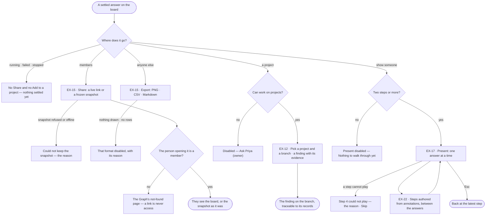

# Share and present an answer

> What an answer becomes once it holds up: shared with the Graph's members, exported for anyone else, shown step by
> step, or added to a project as evidence — so the person who decides sees what was found and how.
> The decision it helps make: *who needs to see this answer, and in which form, to decide on it?*

## User journey

Journeys this feature is a step of: [J02 · Ask and trust the answer](../../../../journeys/J02-ask-and-trust-the-answer.md)

## Stories

| ID | Story | Status |
|---|---|---|
| EX-15 | [Share an answer](stories/EX-15-share-an-answer/story.md) | idea |
| EX-12 | [Add an answer to a project](stories/EX-12-add-an-answer-to-a-project/story.md) | idea |
| EX-17 | [Present a board](stories/EX-17-present-a-board/story.md) | idea |
| EX-22 | [Tell a story in steps](stories/EX-22-tell-a-story-in-steps/story.md) | idea |

## Access

| Act | Role (`.claude/team/TEAM.md` §7) | Everyone else sees |
|---|---|---|
| Copy a live link · keep a frozen snapshot · export PNG, CSV or Markdown | Operator — every member | A non-member opening a link: the Graph's not-found page |
| Add an answer to a project as a finding | `contributor` · shown as *Can work on projects* | *Add to a project* disabled — *Ask Priya (owner)* |
| Present a board | Operator — every member | — |
| Add, edit, move or remove an authored step | Operator — every member, as for any change to a board | — |

## States

| State | What the person sees |
|---|---|
| First use | A board with fewer than two steps: Present is disabled with *Nothing to walk through yet* |
| Empty after a filter | — |
| Loading | Keeping a snapshot: *Copy snapshot link* reads *Keeping…*, disabled, the dialog open |
| Has data | The Share dialog; the presenter with its steps; the finding on its branch |
| Failed | *Could not keep the snapshot* with the reason · a step that cannot play, with *Skip* |
| Agent working or proposing | The answer still running: no Share and no Add to a project on the reply |
| No access | *Add to a project* disabled with *Ask Priya (owner)*; a link opened by a non-member is the not-found page |

## Rules

| Rule | Detail |
|---|---|
| Only a settled answer travels | Share and Add to a project sit on a settled answer's reply line; a running, failed or stopped answer has neither |
| A link is never access | Both links open only for members; outside people get a file |
| An export carries only what the member already sees | Its rows are the run's, read inside its view of the graph; an export never reads the graph again |
| A snapshot is frozen | It keeps the board's records, the answer, its citations and the dataset versions bound when it was taken, and never re-reads them; pruning the run later changes nothing |
| A step is a reply that changed the board | Its title is the question, its words the assistant's message, whole; a table, chart or card stays in the thread. A reply that drew nothing is not a step; an expansion is one, titled *Expanded LHR* |
| Hand edits between replies are one step | Layout, hide, style and move made since the last step become one *Your changes* step when the next reply arrives or presenting starts |
| Presenting is read-only | An earlier step is only ever seen while presenting; nothing in it can be edited. Presenting writes no version and is not restored on reload |
| The walkthrough is the board's | It is saved and versioned with the board, so a reload, a live link and a snapshot carry it, and restoring a version restores its walkthrough |
| Leans on | EX-F01 — the board · EX-F06 — annotations that authored steps show · Projects — the branch a finding joins |

## Data touched

| Record | Read or write |
|---|---|
| The answer's run and what it returned | Read |
| Snapshot — a frozen version of the answer's run board | Write |
| Dataset versions bound to the Graph | Read |
| The board's walkthrough — its steps | Read · write, with the board |
| Finding on a project branch, with its evidence | Write |

## Decisions

| Decision | Detail |
|---|---|
| The live link is the conversation's own address | Sharing it writes nothing; it opens the same board and thread as they are when opened |
| The snapshot keeps the board as records | The answer's drawing is kept as a *Board* table — name, type, id, with node and relationship counts — readable at any size and in either theme; the board's last picture is its thumbnail |
| PNG is the board as last drawn · CSV is the answer's rows | PNG is disabled while nothing is drawn; CSV takes every table's rows, else the drawing's nodes, else a chart's series — disabled only when the answer has none |
| Markdown is one file | The question as the heading, the answer, each part (tables capped at 200 rows, the rest counted), the queries as citations, the view of the graph, the dataset versions, the run and when it was shared |
| Dataset versions are the bindings when taken | A snapshot says *bound when this was taken*, never *read by this answer* |
| Times read in the reader's own time | `Oct 2, 9:29 PM`; only the Markdown export says UTC, because it travels |
| Present is a mode | Present sits in the mode picker; with fewer than two steps it is disabled with *Nothing to walk through yet*. While presenting the row is the picker and `◀ n/N ▶`; the rail, the dock and the forms close |
| A step and its reply point at each other | While presenting, the current step's reply is marked and scrolled into view; every step's reply carries a `Step n` chip that starts presenting there |
| Authored steps sit between the answers | A person may add a step from annotations between two answers, word it, move it among the authored steps and remove it. Reply steps keep their reply's words and the thread's order |

## Open questions

| Question | Who answers |
|---|---|
| — | — |

## Not building

| Item | Why not |
|---|---|
| A public or anonymous link | Membership is the access model |
| A snapshot that refreshes | A frozen snapshot that changes is a live link |
| Sharing into Slack, email or a channel | Delivery is the Inbox's; a link can be pasted anywhere |
| A member list per snapshot | A snapshot is as private as the Graph it is in |
| PDF export | Markdown and the browser's print cover it |
| Auto-play on a timer | A walkthrough is talked over; the presenter sets the pace |
| Rewording or reordering a reply's step | A reply step is its reply; rewording it would make the walkthrough disagree with the thread |
| The answer's tables and charts in the presenter | The board is the drawing; they stay in the thread |
| Exporting a walkthrough as slides or video | Share the board; it plays there |
