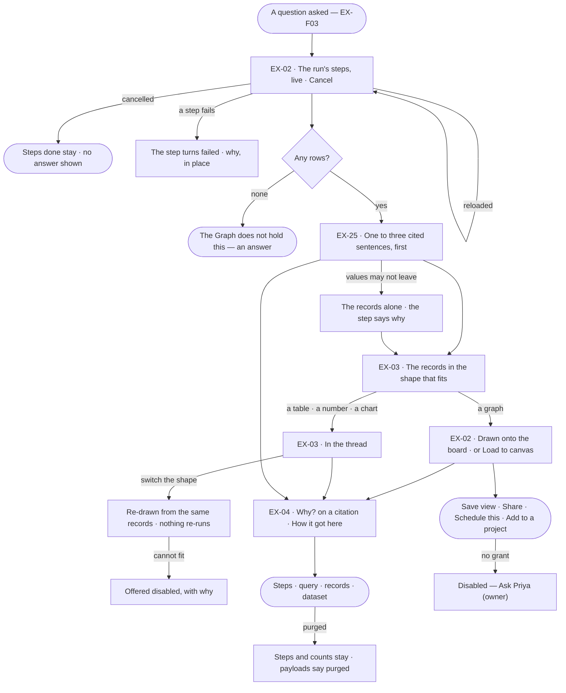
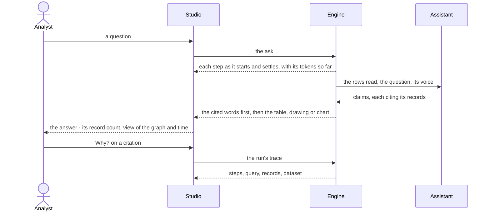

# The answer

> What a question gives back: a few cited words, then the drawing, table, number or chart the records call for —
> watched as it is worked out and traceable to every record behind it — so the person can judge whether to act on it.

## User journey

Journeys this feature is a step of: [J01 · From an empty install to a first answer](../../../../journeys/J01-from-an-empty-install-to-a-first-answer.md) · [J02 · Ask and trust the answer](../../../../journeys/J02-ask-and-trust-the-answer.md)

## Stories

| ID | Story | Status |
|---|---|---|
| EX-02 | [Watch the answer arrive on the board](stories/EX-02-watch-the-answer-arrive-on-the-board/story.md) | idea |
| EX-25 | [The answer in words](stories/EX-25-the-answer-in-words/story.md) | idea |
| EX-03 | [The answer in the shape that fits](stories/EX-03-the-answer-in-the-shape-that-fits/story.md) | idea |
| EX-04 | [See how the answer got here](stories/EX-04-see-how-the-answer-got-here/story.md) | idea |

## Access

| Act | Role (`.claude/team/TEAM.md` §7) | Everyone else sees |
|---|---|---|
| Read an answer, watch its steps, cancel or re-run their own run | Operator — every member | Another member's run: read, not cancelled |
| Load an answer to the board · switch its shape | Operator — every member | — |
| Open *Why?* and *How it got here* — prompts, queries, records | Operator — every member who can read the answer | — |
| Save view · Share | Operator — every member | — |
| Schedule this · Add to a project | `contributor` · shown as *Can work on projects* | Disabled — *Ask Priya (owner)* |
| Author, change and publish answer templates | `builder` · shown as *Can build agents* | The templates are listed read-only; *+* hidden |

## States

| State | What the person sees |
|---|---|
| First use | No answer yet: the question box (EX-F03); a Graph with no templates of its own uses the five that ship |
| Empty after a filter | Zero rows: *The Graph does not hold this*, a sentence in the reading order — never an empty table or a zeroed chart |
| Loading | A row per step as it starts — running · done · failed · retrying 2/3 · repairing — with time and tokens; a table paints while the next step runs; *Writing the answer…* over it |
| Has data | Cited words, then the records' shape, then the meta line — *195 records · Everything · 9 ms* — and its acts |
| Failed | The failed step, why, in place; a failed Answer step leaves the records as the answer |
| Agent working or proposing | The live steps, with the agent and its plan named, and *Cancel* |
| No access | Every member reads an answer and its trace; *Schedule this* and *Add to a project* without the grant say *Ask Priya (owner)* |

## Rules

| Rule | Detail |
|---|---|
| An answer is a sequence | Cited words, a drawing, a table, a number, a chart — each of a declared kind, in the order the steps made them, nothing merged into a summary |
| Words lead | The cited sentences come first; the records they cite follow |
| Everything cites | Every part names the query and the records behind it, one click away. A sentence with no record behind it is dropped before it ships |
| Code picks the shape | The assistant classifies the question and writes the words; the shape is chosen from what the records are — a graph, rows, one number, a category and a number, nothing — then ranked by the visual asked for (*as a chart*) and the kind of question. Templates are never in the prompt |
| Asking for a visual ranks, never forces | *As a chart* over one number still shows the number; the chart is offered disabled with its reason |
| A drawing adds | A graph answer adds to what is on the board, never replaces it; it is counted as drawn — each node and relationship once |
| A reload reads the record | Opening a conversation, switching a tab or reloading shows what is stored and asks the graph nothing; reading again is the person's *Re-run* |
| A re-run is a new run | It leaves the earlier answer in place; a re-run that fails shows beside the answer it re-checked |
| The time is the run's | The meta line's time is the run's work, stored by the engine when it settles; the query's own time is its step's |
| Templates own the markup | A template maps fields that exist; the assistant never writes markup. An HTML template has no script, no network and no outside assets |
| The trace is part of the answer | Not an admin view: whoever can read the answer reads how it was reached |
| Leans on | EX-F01 — the board answers draw on, the Element panel a record opens in · EX-F03 — the question · EX-F05 — cannot answer, third-party claims, *Fork from here* · Data — the dataset behind a record |

## Data touched

| Record | Read or write |
|---|---|
| Run and its steps — state, time, tokens, prompt, rationale, query, rows read, skills offered and applied, rules cited | Write (the engine) · read |
| The answer's parts — kind, order, template, citation | Write (the engine) · read |
| Answer templates — name, kind, shape it accepts, its definition, intent, version, status | Read · write (Can build agents) |
| A question asked back and its answer, as a value | Write · read |
| Graph records and their datasets | Read |

## Decisions

| Decision | Detail |
|---|---|
| Everything answers in the thread | Answers, the words of a chart, refusals, cannot answer, traces and confirmations arrive as the assistant's messages; the question is a bubble on the right |
| A reply | The assistant's mark, the cited words, the parts; under them the meta line — record count · view of the graph · time — then *Load to canvas* (a graph not yet drawn, or a table whose rows are things in the graph) · *Save view* · *Share* · *Fork from here* · *Schedule this* · *Add to a project*, folding into *⋯* by width; *How it got here* pinned first. No labelled button row under the answer |
| One offer, from the result | *Load to canvas* is the only offer, at most one per reply, never on a number, a chart or a total; it runs the drawing as its own read in the same conversation |
| A graph part has no card | In the thread it is the reply's sentence and meta line; on the board it is the drawing. Every other part is a card: its kind, the template drawing it, the citation |
| Switching the shape is the answer's | A switch re-draws the same records and is kept on the answer, so everyone opening it sees the shape chosen |
| Five templates ship | Records table · single value · category bars · graph · nothing held — competing with a Graph's own on the same terms. Between eligible ones: the visual asked for, then the kind of question, then the most specific shape |
| Templates are promoted from use | A shape that read well is published as a template and picked next time the records match |
| The answer reads a sample past 50 rows | And the words say they spoke from a sample |
| The Answer step fails soft | A model error, a timeout, values that may not leave, or no claim that could be cited leaves the records as the answer and marks the step, never the run |
| Offered and applied are two counts | Each with what it means beside it |
| Purging keeps the shape | Payloads purge with their window; the steps and their counts stay |

## Open questions

| Question | Who answers |
|---|---|
| None open | — |

## Not building

| Item | Why not |
|---|---|
| An uncited summary over the parts | It would restate without citing; the words are written claim by claim |
| Markup or script written by the model | Rendering belongs to a template |
| Comparing answers across runs | Compare and a schedule's history do that |
| Text streaming word by word | The parts are structured; a half-drawn table is not useful |
| Pausing and resuming a run · editing a step mid-run | Cancel and ask again is honest; the plan is checked before it runs |
| Editing a trace or an answer in place | It is a record; asking again is a new question |
| Hiding prompts from members | Whoever can see the answer can see how it was reached |
| The model's internal reasoning tokens | The trace records what each step reported, not what cannot be checked |
| A second model call to check the words | The citations are the check |
| Per-answer styling | A template is chosen, not restyled |
| Matching the question's words to a template | Picking a shape is a classification, not a substring match |
