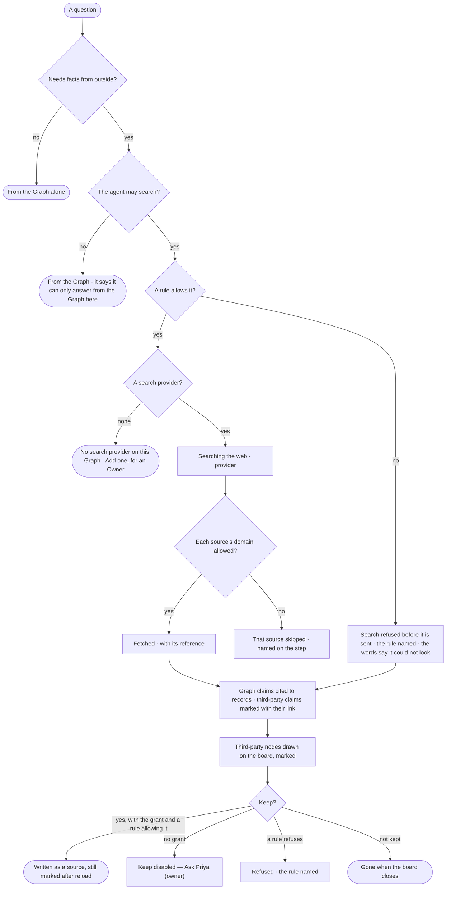

# EX-26 · Facts from beyond the Graph, marked as such

**As** an analyst asking about my Graph **I want** the agent to fill in what the Graph does not hold — from the web or
from what its model knows — and propose what to keep, while I decide **so that** I get the whole picture and always see
which part is my data, which came from somewhere else, and where.

Tasks: [task.md](task.md) · Feature: [EX-F05](../../feature.md)

## Who can

| Lens | Can | Otherwise sees |
|---|---|---|
| Admin | Read third-party claims and nodes and their references, *Keep* a third-party node, allow third-party sources in a view of the graph, add and change search providers | — |
| Operator | Read third-party claims and nodes and their references | *Keep* disabled — *Ask Priya (owner)*; the rules and search providers read-only. With *Can work on projects*: *Keep*; with *Can shape the model*: the rules; as Owner: search providers |

## Flow

## Acceptance criteria

| # | Given | When | Then |
|---|---|---|---|
| EX-26.1 | A view of the graph whose rules allow the internet, and an agent allowed to search | a question needs facts the Graph does not hold | the run searches the web through the Graph's search provider and reads what it found, as steps — *Search* and *Fetch* — named in its plan |
| EX-26.2 | A claim from beyond the Graph | it is shown in the words, on the canvas or in the panel | it is marked *Third-party ·* its source — internet, api, app, db, agent or model |
| EX-26.3 | A third-party item from the internet | the person opens its reference | it shows the link, title, kind (website, document, file), domain and when it was fetched; the link opens in a new tab |
| EX-26.4 | A third-party item with no reference | the answer is assembled | it is not shown |
| EX-26.5 | A view of the graph whose rules do not allow third-party sources | a question needs outside facts | it is answered from the Graph alone and the trace says nothing was asked outside |
| EX-26.6 | A rule that refuses the search | the run plans it | the search is refused before it is sent, the step names the rule, and the words say *I'm not allowed to look that up here* in the agent's voice |
| EX-26.7 | An agent not allowed to search | the question needs outside facts | no search is planned, and the words say it can only answer from the Graph here |
| EX-26.8 | A source whose domain a rule refuses, or a page that does not load | the run fetches | that source is skipped and named on the step with its link; the others are used |
| EX-26.9 | The model's own knowledge allowed by a rule on the AI model | the model adds a claim from what it knows | it is marked *Third-party · model*, naming the model |
| EX-26.10 | A search running | the person watches | the step reads *Searching the web ·* the provider, while the Graph's steps' results already show |
| EX-26.11 | Third-party nodes on the board, a member with *Can work on projects* and a rule allowing the write | they select them and choose *Keep* | each is written as a source linked to what it is about, still marked third-party after a reload |
| EX-26.12 | A rule refusing the write | a member chooses *Keep* | it is refused, naming the rule |
| EX-26.13 | Third-party nodes not kept | the board closes | they are gone; nothing was written |
| EX-26.14 | A link that has since died | the person opens the reference | it keeps the link and says *as fetched on* its date |
| EX-26.15 | An Owner | they open Settings › AI and connections › Search providers | they see each provider with its last ping and the rules that name it, and add one, which is pinged before it saves |
| EX-26.16 | A Graph with no search provider | an allowed question needs the web | the step says *No search provider on this Graph*, with *Add* for an Owner, and the answer is from the Graph |
| EX-26.17 | A search provider whose last ping failed | a run reaches it | the *Search* step fails, named, and the answer is from the Graph |
| EX-26.18 | An Operator without *Can work on projects* | they select third-party nodes | *Keep* is disabled — *Ask Priya (owner)* |
| EX-26.19 | An Operator who is not the Owner | they open Search providers | they read them; *Add* is hidden |
| EX-26.20 | An answer with third-party claims | the person opens *How it got here* | it shows the search, each fetch with its reference, and which claims came from where |

## Screens

| Surface | Lens | First use | Empty after a filter | Loading | Has data | Failed | Agent working or proposing | No access |
|---|---|---|---|---|---|---|---|---|
| Third-party in the answer | Admin | explore.board · Graph only | — | explore.board · Searching | explore.board · Third-party | explore.board · Search refused | explore.board · Working | — |
| Third-party in the answer | Operator | explore.board · Graph only | — | explore.board · Searching | explore.board · Third-party | explore.board · Search refused | explore.board · Working | — |
| Third-party nodes and Keep | Admin | — | — | explore.board.menu · Keeping | explore.board.menu · Keep | explore.board.menu · Keep refused | explore.board.menu · Third-party nodes | — |
| Third-party nodes and Keep | Operator | — | — | explore.board.menu · Keeping | explore.board.menu · Keep | explore.board.menu · Keep refused | explore.board.menu · Third-party nodes | explore.board.menu · Keep disabled |
| Search providers | Admin | settings.ai · Search providers empty | — | settings.ai · Search provider pinging | settings.ai · Search providers | settings.ai · Search provider ping failed | — | — |
| Search providers | Operator | settings.ai · Search providers empty | — | settings.ai · Loading | settings.ai · Search providers | settings.ai · Search provider ping failed | — | settings.ai · Search providers read only |
