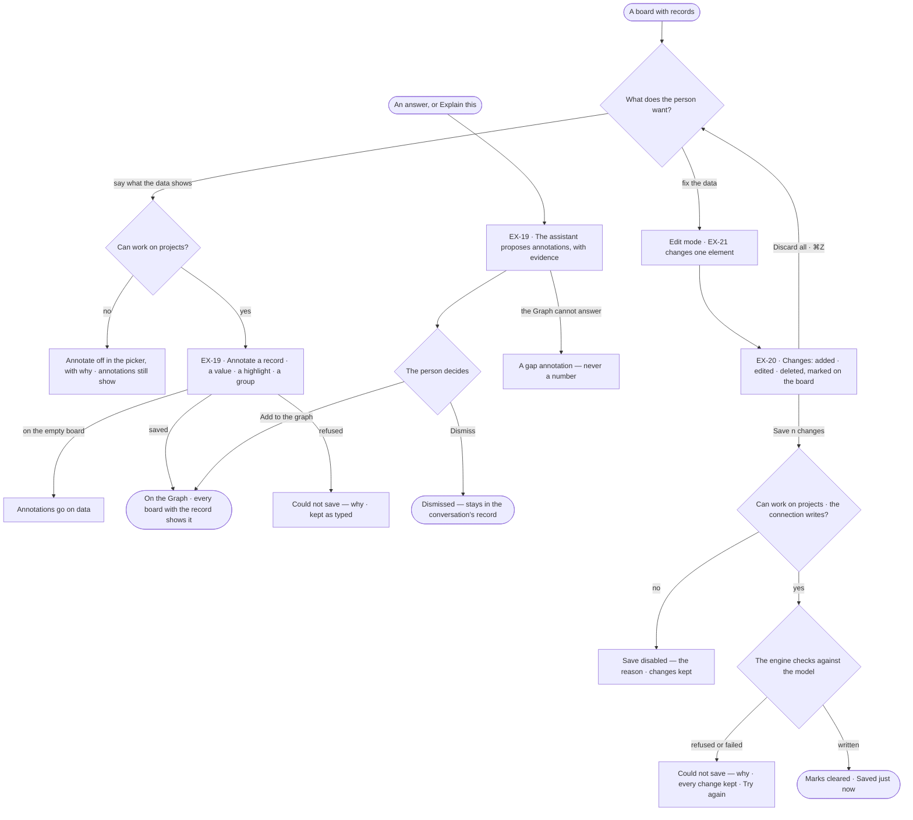
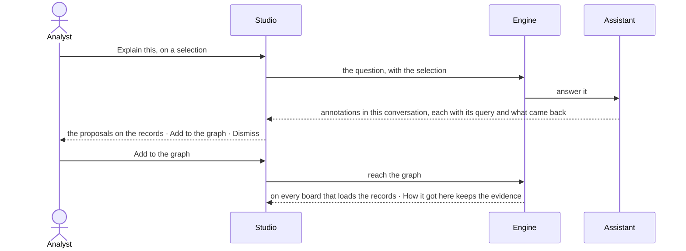

# Annotate and edit the data

> What a person, or the assistant, says about the records — kept with them for whoever loads them next — and the fixes
> made to the records themselves, held on the board until the person decides to save them to the Graph.

## User journey

## Stories

| ID | Story | Status |
|---|---|---|
| EX-19 | [Annotate the records](stories/EX-19-annotate-the-records/story.md) | idea |
| EX-20 | [Save or discard the board's changes](stories/EX-20-save-or-discard-the-boards-changes/story.md) | idea |

## Access

| Act | Role (`.claude/team/TEAM.md` §7) | Everyone else sees |
|---|---|---|
| Read annotations · hide or show them on the board | Operator — every member | — |
| Write an annotation · add the assistant's to the Graph · dismiss it | `contributor` · shown as *Can work on projects* | Annotate off in the picker — *You can view annotations — Ask Priya (owner) to annotate* |
| Change or delete a person's annotation | Its author | Delete off — *Only Priya Nair can delete it* |
| Stage edits on the board · discard them | Operator — every member | — |
| Save the board's edits to the Graph | `contributor` · shown as *Can work on projects*, on a connection that writes | Save disabled — *You can change this board, not the graph*; a read-only connection gives its own reason |

## States

| State | What the person sees |
|---|---|
| First use | No annotation on these records: the panel says *Nothing annotated here yet*; no change on the board: no Changes button |
| Empty after a filter | Every annotation hidden in the Legend: *n hidden on this board · Show* |
| Loading | Records draw first; annotations arrive after, moving nothing. Saving: rows dim, *Saving…*, the list fixed until it settles |
| Has data | Cards beside records, rings, frames — or a count badge on each; the Changes panel with its count |
| Failed | *Could not save* with the reason and *Try again*; every change and every typed word kept |
| Agent working or proposing | The assistant's annotations on the records, marked as its own, each with *Add to the graph* · *Dismiss* and its evidence |
| No access | Annotations show; Annotate is off and Save disabled, each with its reason |

## Rules

| Rule | Detail |
|---|---|
| An annotation is on data | It names the records it is about — a node, a relationship, one value, a set (highlight) or two or more nodes (group). Nothing free on the board |
| One word | *Annotation*, with an author — a person or the assistant. Tools in Annotate: Annotate · Highlight · Group |
| It belongs to the Graph | Kept by Invana against the records, never on a board and never in the customer's graph database; a read-only database can be annotated. Any board that loads a record shows its annotations |
| A value annotation keeps its value | When the record's value differs it says *Was 71% when noted*; it never rewrites itself |
| A deleted record | Its annotation is listed as *its record was deleted*, with what it said |
| Reach | A person's annotations reach the Graph. The assistant's stay in their conversation until a person adds them to the Graph or dismisses them |
| Evidence | The assistant's annotations carry their query, what came back and the reply; where the Graph cannot answer, a gap annotation — never a number |
| Hidden is the board's | The Legend's *Annotations* section — all · by you · by others · by the assistant · highlights · groups — and *In full / Badges* are saved with the board, so everyone opening it sees the same; an Operator's own toggles are theirs and not saved |
| Annotations are drawn with the data | Cards are laid out with the records, so none overlaps a node or another card, and an image export carries them; they are never counted, typed, exported as data or undone |
| Unsaved is the board's history since the last save | Undo and Redo move it; what the engine brings in, an expansion, is never unsaved |
| The model is the schema | The engine refuses a type or key the published model does not have, whatever Studio sends |
| Leans on | EX-F01 — the board and the Element panel · EX-F02 — authored steps that show annotations · Model — the published model edits are checked against |

## Data touched

| Record | Read or write |
|---|---|
| Annotation — kind, records, value then, text, colour, author, conversation, reach, evidence | Read · write |
| The board's annotation view — what is hidden, In full or Badges | Read · write, with the board |
| Graph records — nodes and relationships | Write, on Save, as one run |
| The published model's types and keys | Read |

## Decisions

| Decision | Detail |
|---|---|
| Annotations live in Invana, not the customer's database | Authorship and conversations are Invana's; a read-only graph database can still be annotated |
| The assistant proposes, the person adds | The assistant's annotations are proposals in their conversation; only a person's *Add to the graph* makes them the Graph's |
| Edits stage, then save as one run | Added · edited · deleted stay marked on the board until *Save n changes*; the save is one recorded run. A Cypher database writes it in one transaction; a Gremlin database writes edit by edit and stops at the first refusal, saying what was applied |
| Unsaved marks | New: a dashed outline in the warning colour. Edited: a dot in the warning colour. Deleted: a faded, dashed ghost in place |
| The Changes panel does not open by itself | The rail's Changes button carries the count; the panel lists Added · Edited · Deleted, each row framing its element and reverting on its own, a node taking what hangs on it; it ends *Discard all · Save n changes*. No bar in the footer |
| Discard asks nothing | ⌘Z brings it back |
| A blank value is not saved | Removing a row unsets the key |

## Open questions

| Question | Who answers |
|---|---|
| Saving edits and writing annotations need *Can work on projects* in the engine; the glossary puts *loading data* under *Can shape the model*. Which grant should each need? Recommend: *Can work on projects* for both, as the engine enforces | Ravi |

## Not building

| Item | Why not |
|---|---|
| Free shapes, arrows, freehand ink, text on the board | They are about the board, not the data |
| Comment threads, replies, mentions on an annotation | A conversation about data is the assistant's |
| Writing annotations into the graph database | They are Invana's |
| Live co-editing of one annotation · merging two members' edits | Last save wins |
| Resizing or rotating a group | It is the box around its records |
| Editing data in Explore mode | Writing is a mode entered on purpose |
| Bulk edit of a selection | One element at a time; bulk changes are an upload in Data |
| Keys outside the model | The model is the schema; adding a key is Model's job |
| Undo after Save | A saved change is in the graph; reverting it is another edit |
