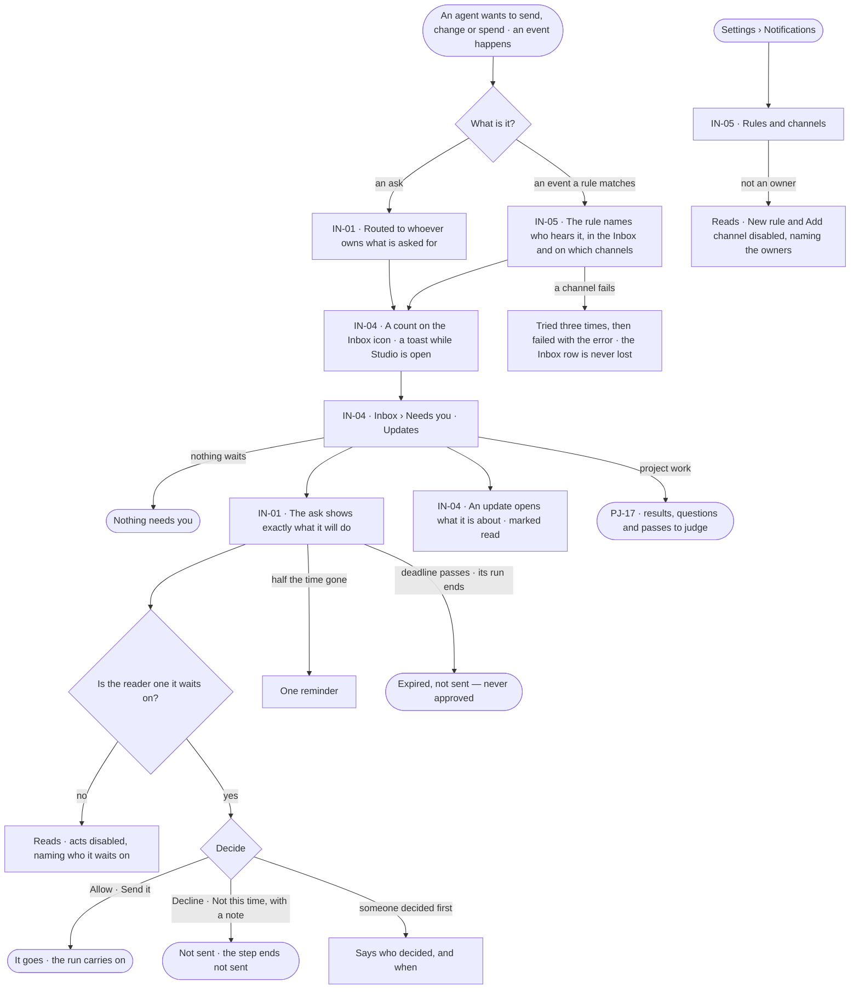
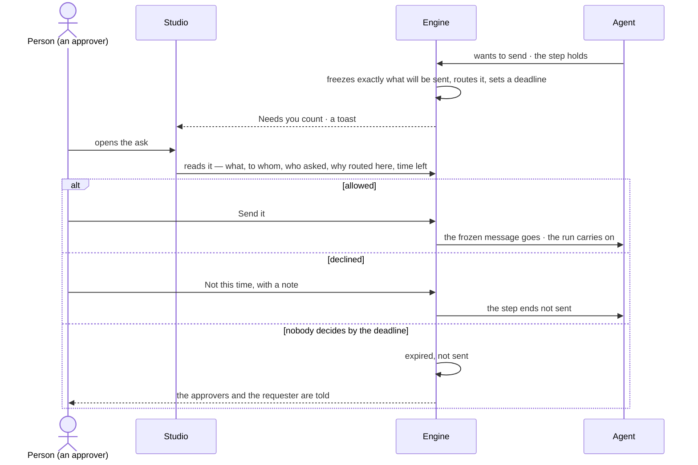

# Needs you — approvals and notifications

> Whatever an agent is set to ask first about — by default every send, change and spend — waits for a person,
> showing exactly what it will do; everything else that should reach a person arrives in the same Inbox, by rules an owner writes. The decision it helps make:
> *should this go — this message, this access, these tokens — and what needs me first?*

## User journey

Journeys this feature is a step of: [J03 · Give an agent work and decide on the result](../../../../journeys/J03-give-an-agent-work-and-decide-on-the-result.md) · [J04 · Build an agent and improve it from what runs teach](../../../../journeys/J04-build-an-agent-and-improve-it-from-what-runs-teach.md) · [J06 · Set what an agent may touch](../../../../journeys/J06-set-what-an-agent-may-touch.md)

## Stories

| ID | Story | Status |
|---|---|---|
| IN-01 | [Decide what an agent asks before it acts](stories/IN-01-decide-what-an-agent-asks-before-it-acts/story.md) | idea |
| IN-04 | [See what needs me in one inbox](stories/IN-04-see-what-needs-me-in-one-inbox/story.md) | idea |
| IN-05 | [Say which events reach whom, and where](stories/IN-05-say-which-events-reach-whom-and-where/story.md) | idea |

## Access

| Act | Role (`.claude/team/TEAM.md` §7) | Everyone else sees |
|---|---|---|
| Read one's own Inbox — Needs you and Updates | Operator — every member | — |
| Read every pending ask in the Graph (*All*) and the answered ones | Operator — every member | — |
| Decide an ask — allow or decline, with a note | The people it is routed to, whatever their Graph role; a Graph role does not widen it | The ask reads; its acts are disabled, naming who it waits on |
| Read rules and channels | Operator — every member | — |
| Write a rule — notification or History alert — or a channel | `owner` · shown as *Owner* · Admin | Read only; *New rule*, *Add channel* and each switch disabled, naming the owners |
| Project work in Needs you | PJ-F02 — *Can work on projects* | As PJ-F02 says |

## States

| State | What the person sees |
|---|---|
| First use | Needs you: *Nothing needs you*, as good news. Updates with no rule written: *Nothing needs you*, with *New rule* — failures reach a person only through a rule. Rules: *No rules yet*, with *New rule* |
| Empty after a filter | Needs you or Updates filtered by product, kind or *Unread* with no match: *Nothing matches*, with *Clear filters* |
| Loading | The Inbox opens at once with rows loading in place; its count is the last one read |
| Has data | Needs you — asks first, nearest deadline first; Updates newest first, unread marked. Rules one row each; channels with their masked target and *ready* |
| Failed | The list could not load, saying why, with *Try again*. A channel that failed a send names the error on its delivery |
| Agent working or proposing | An agent's ask: what it will send, change or spend, exactly, with who asked and on whose behalf |
| No access | An ask routed to someone else reads, its acts disabled, naming who it waits on. Rules and channels read; every write disabled, naming the owners |

## Rules

| Rule | Detail |
|---|---|
| One list of what waits | Needs you holds every ask an agent or a run makes of a person — access · budget · delegation · send · question · more than a mode allows (ST-31) — a held delivery of a finished run, a breaking model publish, and project work (PJ-F02). The Inbox icon and the header carry one count: unread updates + asks waiting on the reader + runs waiting on the reader's answer |
| An ask shows what it will do | Exactly what will be sent — for a message its To, Subject and body; for a delivery the channel and message — frozen when it is asked. Allowing sends that, never a re-render |
| An ask names its routing | Each ask says who asked and on whose behalf (*Ravi ▸ Route analyst*), what it wants in one line, who it is routed to and why (*world owner* · *agent owner* · *started the run* · *wrote the task* · *install admin*), how long it has waited, and its run |
| Routed to whoever owns what is asked for | The owner of the view of the graph for access; the target agent's owner for a delegation and a send; the person who started the run for budget; the task's author for a question; an install admin for workers; whoever may change a mode at the level that blocked an agent (ST-31) |
| Only the people it is routed to decide | A Graph role does not widen it — an owner not named is refused like anyone else. Any one of them decides; no quorum, no order |
| A deadline, one reminder | Each ask has a deadline. One reminder goes at half-time to those who have not decided. At the deadline it is *expired, not sent*; a late decision is refused |
| Never decided by itself | Nothing set to Ask first is ever decided by itself; an agent acts without asking only where a person set Allow ([the three modes](../../../settings/product.md#decisions)). Expiry tells the approvers and the requester in the Inbox |
| An ask ends with its run | When its run ends, every pending ask of it leaves Needs you and closes expired; what it held is not sent. A held delivery and a breaking publish keep their own deadline |
| A waiting step holds; the run carries on | Only the step that asked waits |
| Allowed for this run | An allowed ask reaches that agent, for this run, never its children. *Allow always* exists only on a delegation and adds the target to the caller's *May delegate to* |
| A held delivery holds the send, not the run | The run has settled; declining costs nothing and its status is unchanged |
| A breaking publish | Its ask is the impact list; allowing opens the migration run; declining or expiry leaves the draft unpublished. It is routed to the Graph's owners other than the requester |
| Only asks toast | A new ask or question for the reader shows a toast with *Review*; updates never toast |
| Rules read what happened | A rule matches events after they are written, never slowing or failing a write. A rule never matches its own notifications, deliveries or reminders, so it cannot feed itself |
| In the Inbox, and out | *In app* is not a channel: every rule and schedule may write to the Inbox. Channels — email · Slack · webhook — are what leaves Invana |
| Channel secrets are write-only | Stored encrypted, never read back; the read shows a masked target |
| A failed send retries | Three tries, then *failed* with the error; the Inbox row is written first and never depends on a channel |
| Recipients resolve when a rule matches | Named members still on the Graph, holders of named Graph roles, and *whoever the run was for*. An event on a private project reaches only its people |
| Alerts over History | A History alert matches acts — what was done, what it touched, allowed or refused and why, optionally a count in a window — and tells named members in the Inbox only. It sees only what happens after it exists |
| Leans on | Agents and their runs (AG-F03) · project work in Needs you (PJ-F02) · suggested changes (EX-F07) · schedules and their deliveries (AG-F07) · History (IN-F03) · access rules (ST-F02) |

## Data touched

| Record | Read or write |
|---|---|
| Asks — kind, what it holds exactly, who asked and on whose behalf, routed to and why, deadline, status, who decided, when, the note | Write · read |
| Notifications — one Inbox row per person, read or not, its target | Write · read |
| Deliveries — one send to one channel, exactly what was sent, status, tries, the error | Write · read |
| Notification rules · History alerts · channels | Write · read |
| Runs waiting on the reader's answer (AG-F03) | Read |
| History rows of every decision and every rule change (IN-F03) | Write |

## Decisions

| Decision | Detail |
|---|---|
| Needs you is the one queue | Every ask, every held send and project work wait in one list; there is no queue per product |
| The act is in the row | An ask shows what it will send, change or spend in its row — the start of the body with *See all it will send* — and its acts beside it, as the design language says; nothing is decided unseen |
| An ask is decided as shown | Allow or decline what was shown. Changing it before it goes is a new run, not an edit of the ask |
| Acts carry their kind's words | A send: *Send it* · *Not this time*. Access, budget and delegation: *Allow* · *Decline*. A question: its answers |
| Rules live in Settings › Notifications | Notification rules, History alerts and channels sit in one place, *What reaches whom* over *Where it can go* |
| Rules and channels are the owner's | A channel holds a credential and a rule decides who is told; reading them is every member's |
| Updates are notifications | The Inbox's Updates are the reader's notifications; Needs you never holds an update |

## Open questions

| Question | Who answers |
|---|---|
| Does the Inbox read across every Graph the person is on? The board reads *airways and your other graphs*; asks and notifications are per Graph today. Recommend: yes, grouped by Graph, the open Graph first | Ravi |
| May a person change the arguments of a held step before allowing it, re-checked against what the agent may do? The project review notes allow it; this feature decides an ask as shown. Recommend: no — decline with a note; the agent runs again with it | Ravi |
| Does an answered ask stay readable in the Inbox (*Answered*), or only in History? Recommend: in History alone — the Inbox holds what waits | Ravi |

## Not building

| Item | Why not |
|---|---|
| Changing what an ask will send before allowing it | Allow or decline what was shown; an edit is a new run |
| Quorum or ordered approvers | Any one of the people it is routed to decides |
| Deciding by email reply | A decision is a signed-in act in Studio, the CLI or the API |
| A History alert sent to a channel | An alert reaches people in the Inbox; channels are a notification rule's |
| Microsoft Teams | Listed *not connected*; no work planned |
| An inbox per product | One Inbox, filtered by product |
| Digests and quiet hours | A schedule is how routine reading recurs |
| Rules on an answer's value | That is a monitoring product |
| Escalation chains and on-call rotations | A rule names its people; paging policy is another product's job |
| Per-person channel preferences | A rule owns its channels; a person reads the Inbox |
